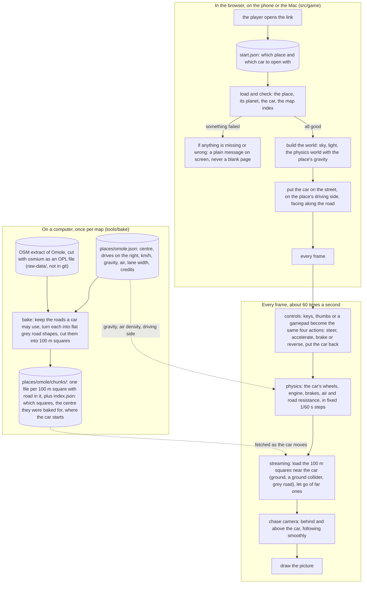

# Scope 005 overview: how slice 1 fits together

Status: draft

One picture of the whole slice, for the owner, before the per-function
designs. Each box names the file that does it; each file has its own design in
`docs/designs/` with one flowchart per function. Research behind every choice:
`research/36-slice-1.md`.

## The picture

## The same story in words

1. **On the computer (once).** The orchestrator cuts an OpenStreetMap extract
   around Babatunde Ladega Street with `osmium` and gives it to the bake. The
   bake reads the place file for the centre and the lane width, keeps only the
   roads a car can drive on, works out how wide each one is, turns each into
   flat pieces of grey road, and cuts them into 100 m squares. Each square
   with road becomes a small file; `index.json` lists them and says where the
   car starts (on the road nearest the centre, facing along it). Same input,
   byte-identical output, every time.
2. **The page opens.** It reads `start.json` (which place and which car; a
   link can ask for another with `?place=` and `?vehicle=`), then loads and
   checks the place, its planet, the car and the map index with the same
   checkers we already have. If anything fails it says what, in plain words,
   and stops.
3. **The world is built.** Light and sky, an empty physics world pulling down
   with the place's gravity, and the car (a grey-box hatchback with real
   numbers) parked on the street on the place's driving side.
4. **Every frame.** The controls turn whatever the player is touching or
   pressing into four actions. The car is driven by those actions in fixed
   physics steps. The squares near the car are loaded (ground you can drive
   on, and grey road on top) and far ones let go, so the phone only ever holds
   a few dozen. The camera follows from behind. The picture is drawn.
5. **Measuring.** With `?measure` in the link, the page also counts the bytes
   it downloaded before you could drive, and the frame rate over 60 seconds of
   driving, and shows both on screen.

## Rules every design here follows

- Every function is named by what it is, and is a named function (never a
  multi-line nameless callback), so the drawn flow and the design share a
  name.
- Map files use map words (metres east and north, compass heading). Only the
  game turns them into three.js and Rapier axes: x east, y up, z south.
- Nothing names a place: the engine reads the place file (driving side,
  gravity, air density, lane width) and `start.json` (which place to open).
- Browser-only code (`src/game/`, the DOM parts of `src/controls/`) is kept
  thin; the decisions sit in small pure functions that the blind tests can
  run in Node without a browser.
- The browser code needs the DOM types, which the current `tsconfig.json`
  (Node only) leaves out; the coder adds a browser tsconfig for `src/game/`,
  `src/controls/`, `src/camera/`, `src/measure/` (plumbing, no design).
- Game-feel numbers that no published figure decides (stick dead zone,
  steering speed, camera distance, how far you can see) are the owner's
  choice, kept together in `src/controls/feel.ts` and
  `src/camera/chase.ts` with "owner-choice, proposed" beside each, until he
  has driven it and says yes.

## Files and their designs

| Where | What it does | Design |
|---|---|---|
| `tools/bake/cli.ts` | the command the orchestrator runs | `tools/bake/cli.md` |
| `tools/bake/bake.ts` | the whole bake, start to finish, without touching disk | `tools/bake/bake.md` |
| `tools/bake/opl.ts` | reads the OSM extract (OPL lines) | `tools/bake/opl.md` |
| `tools/bake/roads.ts` | which roads, how wide | `tools/bake/roads.md` |
| `tools/bake/projection.ts` | latitude and longitude to metres from the centre | `tools/bake/projection.md` |
| `tools/bake/ribbons.ts` | a road becomes flat convex pieces | `tools/bake/ribbons.md` |
| `tools/bake/clip.ts` | pieces cut to 100 m squares, then triangles | `tools/bake/clip.md` |
| `tools/bake/chunk-text.ts` | chunk and index files written the same way every time | `tools/bake/chunk-text.md` |
| `tools/bake/start.ts` | where the car starts | `tools/bake/start.md` |
| `tools/bake/write.ts` | replaces the chunk folder on disk | `tools/bake/write.md` |
| `tools/site/data-files.ts` | which data files go into the built game | `tools/site/data-files.md` |
| `src/world/grid.ts` | the 100 m squares, shared by bake and game | `src/world/grid.md` |
| `src/world/chunk.ts` | checks chunk and index files | `src/world/chunk.md` |
| `src/place/place.ts` | place file: `centre`, lane width (changed) | `src/place/place.md` |
| `src/place/vehicle.ts` | vehicle file: real numbers and their sources (changed) | `src/place/vehicle.md` |
| `src/place/start.ts` | `start.json` checker | `src/place/start.md` |
| `src/vehicle/rapier-settings.ts` | real car numbers to Rapier settings | `src/vehicle/rapier-settings.md` |
| `src/vehicle/drive-force.ts` | engine, drag and rolling resistance | `src/vehicle/drive-force.md` |
| `src/vehicle/pedals.ts` | brake, or reverse when stopped | `src/vehicle/pedals.md` |
| `src/vehicle/steering.ts` | how far the front wheels turn | `src/vehicle/steering.md` |
| `src/vehicle/car.ts` | the car in the physics world | `src/vehicle/car.md` |
| `src/controls/actions.ts` | the four actions, combined | `src/controls/actions.md` |
| `src/controls/keyboard.ts` | keys to actions | `src/controls/keyboard.md` |
| `src/controls/gamepad.ts` | gamepad to actions | `src/controls/gamepad.md` |
| `src/controls/touch.ts` | thumbs to actions | `src/controls/touch.md` |
| `src/camera/chase.ts` | the chase camera | `src/camera/chase.md` |
| `src/game/main.ts` | the page starts | `src/game/main.md` |
| `src/game/load.ts` | loads and checks the files | `src/game/load.md` |
| `src/game/failure.ts` | plain messages | `src/game/failure.md` |
| `src/game/physics.ts` | physics world, ground colliders, map edge, fixed steps | `src/game/physics.md` |
| `src/game/scene.ts` | what is drawn | `src/game/scene.md` |
| `src/game/streaming.ts` | which squares to load and let go | `src/game/streaming.md` |
| `src/game/loop.ts` | one frame | `src/game/loop.md` |
| `src/measure/measure.ts` | download size and frame rate | `src/measure/measure.md` |

Data files the coder writes (no designs; checked by the checkers above):
`places/omole.json`, `vehicles/hatchback.json`, `start.json`, and the
cascade into `places/finglas.json` and `places/yaba.json` (`skyPosition`
becomes `centre`; lane width added).
