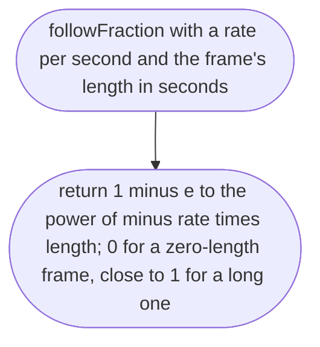
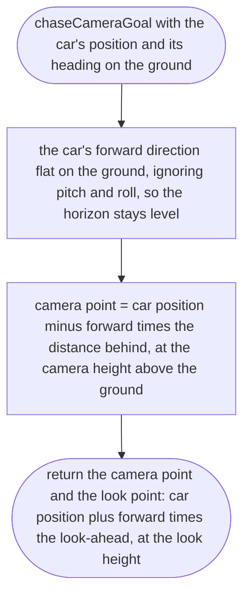
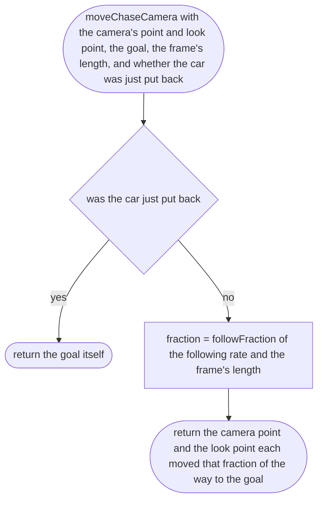

# src/camera/chase.ts

Status: draft

New in scope 005 (item 4). A chase camera behind and above the car. It
follows the car's position smoothly instead of being bolted to the body, so
every bump of the springs does not shake the picture (our
research/world-drive/12, item 1). Smoothing uses a fraction worked out from
the time step, 1 − e^(−rate × time), which gives the same feel at 60 and 120
frames a second (research 12, item 6). Distance, height, look-ahead, field of
view and following rate are game-feel numbers, the owner's choice, proposed
as named constants in this file: 6 m behind, 2.5 m above the ground, looking
at a point 3 m ahead of the car and 1 m up, field of view 60 degrees,
following rate 4 per second. The pictures drawn from the code will be in
`docs/flows/src/camera/chase.md`.

## followFraction

Why the game needs it: smoothing that does not depend on the phone's frame rate.

## chaseCameraGoal

Why the game needs it: where the camera wants to be: behind the car along its heading, at a fixed height, and what it looks at.

## moveChaseCamera

Why the game needs it: the camera glides toward its goal each frame and never jumps, except when the car is put back, where gliding across the map would be confusing.

