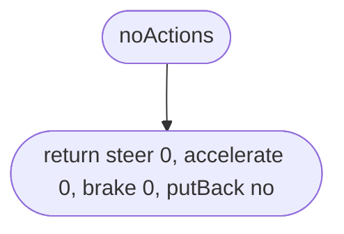
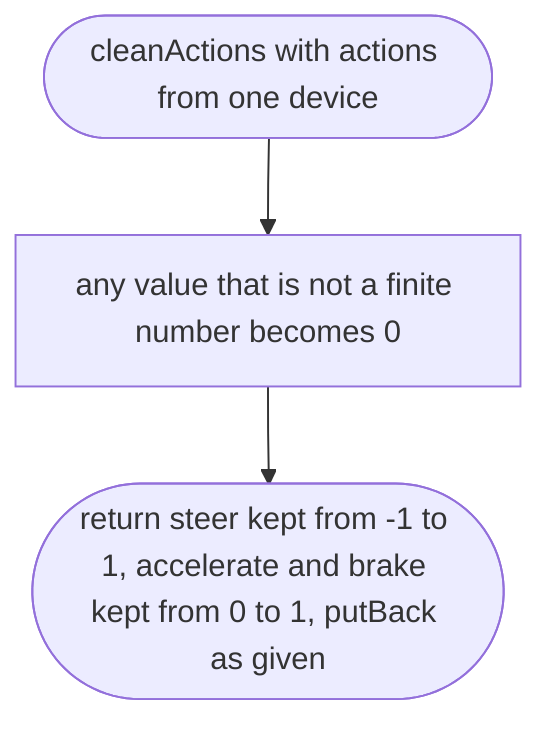
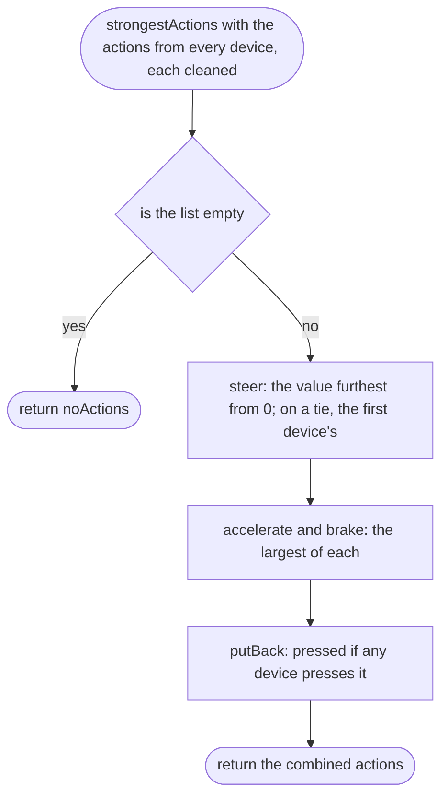
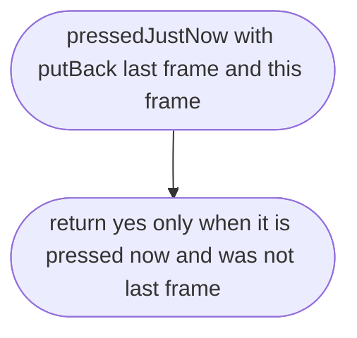

# src/controls/actions.ts

Status: draft

New in scope 005 (item 6). One control model for every device (CLAUDE.md
touch rule; D-0026): every device produces the same four actions, and the car
only ever sees actions, never keys or thumbs. The actions: `steer` from −1
(full left) to 1 (full right), `accelerate` from 0 to 1, `brake` from 0 to 1
(brake, or reverse when stopped; `pedals.ts`), and `putBack`, pressed or not
(put the car back on its wheels). The pictures drawn from the code will be in
`docs/flows/src/controls/actions.md`.

The game-feel numbers for all controls live together in `src/controls/feel.ts`
(constants only, each marked "owner-choice, proposed 2026-10-11"): stick dead
zone 0.1 (nipplejs's default `threshold`, research/36), gamepad dead zone 0.1,
stick radius 60 CSS pixels, the stopped speed, the steering rates.

## noActions

Why the game needs it: when nothing is touched, the car is not driven.

## cleanActions

Why the game needs it: a broken reading from a device (a gamepad sending a number out of range, or not a number) must never reach the physics.

## strongestActions

Why the game needs it: the player can use keys, a gamepad and the screen at the same time, and the car does what the strongest of them asks, so nothing fights.

## pressedJustNow

Why the game needs it: holding the put-back button puts the car back once, not sixty times a second.

