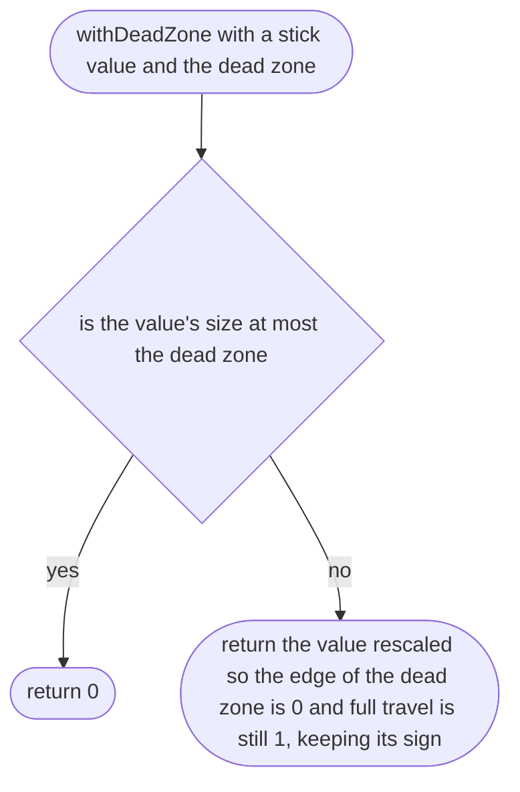
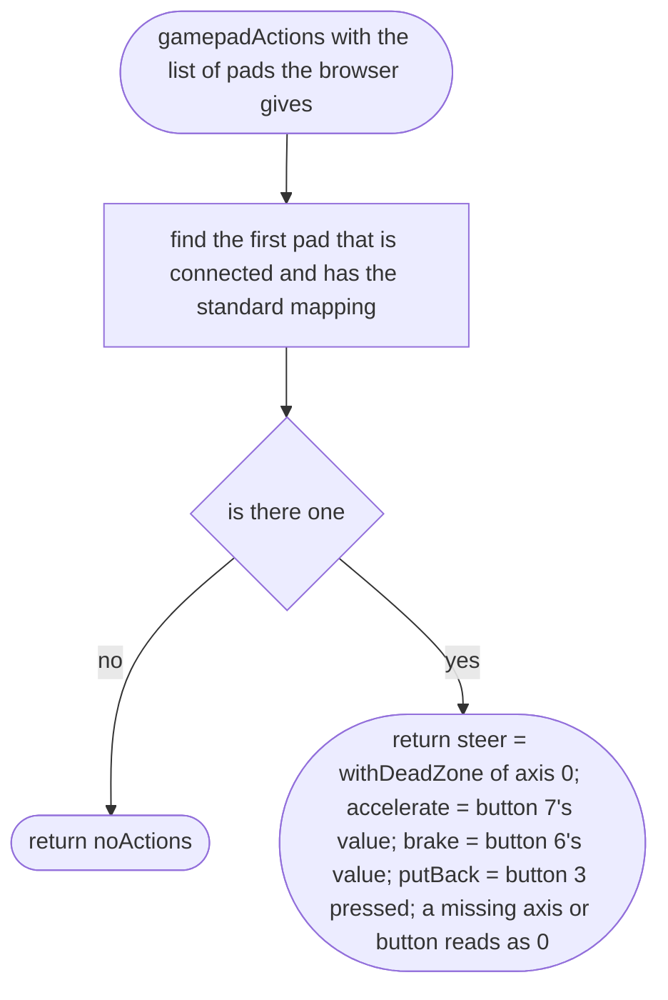

# src/controls/gamepad.ts

Status: draft

New in scope 005 (item 6, "gamepad if simple": it is). Only pads the browser
reports with `mapping` "standard" are used, so the buttons are where the W3C
Gamepad spec's standard layout puts them (w3c/gamepad `index.html`, opened;
research/36): axis 0 left stick sideways, button 7 right trigger, button 6
left trigger, button 3 top of the right-hand cluster. The page asks the
browser for the pads every frame (MDN, "Using the Gamepad API"). The pictures
drawn from the code will be in `docs/flows/src/controls/gamepad.md`.

## withDeadZone

Why the game needs it: a worn stick never rests exactly at zero, and the car must not drift to one side when the player lets go.

## gamepadActions

Why the game needs it: a player with a controller on the Mac drives with the stick and triggers, the same actions as keys and thumbs.

