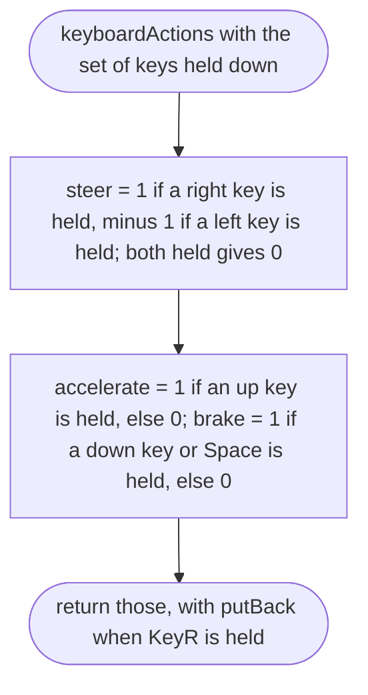
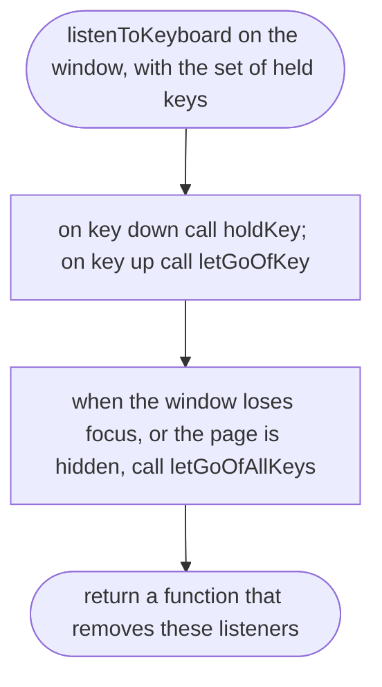
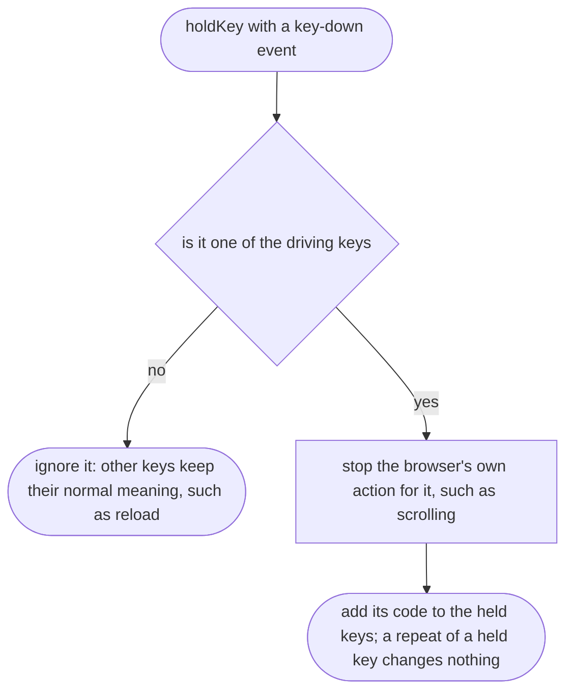
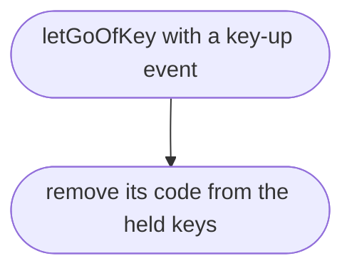
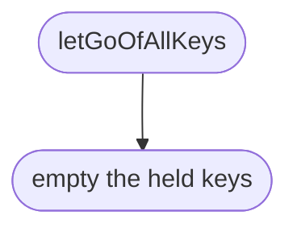

# src/controls/keyboard.ts

Status: draft

New in scope 005 (item 6). Keys to actions. Keys are read by `code`, the
physical key, so WASD sits in the same place on an AZERTY keyboard (MDN
`KeyboardEvent.code`, research/36). Keys: ArrowLeft or KeyA steers left,
ArrowRight or KeyD steers right, ArrowUp or KeyW accelerates, ArrowDown, KeyS
or Space brakes and reverses, KeyR puts the car back. The pictures drawn from
the code will be in `docs/flows/src/controls/keyboard.md`.

## keyboardActions

Why the game needs it: the Mac player drives with the arrows or WASD, the same actions as the thumbs on a phone.

## listenToKeyboard

Why the game needs it: keeps the set of held keys right, including when the player switches window with a key still down.

## listenToKeyboard > holdKey

Why the game needs it: the arrows and Space would otherwise scroll the page while driving.

## listenToKeyboard > letGoOfKey

Why the game needs it: letting go of a key stops that action.

## listenToKeyboard > letGoOfAllKeys

Why the game needs it: a key held while switching to another window never sends its key-up; without this the car would keep accelerating on its own.

