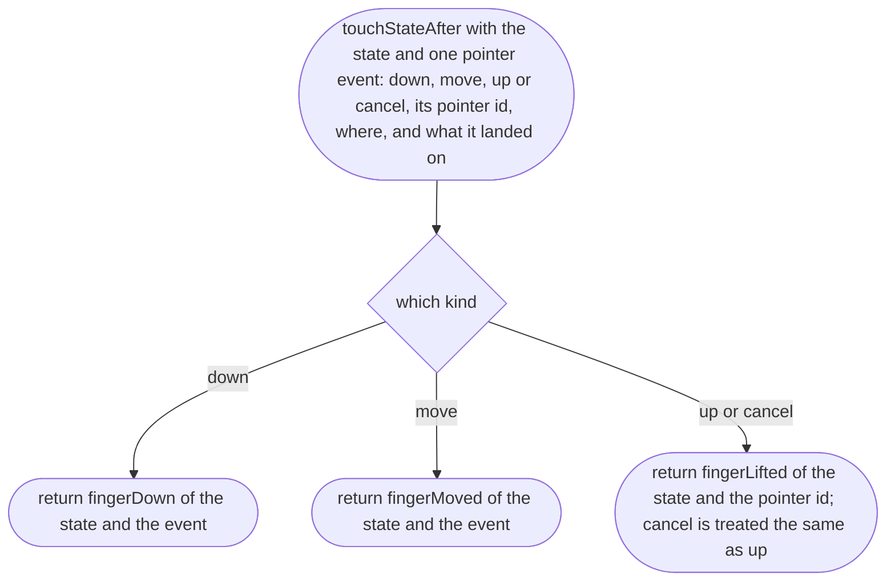
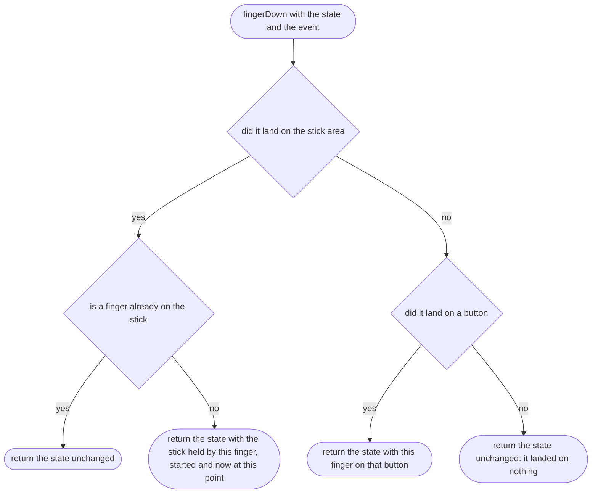
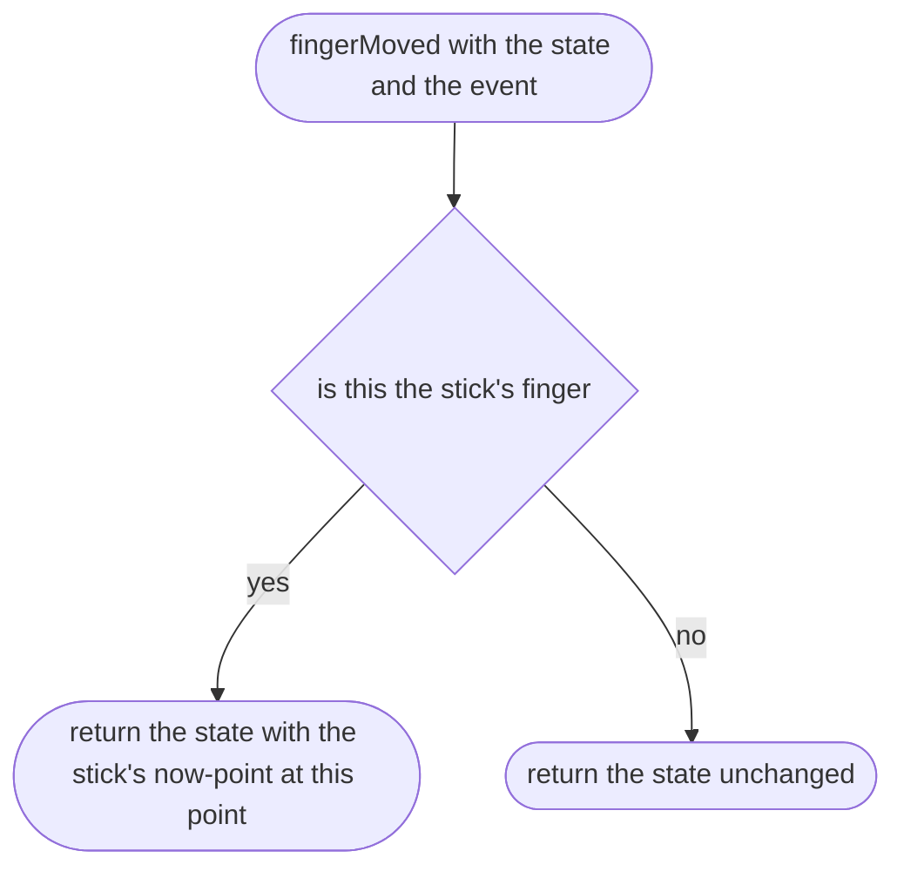
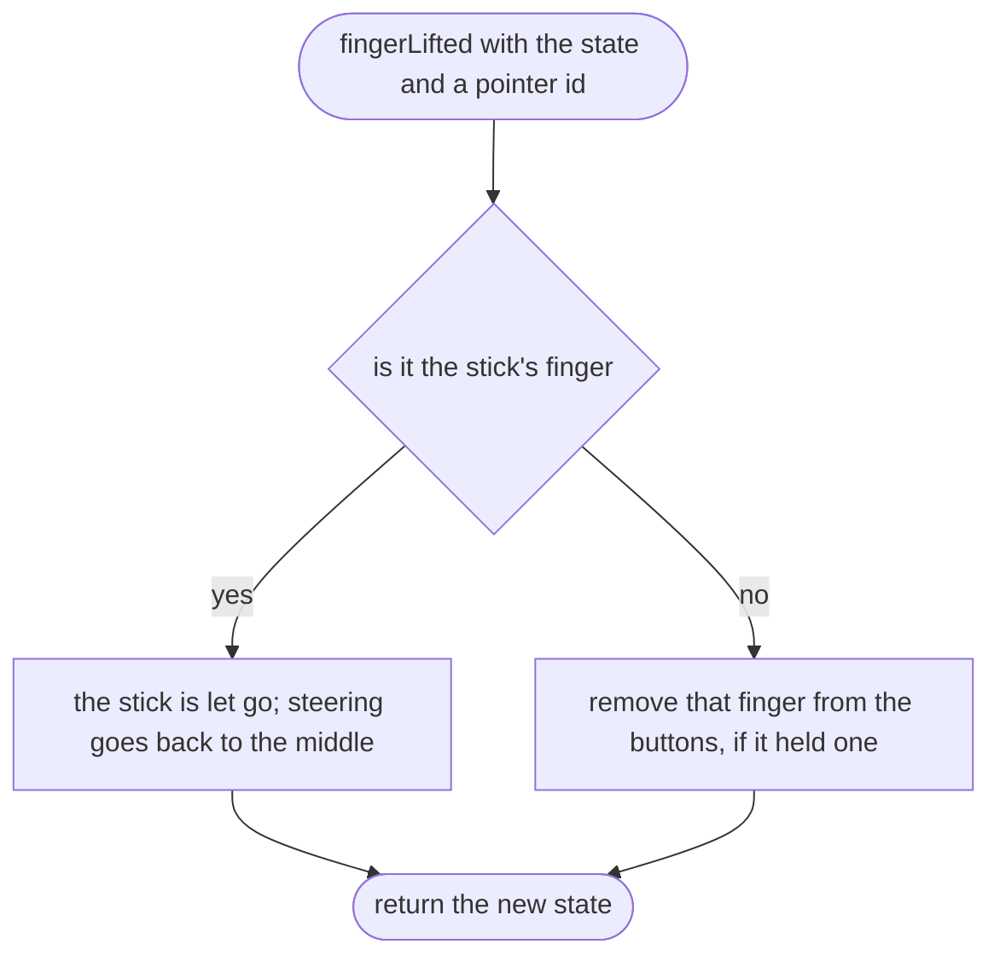
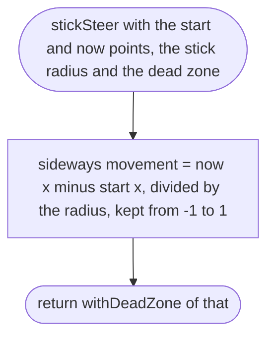
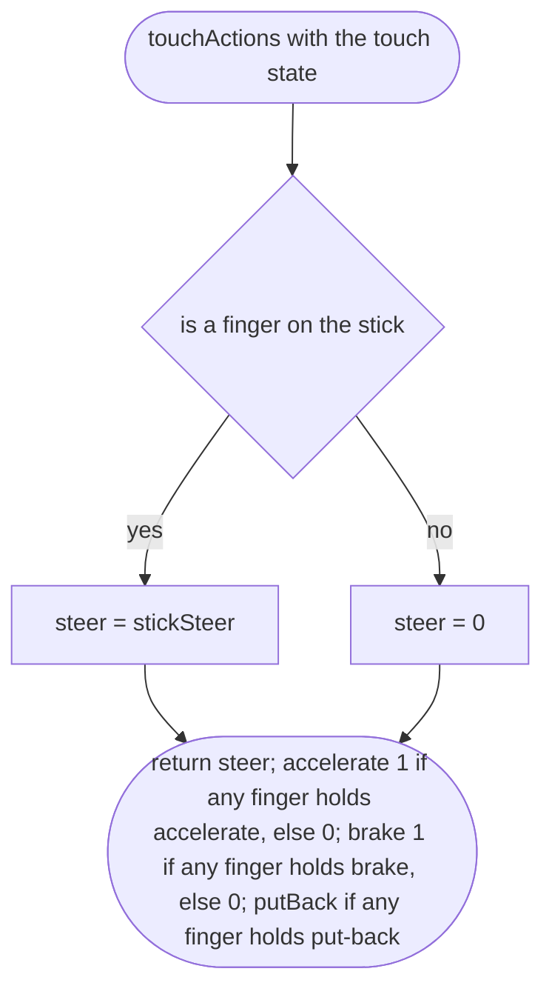
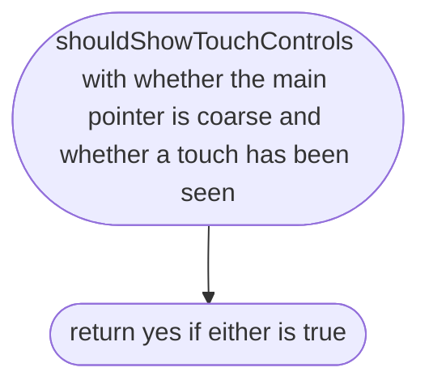
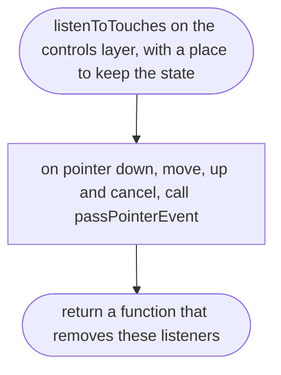
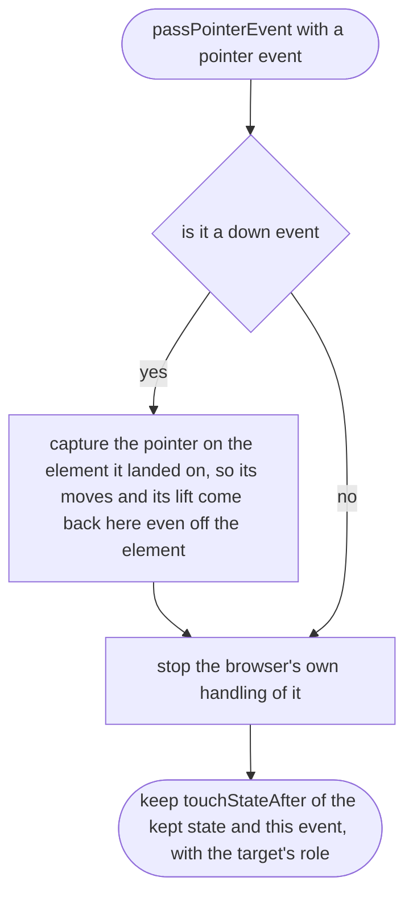

# src/controls/touch.ts

Status: draft

New in scope 005 (item 6). Thumbs to actions. Layout: the left half of the
screen is the stick area: the stick appears where the left thumb lands and
only its sideways movement steers (nipplejs `dynamic` mode, technique;
research/36). On the right, a large accelerate button at the bottom right,
the brake/reverse button beside it to its left, and a smaller "put the car
back" button above them. Nothing needs two fingers on one side (scope item 6).
Every finger is followed by its own `pointerId` (MDN Pointer Events), so the
stick and a pedal work at the same time; the controls have
`touch-action: none` so the browser does not scroll or zoom under the thumbs.

The decisions are in pure functions over a small **touch state** (which
finger holds the stick and where it started and is now; which finger holds
which button), so the blind tests can run them without a browser; the DOM
part only turns pointer events into those calls. The pictures drawn from the
code will be in `docs/flows/src/controls/touch.md`.

## touchStateAfter

Why the game needs it: every finger down, moved, lifted or cancelled by the phone (a call coming in, a swipe from the edge) updates one state, so a lost finger never leaves the car accelerating.

## fingerDown

Why the game needs it: a thumb on the left starts the stick where it lands; a thumb on a button presses it; a second thumb on the stick area does not steal the stick.

## fingerMoved

Why the game needs it: the stick follows the thumb; a finger sliding off a button keeps the button held until it lifts, as on a real pedal, because the browser keeps sending its moves to the button (pointer capture).

## fingerLifted

Why the game needs it: lifting a thumb lets go of exactly what that thumb held.

## stickSteer

Why the game needs it: how far the thumb has moved sideways from where it landed is how far the wheel turns, with a small dead zone so a resting thumb does not steer.

## touchActions

Why the game needs it: the thumbs give the same four actions as keys and pads.

## shouldShowTouchControls

Why the game needs it: the phone shows the thumb controls; the Mac with a mouse does not have them covering the road, until someone touches a touch screen.

## listenToTouches

Why the game needs it: joins the phone's pointer events to the touch state.

## listenToTouches > passPointerEvent

Why the game needs it: each event becomes one call to touchStateAfter, with what it landed on read from the element's role (stick area or which button).

