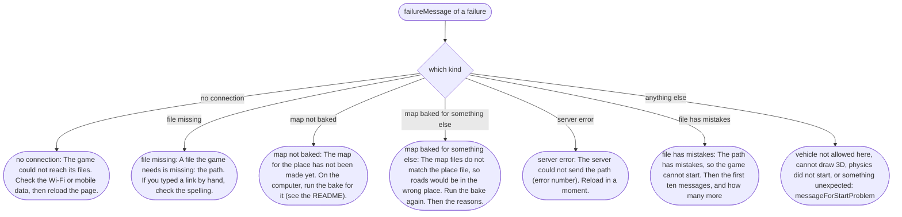
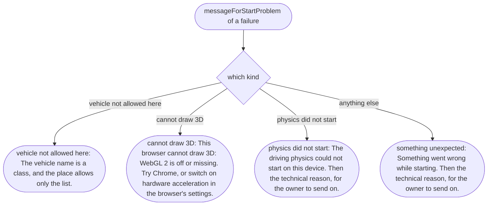
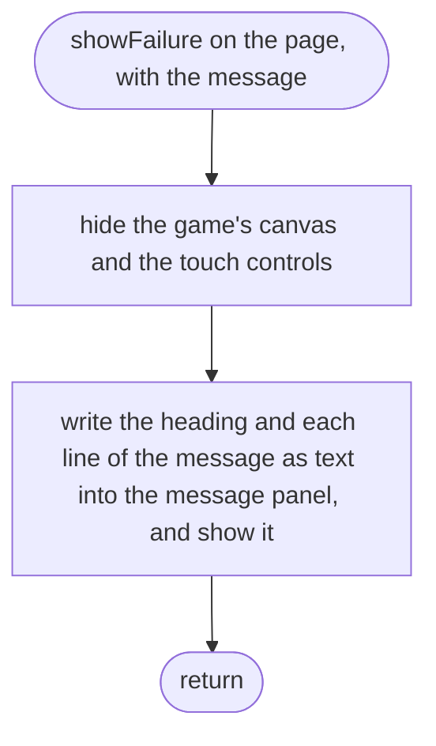
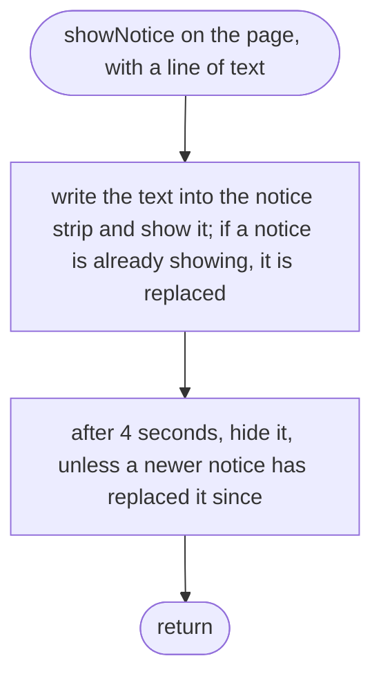

# src/game/failure.ts

Status: draft

New in scope 005 (item 4, "a plain-words message if loading fails"; the
player's story: "he is told so in plain words, not left with a blank
screen"). Turns a failure into words, and shows messages on the page. Text
from files (a place name, a checker message) is put on the page as text, never
as HTML (DOM `textContent`), so a file can never inject anything into the
page. The pictures drawn from the code will be in
`docs/flows/src/game/failure.md`.

## failureMessage

Why the game needs it: the player sees what went wrong and what to do about it, in words a non-coder understands; a place-maker sees the checker's exact line.

## messageForStartProblem

Why the game needs it: the rarer failures, after the files are good, get their own plain words.

## showFailure

Why the game needs it: the message replaces the game on screen, readable on a phone, and the controls are hidden so nothing looks drivable.

## showNotice

Why the game needs it: anything the game does by itself (putting the car back, part of the map not loading, the map's edge) is shown with the reason, and goes away by itself (CLAUDE.md: nothing happens behind the player's back).

