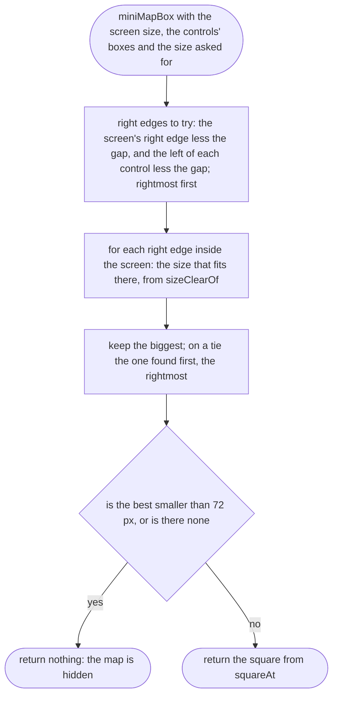
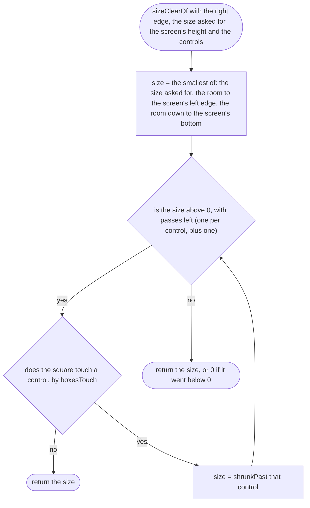
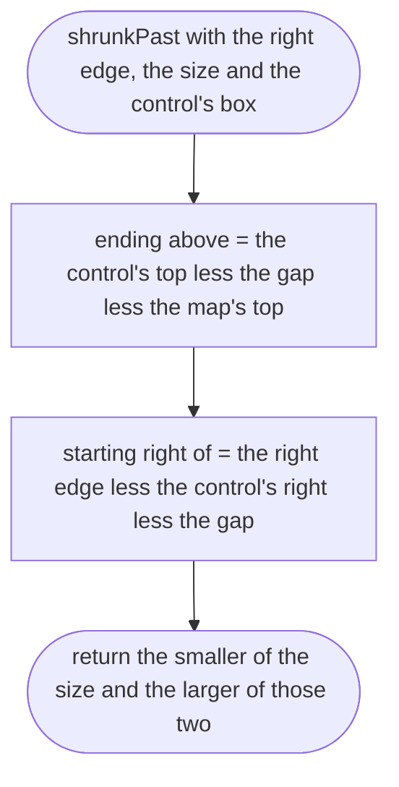
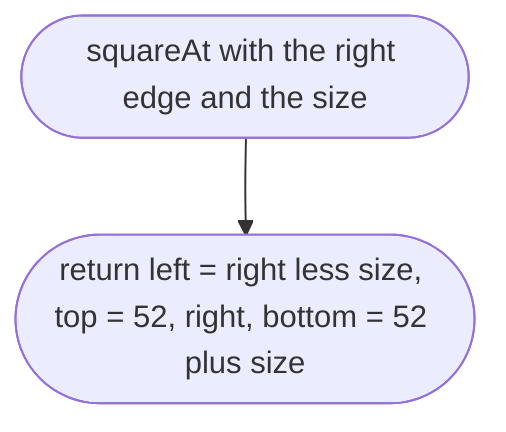
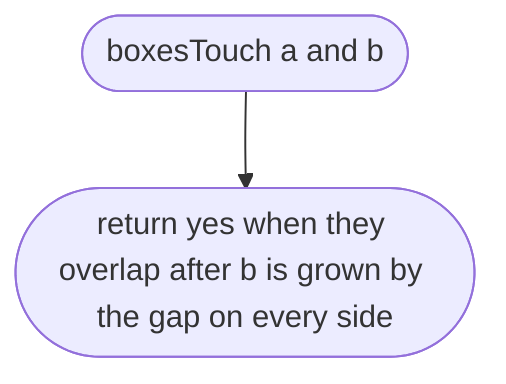

# src/game/hud-layout.ts

Status: approved by the orchestrator in one pass (Scope 005b, the owner's lighter process for non-physics work, 2026-10-11).

New in scope 005b (item 3). Where the small map goes on the screen: a square
in the top right, below the street-name line, as big as asked but never over
a thumb control, in portrait or landscape. The controls are given as boxes
measured from the page (the steering half and each button), so this rule
does not repeat the page's sizes and stays right if they change. Pure; the
browser part is `hud.md`. Our own rule. The pictures drawn from the code will
be in `docs/flows/src/game/hud-layout.md`.

Numbers, the owner's choice, proposed by the coder on 2026-10-11 and awaiting
his yes: the small map 140 px, the big map 260 px; its top 52 px from the
screen's top (the name line is 8 px down and about 36 px tall); 8 px kept
clear round every control and the screen's edge; a map under 72 px is not
shown at all.

On a phone sideways the corner above the buttons is too short, so the map
moves just left of the Go and Flip upright column, still in the right half
(measured in the tests: 393 × 851 upright, the corner; 851 × 393 sideways,
left of the buttons).

## miniMapBox

Why the game needs it: the map must never cover the thumb controls (the scope's story), and should be as big as the player asked for.

## sizeClearOf

Why the game needs it: the biggest map up to the size asked for whose top-right corner is at this edge, inside the screen and clear of every control. A smaller square from the same corner sits inside a bigger one, so each control needs shrinking past at most once, and the loop ends.

## shrunkPast

Why the game needs it: either end the map above the control or start it to the control's right, whichever leaves the bigger map; both are smaller than now, because the two touch.

## squareAt

Why the game needs it: one place says what the map's box is, from its right edge and size.

## boxesTouch

Why the game needs it: closer than the gap counts as touching, so a thumb aimed at a control's edge does not land on the map.

