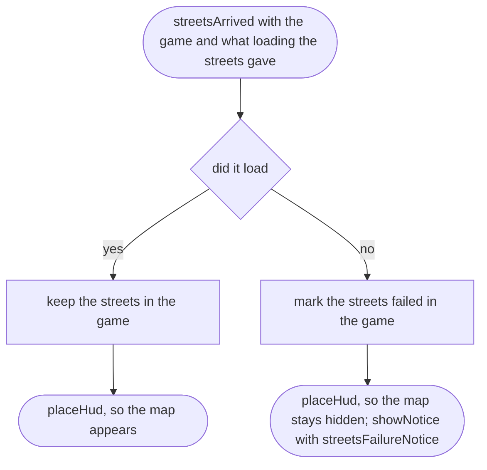
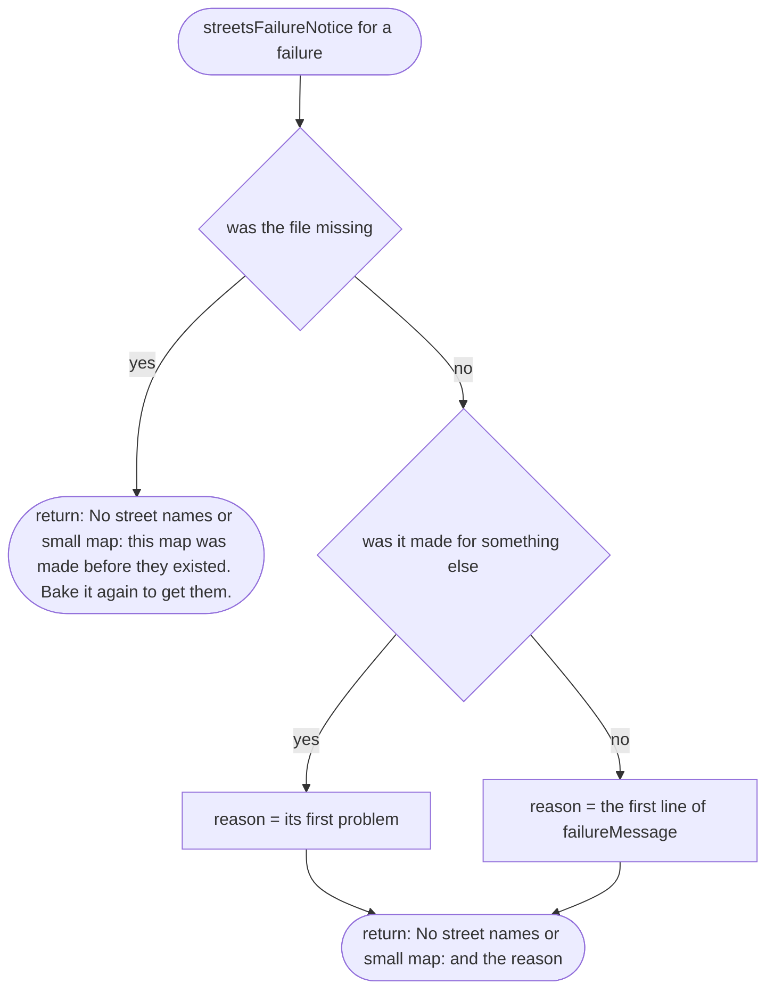
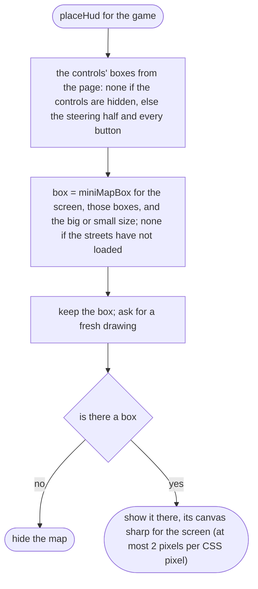
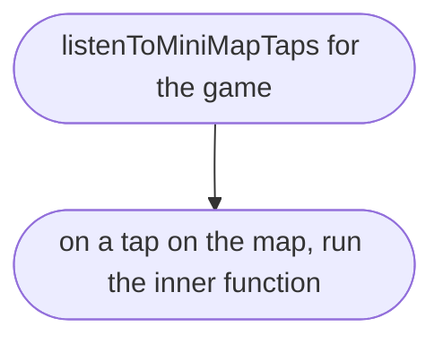
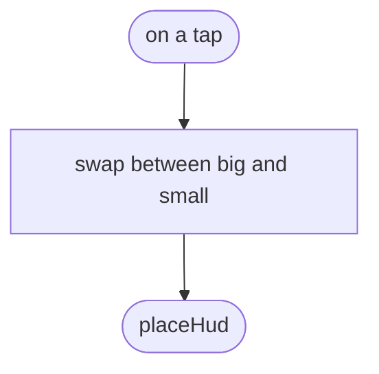
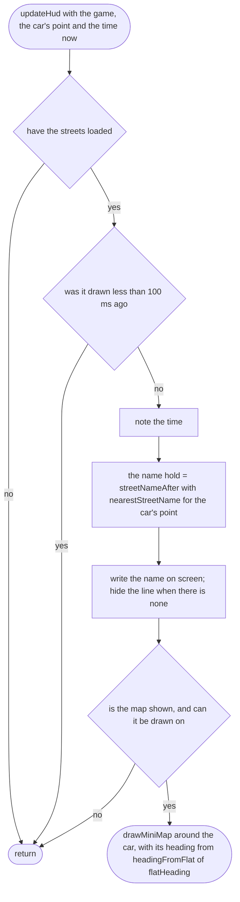

# src/game/hud.ts

Status: approved by the orchestrator in one pass (Scope 005b, the owner's lighter process for non-physics work, 2026-10-11).

New in scope 005b (items 2 and 3). The street-name line and the small map on
the page: filled when the street file arrives, placed clear of the thumb
controls, redrawn ten times a second, made bigger or smaller with a tap. The
rules live in `src/world/streets.md` (which street), `hud-layout.md` (where)
and `minimap.md` (what is drawn); this joins them to the page. Browser
plumbing (MDN): `getBoundingClientRect`, canvas `getContext("2d")`,
`setTransform`, the `click` event, `devicePixelRatio`. The pictures drawn
from the code will be in `docs/flows/src/game/hud.md`.

Ten times a second (every 100 ms) is the owner's choice, proposed by the
coder on 2026-10-11, to be confirmed by the frame-rate measurement on the
phone. The canvas is drawn at most two pixels per CSS pixel, as the 3D
picture is (`scene.md`).

On the page (`index.html`): the name line is at the top middle, white on
dark, one line, cut with … if too long, and ignores touches so a thumb on it
still steers. The notice and the portrait hint move into the left half,
under the name (the notice 52 px down, the hint 150 px), so they never cover
the map on the right; found driving upright, where the centred hint hid the
car arrow. Both still ignore touches.

## streetsArrived

Why the game needs it: the names follow without holding up the drive; if they cannot load, the game drives on without them and the player is told why, once.

## streetsFailureNotice

Why the game needs it: one line in words a non-coder understands; an old bake, which has no street file, gets the fix.

## placeHud

Why the game needs it: the map is placed again whenever the screen turns, the controls appear, the player taps it or the streets arrive, so it never covers a control.

## listenToMiniMapTaps

Why the game needs it: a tap makes the map bigger or smaller (scope item 3).

## listenToMiniMapTaps > inner function 1

Why the game needs it: the same tap swaps both ways.

## updateHud

Why the game needs it: the name says which street the car is on, held for a moment before it changes, and the map follows the car.

