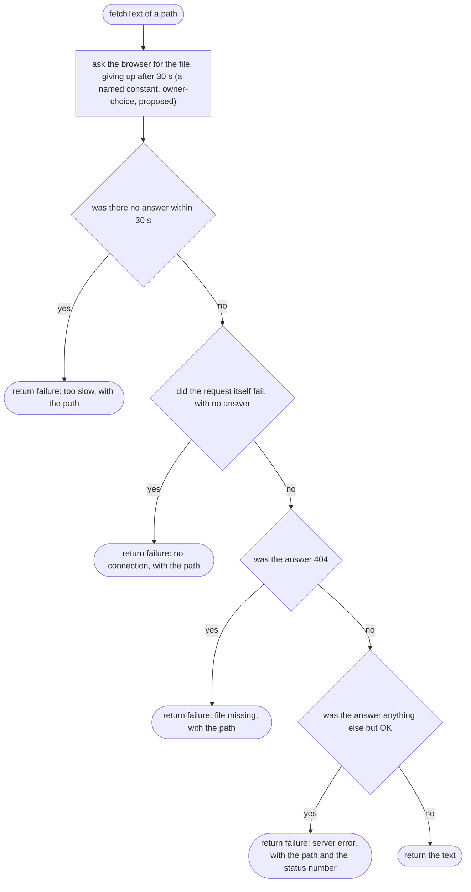
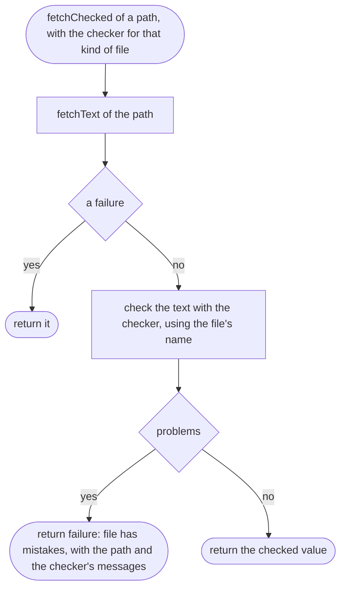
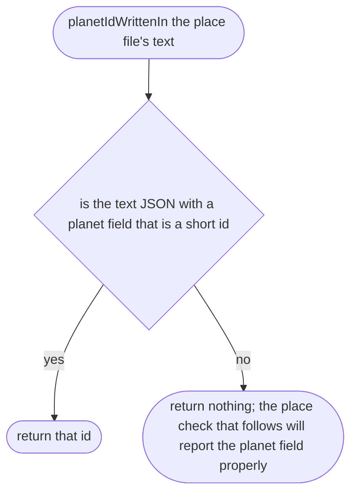
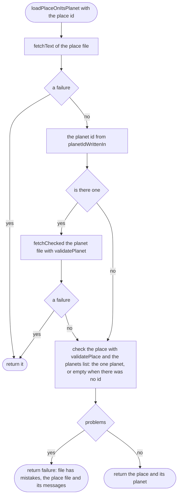
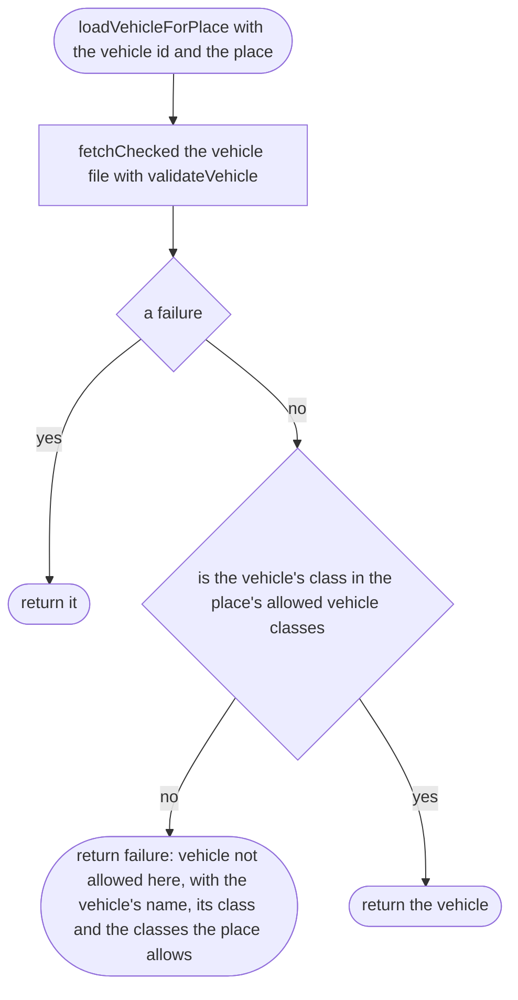
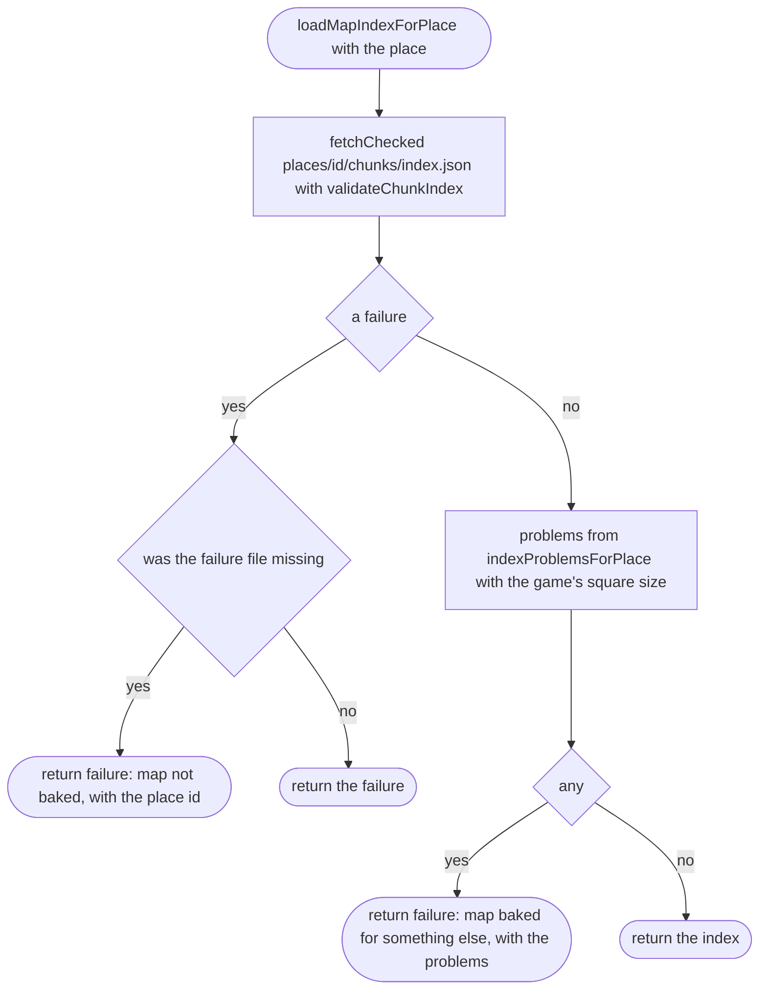
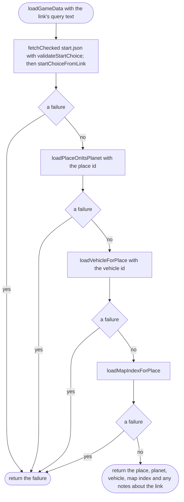
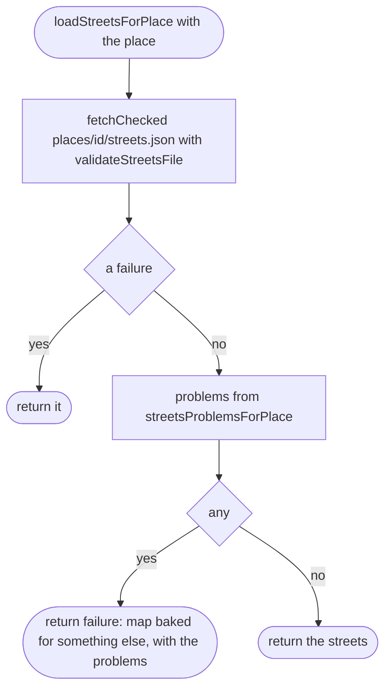

# src/game/load.ts

Status: approved by the orchestrator in one pass (Scope 005b, the owner's lighter process for non-physics work, 2026-10-11).

New in scope 005 (item 4). Loads the files the game needs before the player
can drive, and checks each with the checker that already exists for it. Any
failure stops loading and comes back as a **failure** (what went wrong, and
which file) for `failure.ts` to put into plain words; nothing here touches
the screen. Uses the browser's `fetch`. The pictures drawn from the code will
be in `docs/flows/src/game/load.md`.

Order: `start.json` → the place → its planet → the place checked against
the planet → the vehicle → the map index. Paths: `places/<id>.json`,
`planets/<id>.json`, `vehicles/<id>.json`, `places/<id>/chunks/index.json`.

## fetchText

Why the game needs it: every way a download can fail is told apart, because "no connection" and "file missing" need different advice for the player. A download that never ends is a failure too: on weak Lagos mobile data a stalled request would otherwise leave "Loading the map" on screen forever, the blank-screen story the scope rules out (approver's F14).

## fetchChecked

Why the game needs it: a file that downloads but has mistakes is reported with the checker's own messages (file, line, what to fix).

## planetIdWrittenIn

Why the game needs it: the place checker needs the planet the place is on, and the only way to know which planet file to fetch is to look at what the place file says before it is checked.

## loadPlaceOnItsPlanet

Why the game needs it: the place and its planet, checked together, so a place on a planet with no file, or with gravity outside its planet's range, is caught with the usual message.

## loadVehicleForPlace

Why the game needs it: the car must exist, be a good file, and be a kind of vehicle the place allows.

## loadMapIndexForPlace

Why the game needs it: the map index must exist (the bake has been run) and must match this place (same centre, same square size).

## loadGameData

Why the game needs it: everything needed to start driving, in one call, ending at the first thing that is wrong.

## loadStreetsForPlace

New in Scope 005b. Why the game needs it: the street names and the small map's roads are not needed to drive, so they load after the game has started (`main.md`) and a failure only takes them away, with the reason (`hud.md`, `streetsFailureNotice`).

