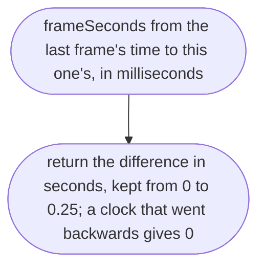
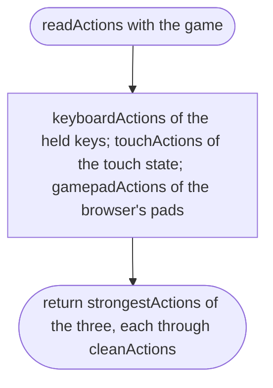
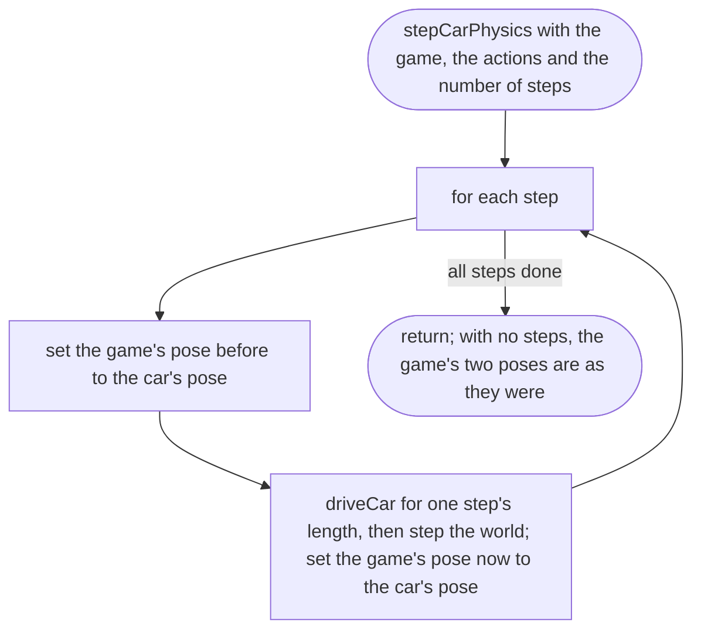
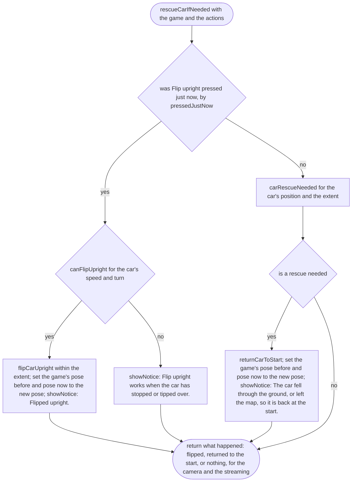
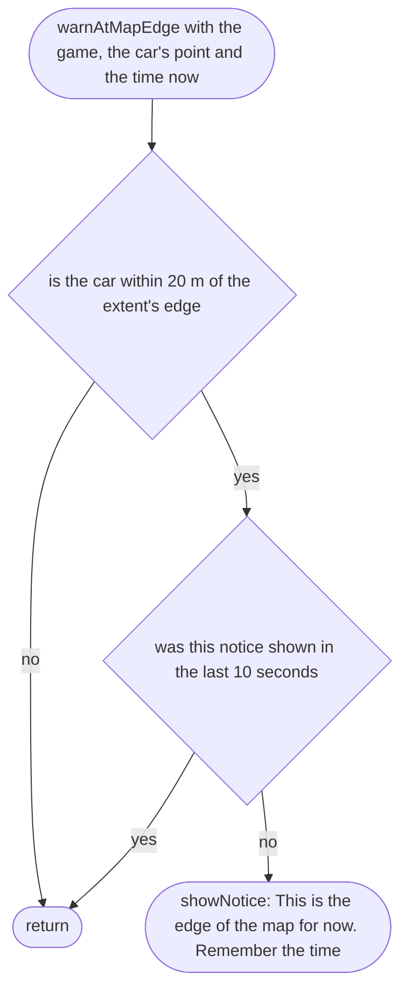
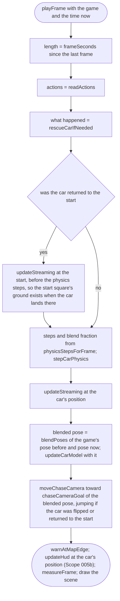
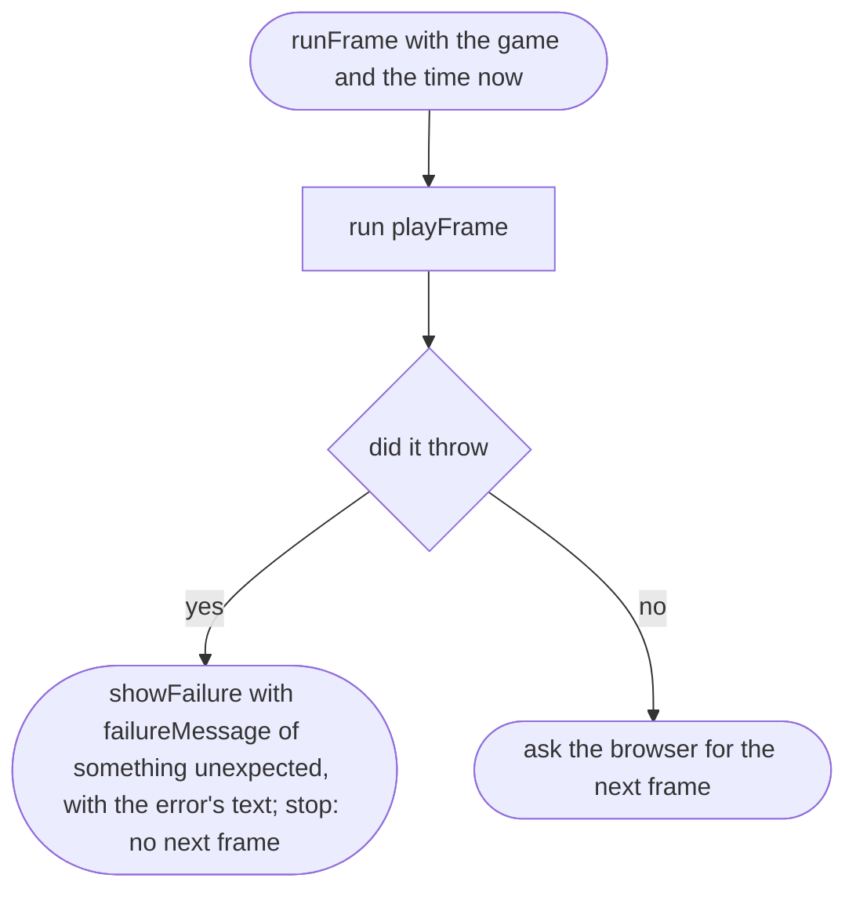

# src/game/loop.ts

Status: approved by the orchestrator in one pass (Scope 005b, the owner's lighter process for non-physics work, 2026-10-11).

New in scope 005 (item 4). One frame of the game, about 60 times a second
(browser `requestAnimationFrame`). Order: read the controls, flip the car
upright if asked (or return it to the start if it left the world, then load
the squares there), run the physics in fixed steps, move the squares, move
the camera, draw. The pose before and the pose now are kept in the game
between frames, for smooth drawing (approver's F17). The pictures drawn from the code will
be in `docs/flows/src/game/loop.md`.

## frameSeconds

Why the game needs it: when the phone locks or the tab is hidden, the next frame comes minutes later; the game must not try to simulate those minutes.

## readActions

Why the game needs it: every device is read every frame and combined, so the player can switch from thumbs to keys at any time.

## stepCarPhysics

Why the game needs it: the car is driven and the world moves in equal steps, and the pose before the last step is kept for smooth drawing. The pose before and the pose now live in the game between frames: a frame with no step (most frames on a 120 Hz screen) leaves them as they were, so the drawing still blends between them; a flip or a return to the start sets both to the new pose, so the car never smears across the map for a frame (approver's F17).

## rescueCarIfNeeded

Why the game needs it: whether the player asked or the car fell off the world, it is put right, and the player is told why, in the same words as the button. Flip upright works only when the car has nearly stopped or tipped over (`canFlipUpright`, `car.md`; orchestrator's decision E2 (b)); otherwise the player is told when it works, and nothing happens to the car.

## warnAtMapEdge

Why the game needs it: the invisible wall at the map's edge is explained, not a mystery; the notice is not repeated while the player stays there.

## measureFrame

Why the game needs it: in measuring mode, the moment the player could first drive is marked once, frames are recorded for 60 seconds from then, and the report appears on screen when done.

## playFrame

Why the game needs it: the whole game, once a frame.

## runFrame

Why the game needs it: frames keep coming while all is well, and a frame that goes wrong ends with a message on screen. Without this, a throw inside a frame stops `requestAnimationFrame` and freezes the picture with no word; `startGameSafely` covers only the start (approver's F17).

