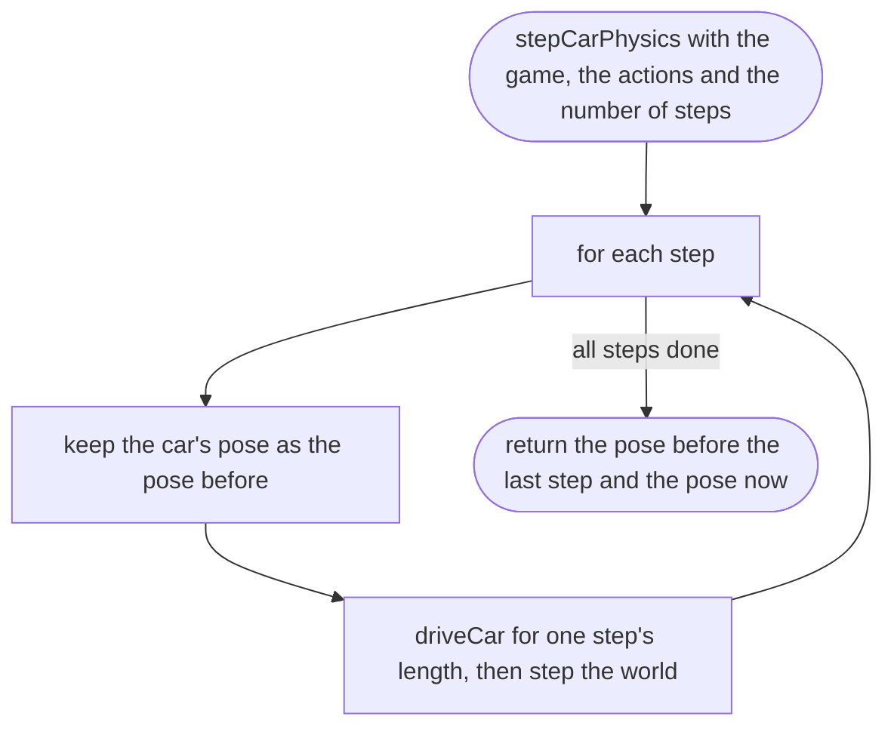
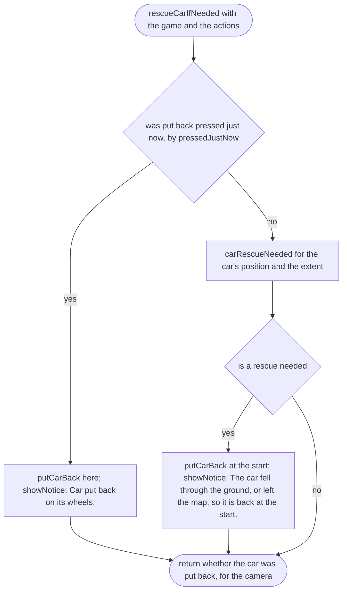
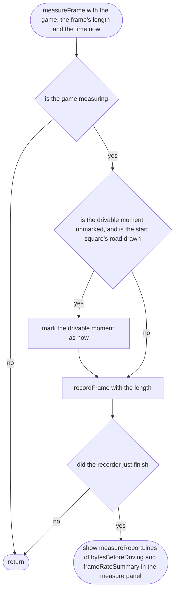
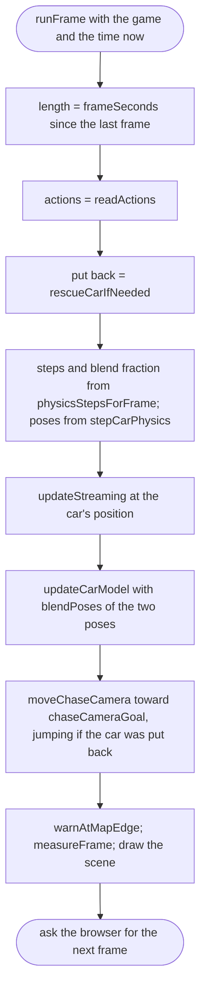

# src/game/loop.ts

Status: draft

New in scope 005 (item 4). One frame of the game, about 60 times a second
(browser `requestAnimationFrame`). Order: read the controls, put the car back
if asked, run the physics in fixed steps, check the car is still on the map,
move the squares, move the camera, draw. The pictures drawn from the code will
be in `docs/flows/src/game/loop.md`.

## frameSeconds

Why the game needs it: when the phone locks or the tab is hidden, the next frame comes minutes later; the game must not try to simulate those minutes.

## readActions

Why the game needs it: every device is read every frame and combined, so the player can switch from thumbs to keys at any time.

## stepCarPhysics

Why the game needs it: the car is driven and the world moves in equal steps, and the pose before the last step is kept for smooth drawing.

## rescueCarIfNeeded

Why the game needs it: whether the player asked or the car fell off the world, it is put back, and the player is told why.

## warnAtMapEdge

Why the game needs it: the invisible wall at the map's edge is explained, not a mystery; the notice is not repeated while the player stays there.

## measureFrame

Why the game needs it: in measuring mode, the moment the player could first drive is marked once, frames are recorded for 60 seconds from then, and the report appears on screen when done.

## runFrame

Why the game needs it: the whole game, once a frame.

