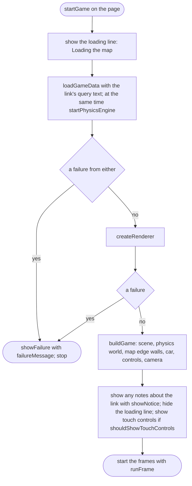
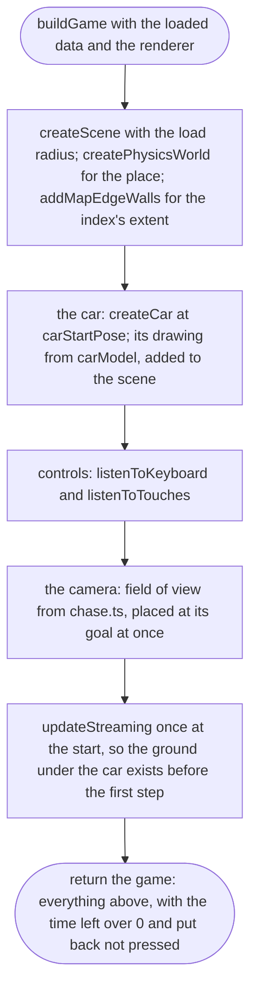
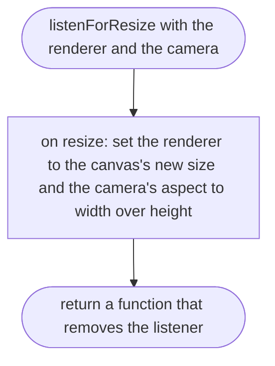

# src/game/main.ts

Status: draft

New in scope 005 (item 4). The page's starting point: load, build the world,
put the car on the street, start the frames. Anything that fails on the way
ends in `showFailure`, so the player never sees a blank page (the scope's
story). The pictures drawn from the code will be in
`docs/flows/src/game/main.md`.

## startGame

Why the game needs it: from opening the link to driving, or to a plain message saying why not.

## startGameSafely

Why the game needs it: an error nobody planned for still ends in a message on screen, never a frozen loading line.

## buildGame

Why the game needs it: everything the frames need, made once, with the car parked on the street.

## listenForResize

Why the game needs it: turning the phone sideways or resizing the window keeps the picture filling the screen without stretching.

