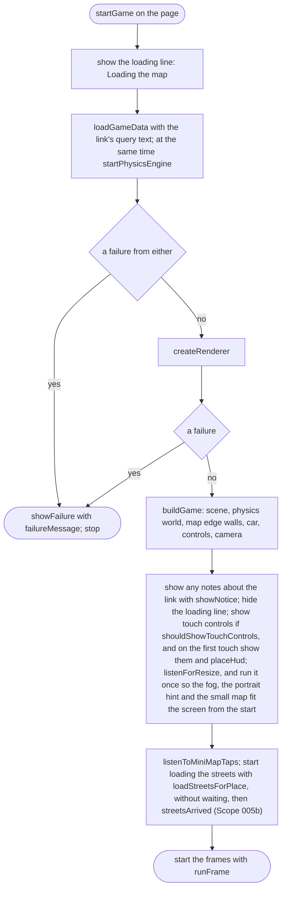
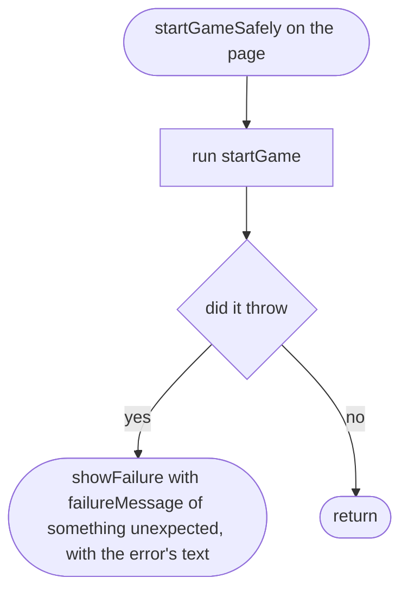
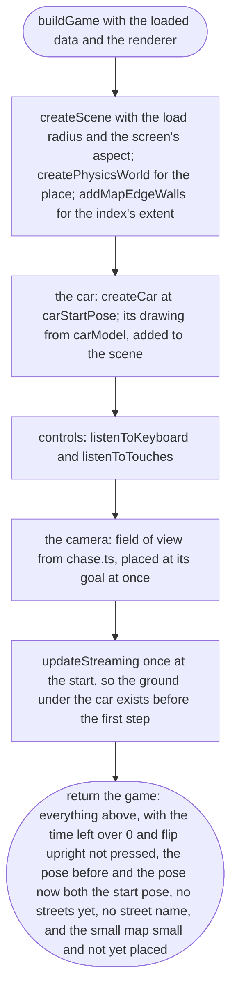
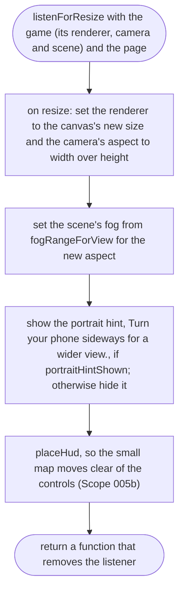
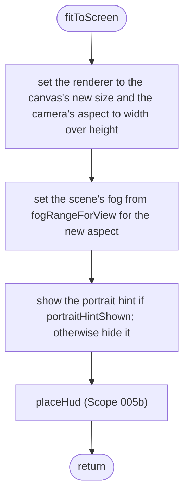
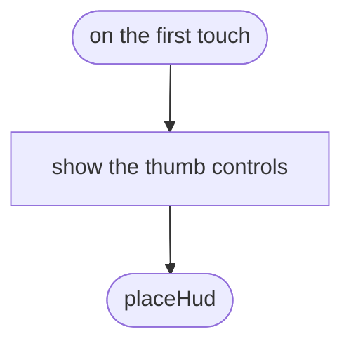

# src/game/main.ts

Status: approved by the orchestrator in one pass (Scope 005b, the owner's lighter process for non-physics work, 2026-10-11).

New in scope 005 (item 4). The page's starting point: load, build the world,
put the car on the street, start the frames. Anything that fails on the way
ends in `showFailure`, so the player never sees a blank page (the scope's
story). The pictures drawn from the code will be in
`docs/flows/src/game/main.md`.

## startGame

Why the game needs it: from opening the link to driving, or to a plain message saying why not.

## startGameSafely

Why the game needs it: an error nobody planned for still ends in a message on screen, never a frozen loading line.

## buildGame

Why the game needs it: everything the frames need, made once, with the car parked on the street.

## listenForResize

Why the game needs it: turning the phone sideways or resizing the window keeps the picture filling the screen without stretching. The fog depends on the screen's shape (`fogRangeForView`, `scene.md`; approver's F13), and the hint to turn the phone shows only while it is held upright (`portraitHintShown`, `touch.md`; decision E3 (a)), so both are worked out again here.

## listenForResize > fitToScreen

Added by the coder in Scope 005 slice 1, approved by the orchestrator on 2026-10-11 (common sense: the check the approved design already asked for): the approved design asked for this check (see below) but named no function for it, and the diagram gate needs one heading per function. `listenForResize` says "on resize: …"; this is the function the browser calls on each resize, holding exactly those steps. Why the game needs it: the same steps run on every resize and once at the start.

## startGame > inner function 1

New in Scope 005b. Why the game needs it: a touch screen on a computer gets the thumb controls once it is touched, and the small map moves clear of them at once.

