# src/game/minimap.ts

Status: approved by the orchestrator in one pass (Scope 005b, the owner's lighter process for non-physics work, 2026-10-11).

New in scope 005b (item 3). The small round map: north up, 300 m across (the
scope's "about 300 m"), centred on the car, with its roads from
`streets.json`, the names of the bigger roads, an arrow for the car, a ring
and an N. Drawn with the browser's 2D canvas (MDN CanvasRenderingContext2D:
`arc`, `clip`, `moveTo`, `lineTo`, `stroke`, `fillText`, `strokeText`,
`measureText`). Names are placed first come, first served, and one that would
overlap a placed name is left out: the greedy collision test web maps use
(MapLibre GL JS, `src/symbol/collision_index.ts`, BSD-3-Clause, technique
only; research/38). The view sums and the label rule are pure and tested;
drawing only follows them. The pictures drawn from the code will be in
`docs/flows/src/game/minimap.md`.

Which names: on the small map, major roads (tertiary and up) only, as the
scope asks; on the big map, every named road, since there is room. Each name
once. Look-and-feel (colours near the 3D world's, road widths 5 px major and
3 px minor, a 10 px font) is the owner's choice, proposed by the coder on
2026-10-11.

## mapView

Why the game needs it: one place says how many pixels a metre is, from the map's size on screen.

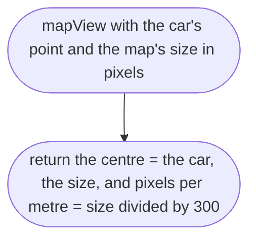

## toScreen

Why the game needs it: north up, so the player can hold the map against a real one: metres east go right, metres north go up.

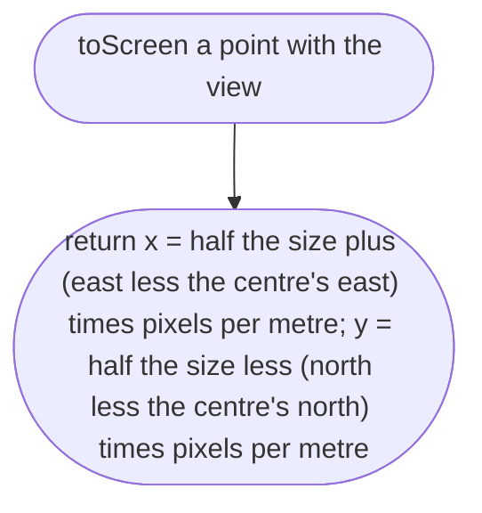

## lineInView

Why the game needs it: of Omole's roads only a few dozen are near the car; the rest are skipped by their box.

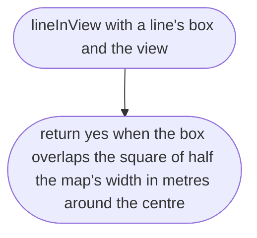

## headingFromFlat

Why the game needs it: the arrow points the way the car faces; game axes are x east, z south (`src/vehicle/car.md`, `flatHeading`).

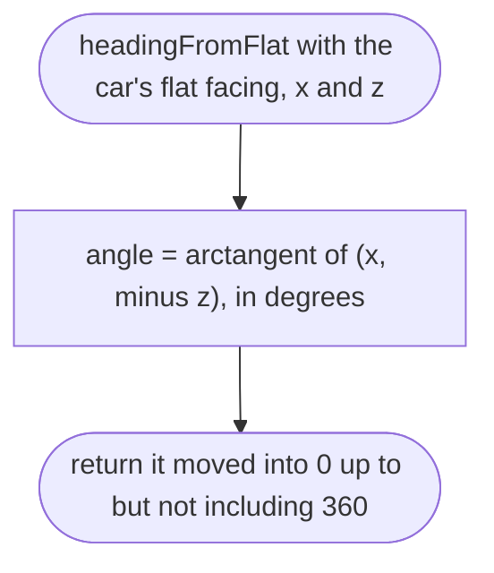

## labelSpots

Why the game needs it: the player sees the names of the streets around him, never two on top of each other, never over his car, and never cut by the map's edge.

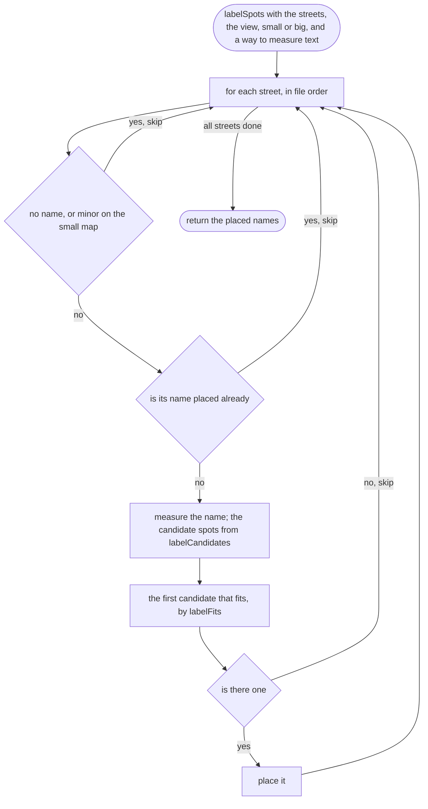

## labelCandidates

Why the game needs it: a name sits on road the player can see, inside the round map, and reads best on the longest piece; when that spot is taken (by the car, or another name) the next longest is tried. A road longer than the map is cut to the circle first, so it still gets its name (found driving: Isheri Road had none).

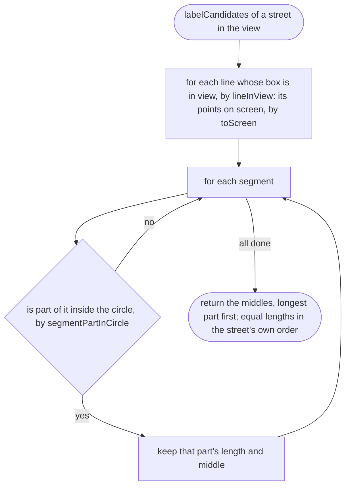

## segmentPartInCircle

Why the game needs it: the part of a segment inside the round map. Where the point a + t(b − a) is exactly one radius from the centre is a quadratic in t (line–circle intersection, standard geometry); the part between the two answers, kept between the segment's ends, is inside.

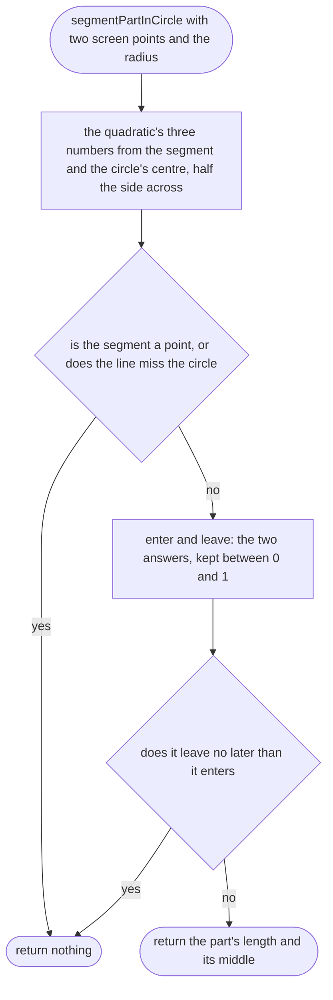

## labelFits

Why the game needs it: a name is written only where it is whole inside the circle, clear of the car arrow and clear of every placed name.

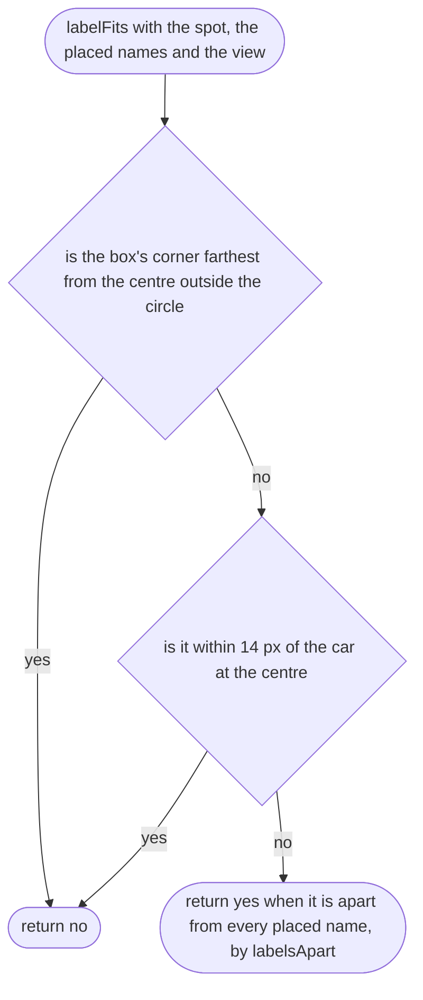

## labelsApart

Why the game needs it: two names are apart when they are side by side or one above the other.

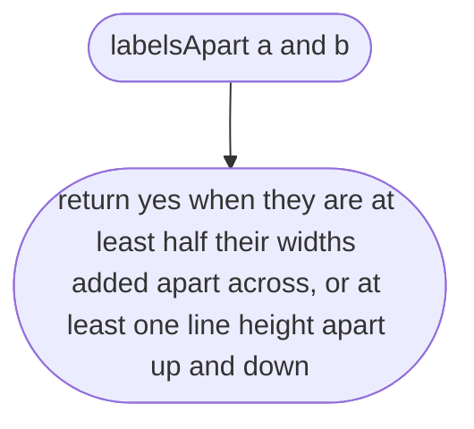

## drawMiniMap

Why the game needs it: the whole map, drawn in one go ten times a second.

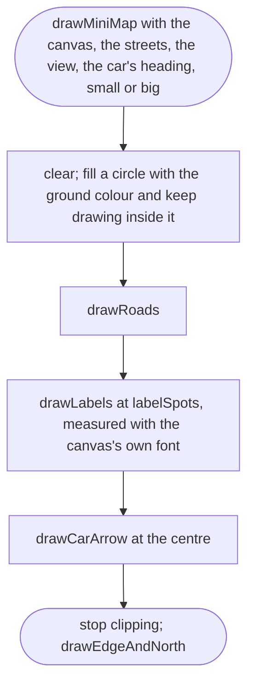

## drawRoads

Why the game needs it: every road twice, a grey casing then white on top, so crossings join up like on a printed map; major roads wider.

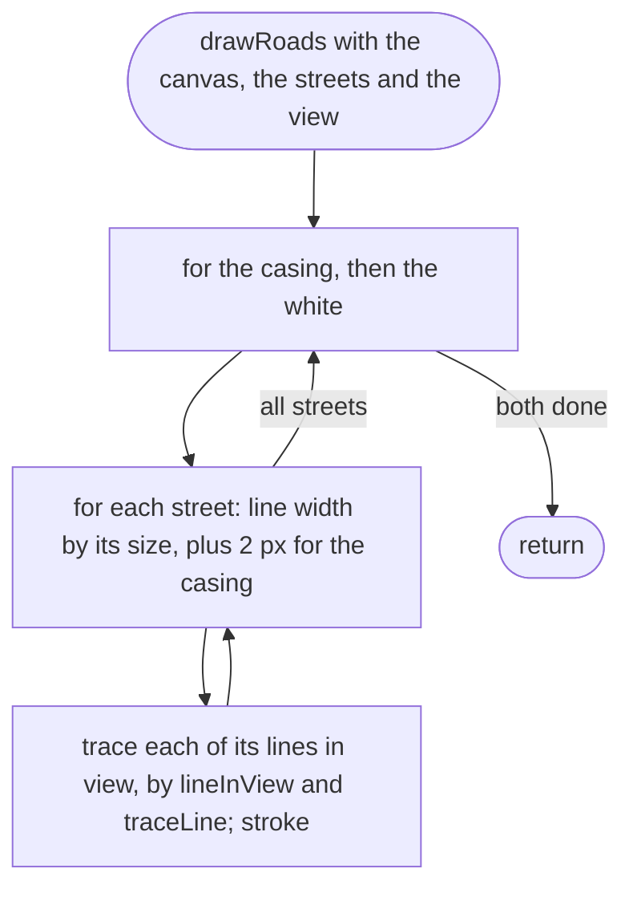

## traceLine

Why the game needs it: one line of points becomes one path on the canvas.

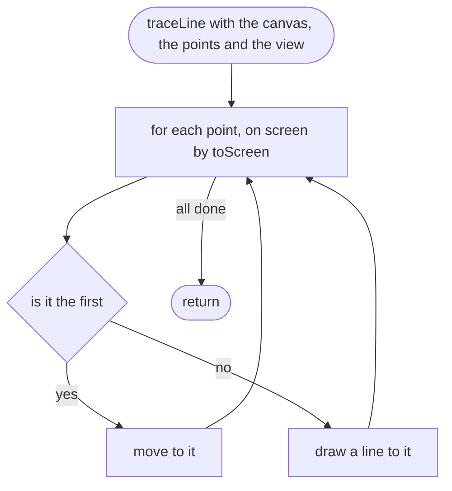

## drawLabels

Why the game needs it: a white halo under each name, so it reads over roads.

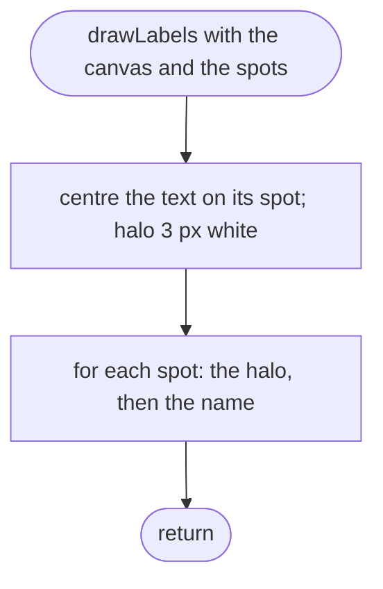

## drawCarArrow

Why the game needs it: the player sees where he is and which way he faces; the canvas turns clockwise for a positive angle, as a compass heading does.

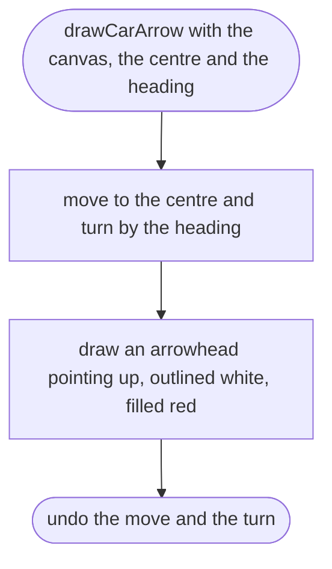

## drawEdgeAndNorth

Why the game needs it: a ring shows where the map ends, and an N at the top says north is always up.

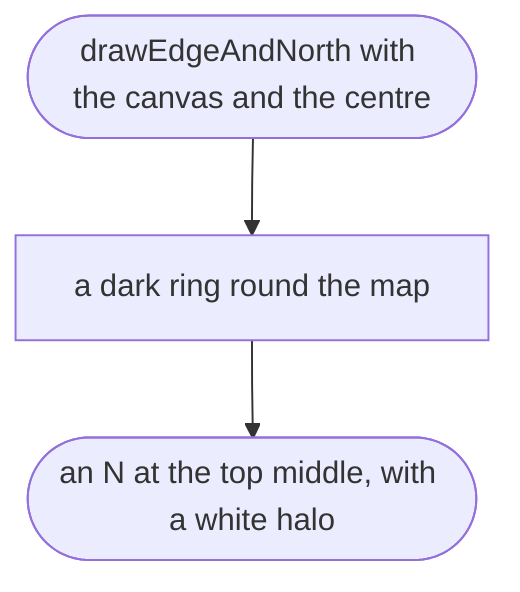
