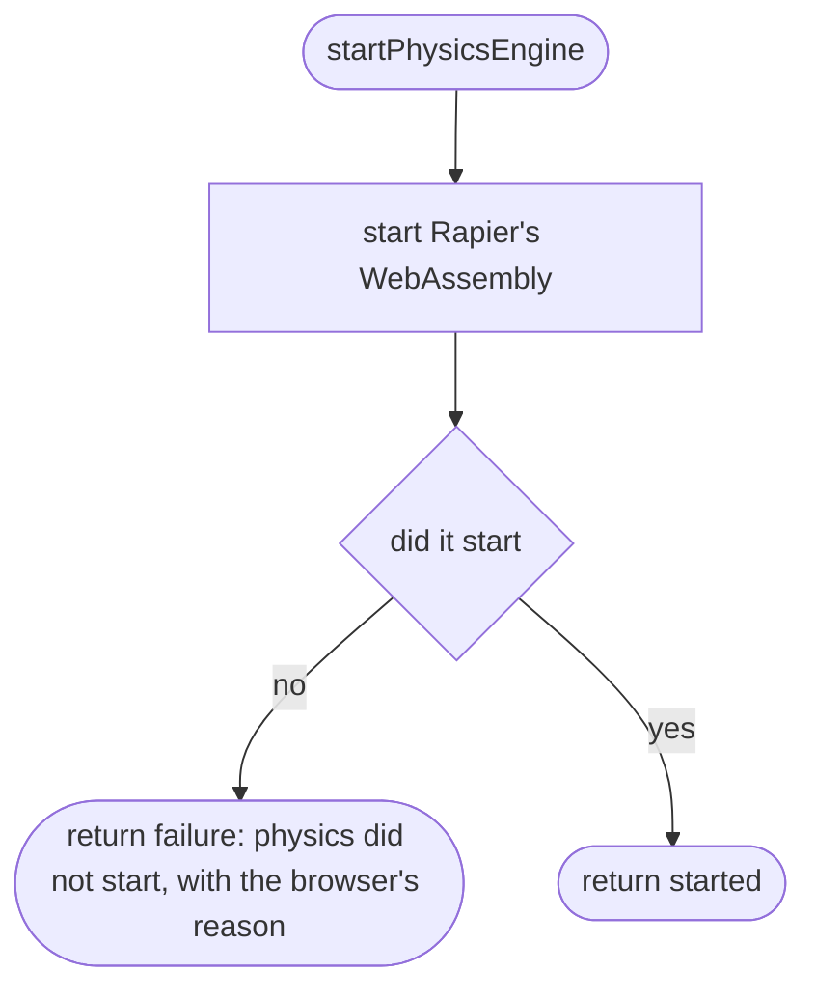
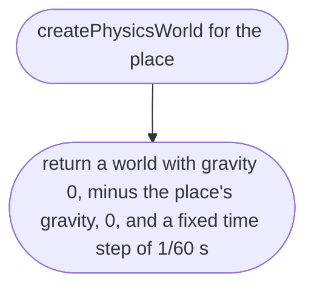
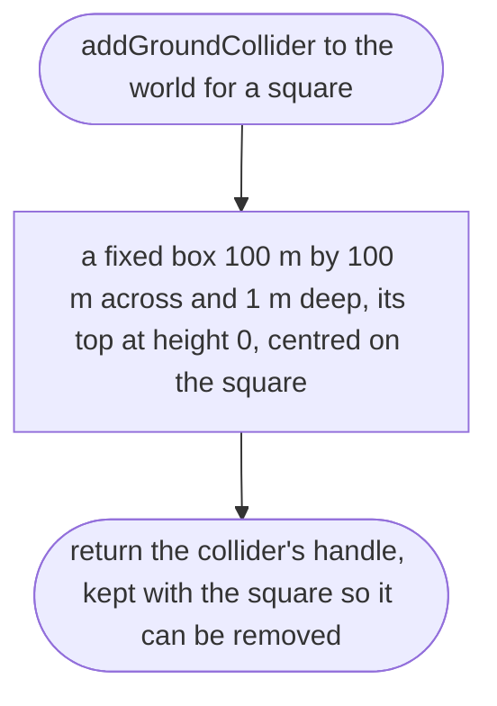
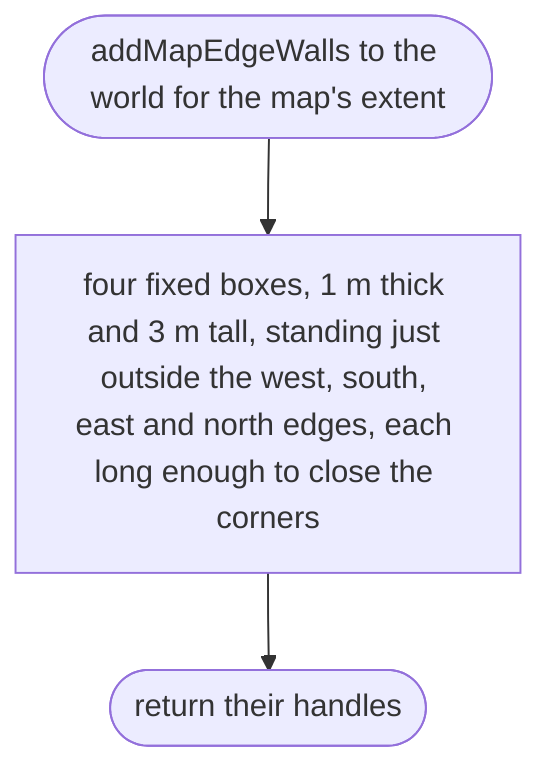
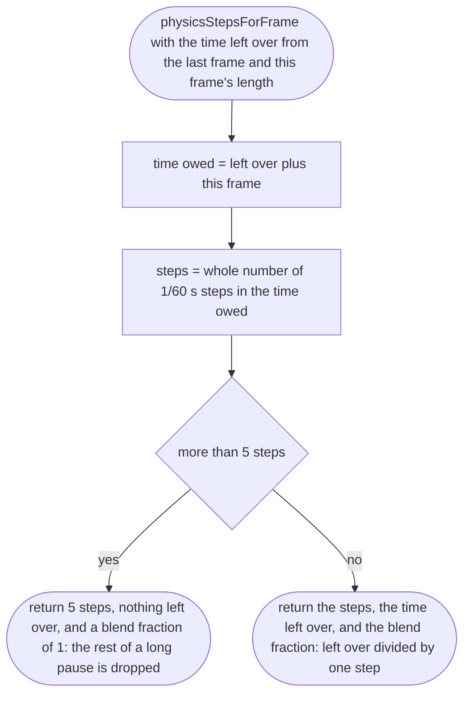
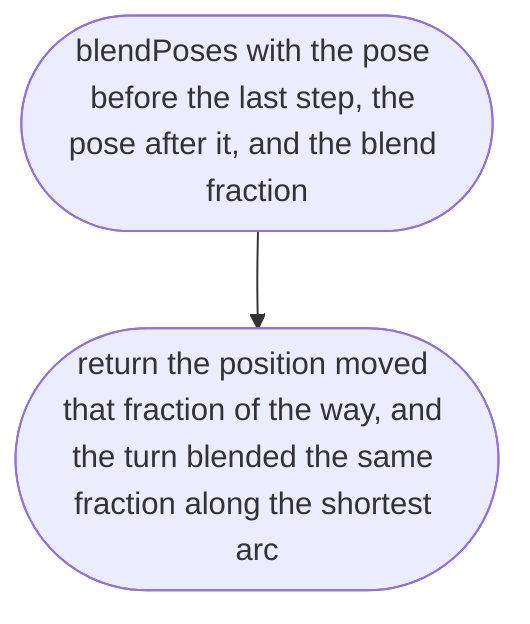

# src/game/physics.ts

Status: draft

New in scope 005 (items 4 and 5). The physics world: Rapier, started once,
pulling down with the place's gravity (D-0009), the flat ground one collider
per 100 m square (D-0008; research/36 section 2, item 7: road colliders add
nothing while ground and road are both flat at 0 m), walls at the map's
edge, and fixed 1/60 s steps (Sketchbook `World.ts`, research/36 section 3).
Rapier 0.21.0 API from its type files: `init`, `World`, `timestep`,
`ColliderDesc.cuboid`, `createCollider`, `removeCollider`. The pictures drawn
from the code will be in `docs/flows/src/game/physics.md`.

## startPhysicsEngine

Why the game needs it: the physics engine is WebAssembly and must be started before anything moves; on a phone that cannot run it, the player is told.

## createPhysicsWorld

Why the game needs it: things fall at the place's own gravity, so a Mars place later falls slower with no code change.

## addGroundCollider

Why the game needs it: the car can drive anywhere on the flat ground, on the road and off it, in every square near it, whether or not that square's road file has arrived.

## addMapEdgeWalls

Why the game needs it: the map ends somewhere; the player meets an invisible wall at the edge instead of driving off into nothing.

## physicsStepsForFrame

Why the game needs it: the car behaves the same on a 60 Hz phone, a 120 Hz Mac and a phone that stutters, because physics always moves in equal steps; after a long pause it catches up only a little instead of fast-forwarding.

## blendPoses

Why the game needs it: the car is drawn between its last two physics positions, so it glides on a 120 Hz screen instead of moving in 60 Hz jerks.

