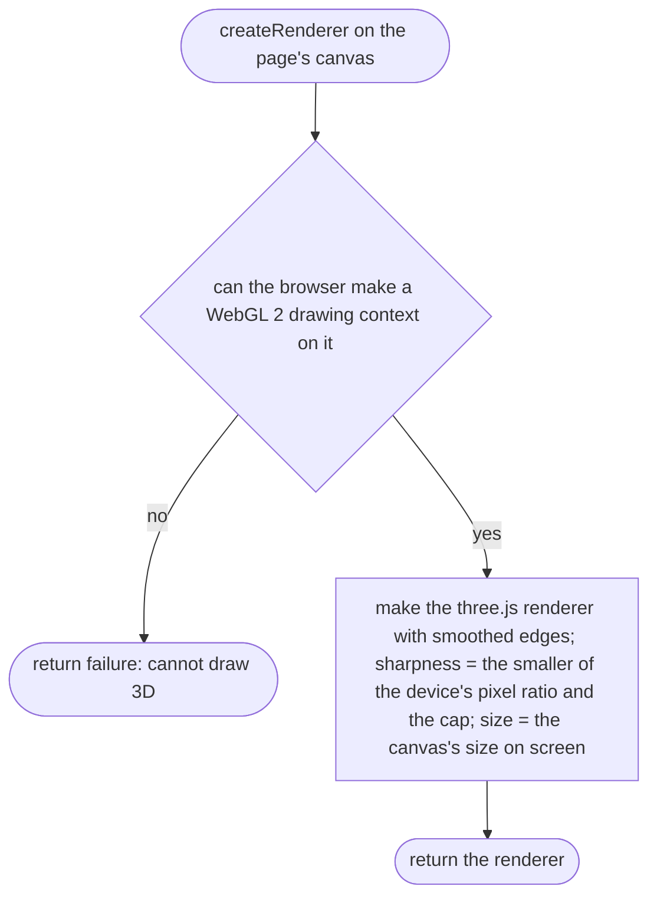
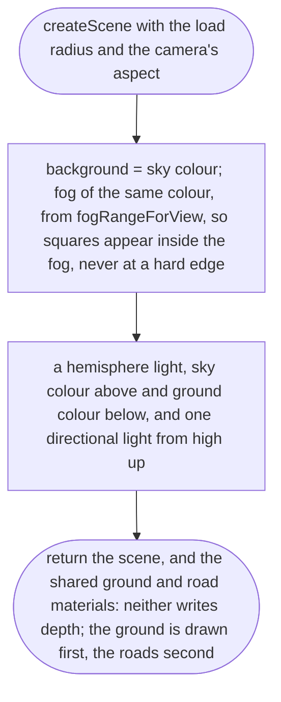
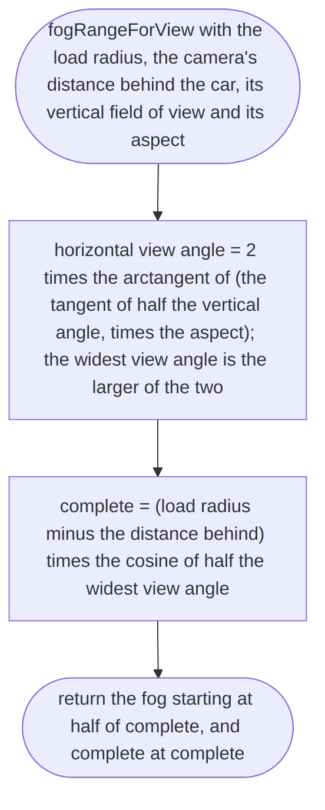
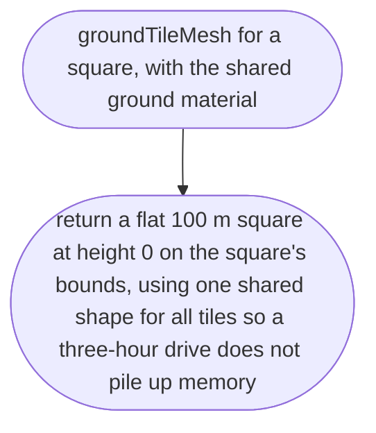
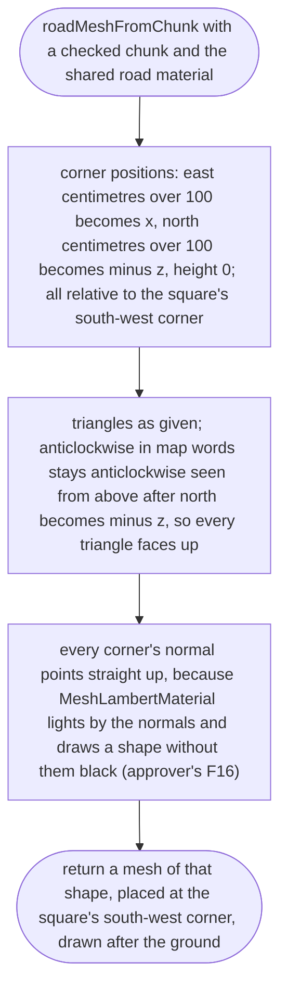
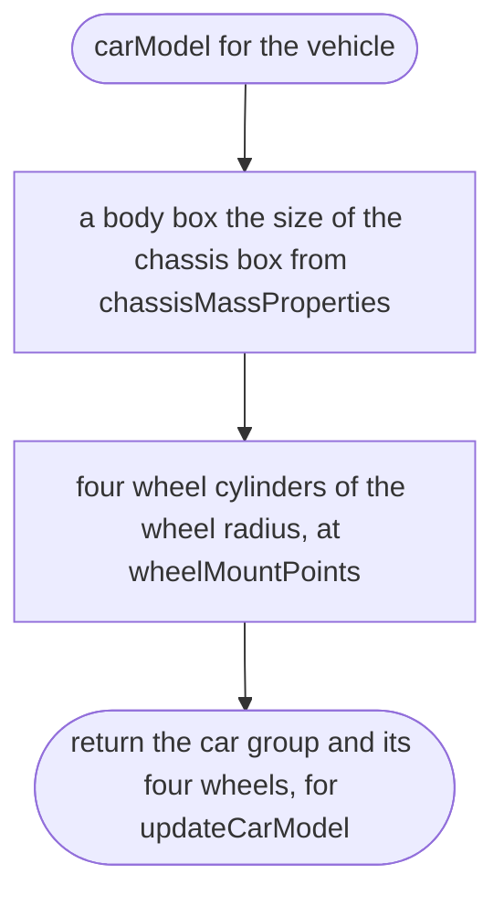
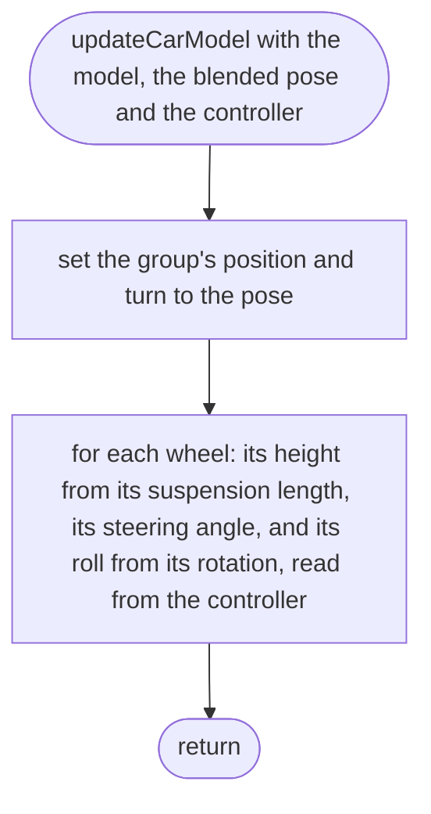
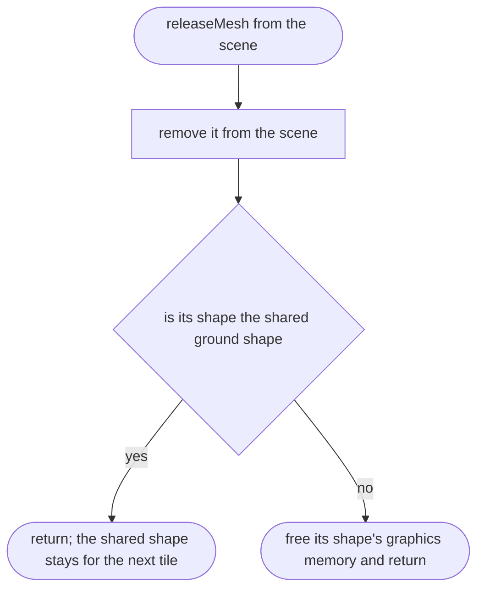

# src/game/scene.ts

Status: approved. Judged by the delegated approver (docs/reviews/slice-1-approver.md); its fixes F1 to F24 and the orchestrator's decisions on E1 to E3 applied in one pass.

New in scope 005 (item 4). What is drawn: sky colour, simple light, the flat
ground per square, the grey roads, and a grey-box car. three.js 0.186.1 with
WebGL 2 (`WebGLRenderer`, `HemisphereLight`, `DirectionalLight`, `Fog`,
`BufferGeometry`, `MeshLambertMaterial`, `Material.depthWrite`,
`Object3D.renderOrder`). Ground and roads are drawn first and write no depth,
so the flat layers can never flicker against each other at any distance
(research/36 section 2, item 4). Colours, light strength, fog distance and the
cap on screen sharpness (device pixel ratio at most 2, to keep the frame rate
on phones with very sharp screens) are look-and-feel numbers, the owner's
choice, proposed as named constants here; the real look is found later
(D-0023). The pictures drawn from the code will be in
`docs/flows/src/game/scene.md`.

## createRenderer

Why the game needs it: the picture fills the phone's screen at a sharpness the phone can keep up with; a browser that cannot draw 3D is told so.

## createScene

Why the game needs it: a plain, readable world: a sky, soft light from above, one sun for shape, and fog that hides where the loaded squares end.

## fogRangeForView

New in scope 005 (approver's F13). Why the game needs it: three.js fogs by depth straight ahead of the camera, not by distance (in 0.186.1, `vFogDepth = - mvPosition.z`), so at the side of a wide screen a square far away has a small depth and pops in nearly unfogged. On a 20:9 phone held sideways, a square 294 m away at the screen edge has a depth of only 181 m. So the fog is pulled in by the cosine of half the widest view angle, and worked out again whenever the screen's shape changes. The load radius stays the owner's performance number; the clear view on a wide phone becomes shorter (about 180 m), which the frame-rate measurement can trade against a bigger radius.

## groundTileMesh

Why the game needs it: the ground under every loaded square, matching its collider.

## roadMeshFromChunk

Why the game needs it: the grey roads of one square, from its checked chunk file.

## carModel

Why the game needs it: the player sees a small car, the real car's size, made of plain shapes: our own invented grey box, no brand (D-0017).

## updateCarModel

Why the game needs it: the drawn car is where the physics car is, its front wheels turn with the steering and every wheel sits on its spring and rolls.

## releaseMesh

Why the game needs it: a square let go must free its graphics memory, or a long drive slowly fills the phone.

