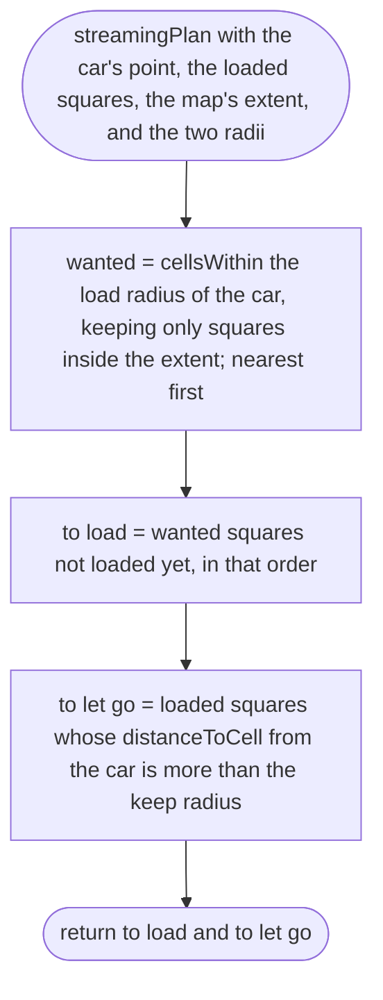
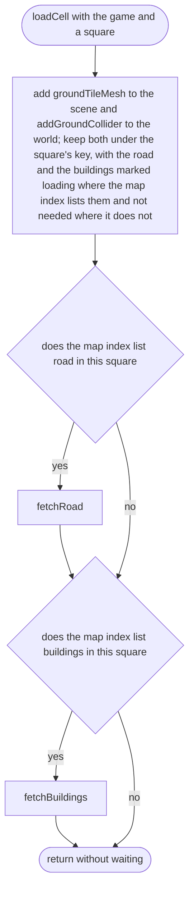
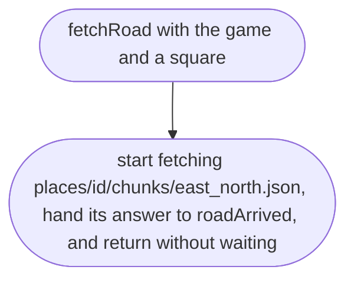
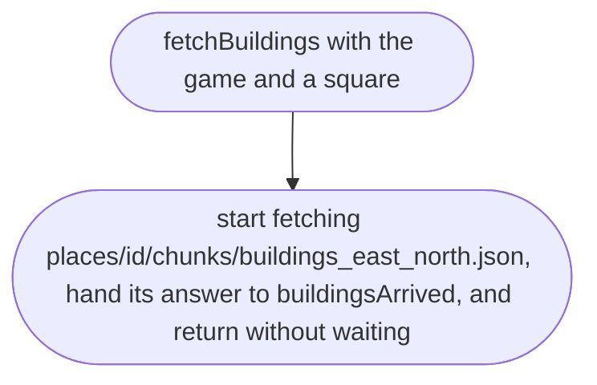
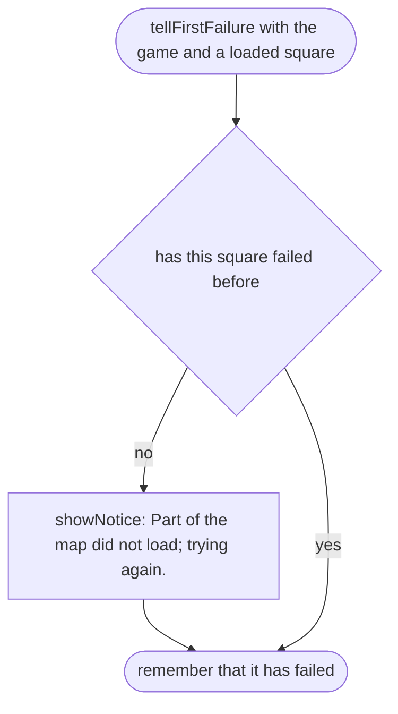
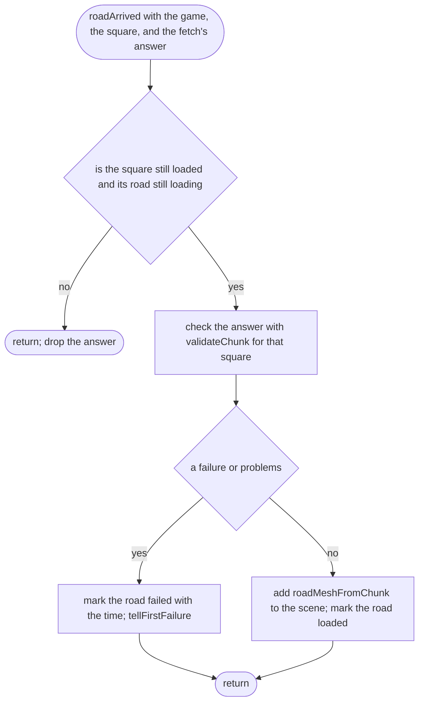
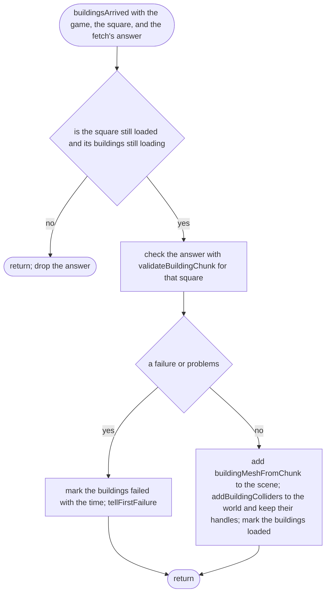
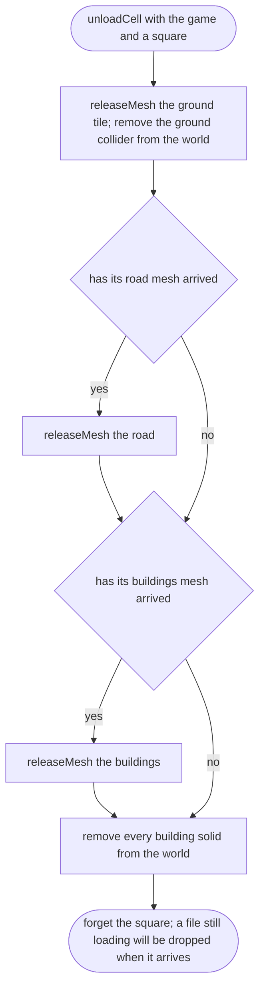
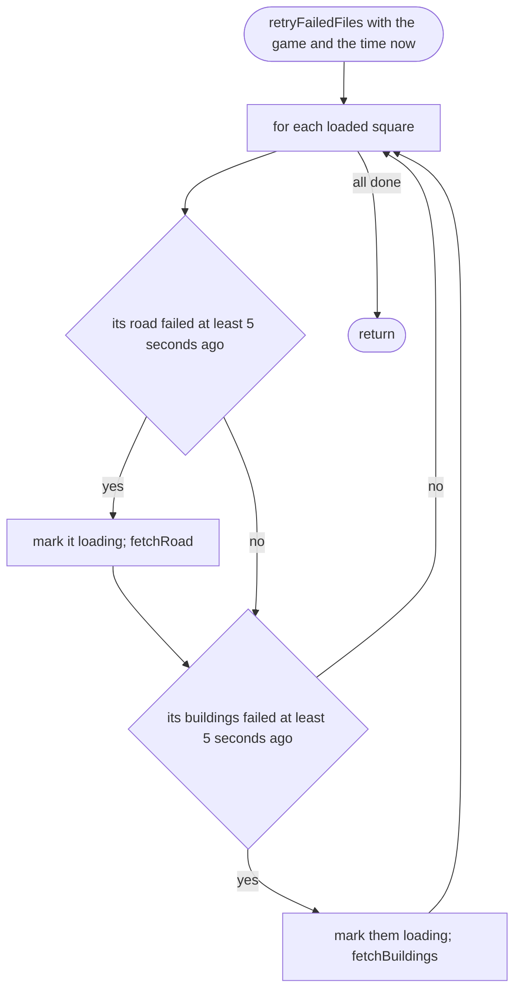
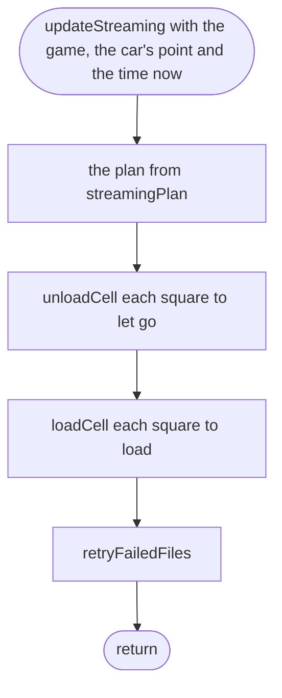

# src/game/streaming.ts

Status: approved by the orchestrator in one pass (Scope 006, lighter process, 2026-10-11).

New in scope 005 (item 4: "the chunks around the car, all chunks within a
view distance; unload far ones"). Squares are loaded within the **load
radius** of the car and let go beyond the **keep radius**, which is larger, so
a car driving along a square's edge does not load and drop the same square
over and over. Both are performance numbers, the owner's choice, proposed at
300 m and 400 m as named constants here, to be confirmed by the frame-rate
measurement on the phone. Only squares inside the map's extent are loaded. The
plan is a pure function the blind tests can run; loading and letting go touch
the scene and the physics. The pictures drawn from the code will be in
`docs/flows/src/game/streaming.md`.

Each loaded square keeps: its ground mesh, its ground collider, its road mesh
when it has arrived, and whether its road is loading, loaded, failed (with
the time) or not needed (the index has no road there); and the same for its
buildings (scope 006), with the handles of their solids.

## streamingPlan

Why the game needs it: only a few dozen squares are ever in the phone's memory, and the ones around the car are always there.

## loadCell

Why the game needs it: the ground and its collider appear at once, so the car can never fall through a square whose road file is slow; the road and the buildings (scope 006) follow when they arrive.

## fetchRoad

Why the game needs it: one place that names a square's road file and hands its answer on.

## fetchBuildings

Why the game needs it: the same for a square's buildings file.

## tellFirstFailure

Why the game needs it: the player is told once that part of the map did not load; retries, and the second file of the same square, stay quiet.

## roadArrived

Why the game needs it: a road file that arrives after the car has driven away is thrown away instead of being drawn in a square nobody holds; a broken one is reported once and tried again later.

## buildingsArrived

Why the game needs it (scope 006): a square's buildings are drawn as one mesh and each gets its solid, so the car stops at a wall; a late file is dropped and a broken one is reported once and tried again, like a road.

## unloadCell

Why the game needs it: letting go of a square removes everything it added, so a three-hour drive uses the same memory as a three-minute one.

## retryFailedFiles

Why the game needs it: a road or buildings file that failed on a weak signal comes back by itself when the signal does, without the player reloading.

## updateStreaming

Why the game needs it: once a frame, the squares follow the car.

