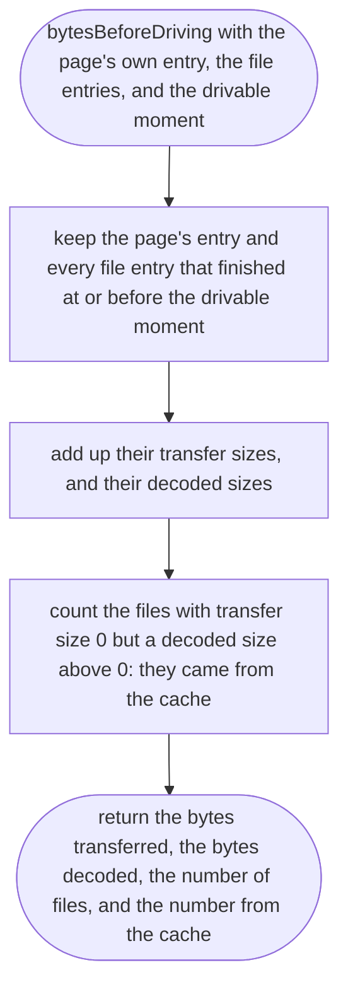
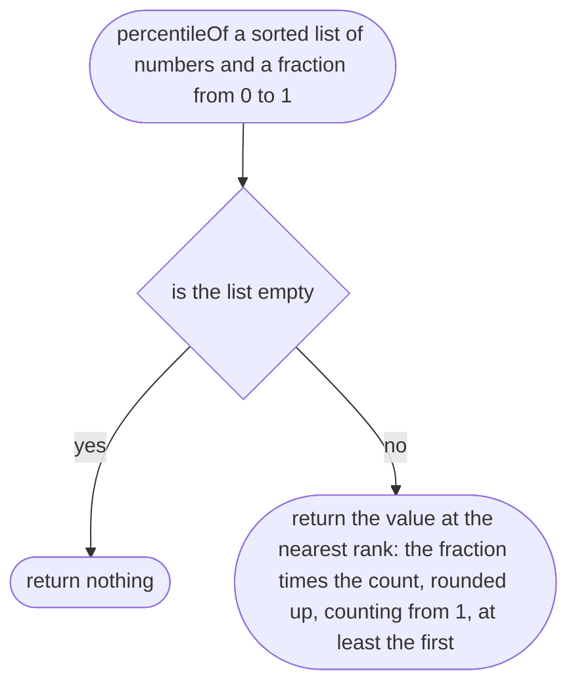
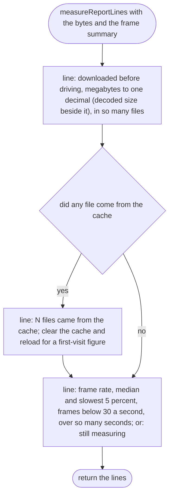

# src/measure/measure.ts

Status: approved. Judged by the delegated approver (docs/reviews/slice-1-approver.md); its fixes F1 to F24 and the orchestrator's decisions on E1 to E3 applied in one pass.

New in scope 005 (item 7). With `?measure` in the link, the page measures
itself, so the owner can read the numbers off his own phone: the bytes
downloaded before he could drive, and the frame rate over 60 seconds of
driving. Bytes come from the browser's Resource Timing entries
(`transferSize`, `decodedBodySize`, `responseEnd`; MDN, research/36 section
6). Measured on the built game only (`npm run build` then
`npm run preview -- --host`), first visit with the cache cleared. The
pictures drawn from the code will be in `docs/flows/src/measure/measure.md`.

"Drivable" means: the car is on the ground and the road of the square it
starts in has been drawn. The page marks that moment once (`drivableAt`).

## bytesBeforeDriving

Why the game needs it: the 30 MB target is about what the player waits for before driving, not what loads later.

## percentileOf

Why the game needs it: the slowest frames matter more than the average, because they are the stutters a player feels.

## frameRateSummary

Why the game needs it: three numbers a designer can read: the usual frame rate, the frame rate in the worst moments, and how many frames fell below 30 a second.

## recordFrame

Why the game needs it: collects frame lengths for exactly 60 seconds of driving after the drivable moment, then stops, so the report is the same length every time.

## measureReportLines

Why the game needs it: the numbers on screen, in words, with the warnings that make them honest.

