# src/measure/measure.ts

Status: approved by the orchestrator in one pass (measure fix after the owner's 0.0 MB report, 2026-10-11).
(2026-10-11): the panel said "0.0 MB in 47 files" although the game had
loaded, because the browser gave size 0 for every file. Earlier version
approved by the delegated approver (docs/reviews/slice-1-approver.md).

New in scope 005 (item 7). With `?measure` in the link, the page measures
itself, so the owner can read the numbers off his own phone: the bytes
downloaded before he could drive, and the frame rate over 60 seconds of
driving. Bytes come from the browser's Resource Timing entries
(`transferSize`, `decodedBodySize`, `responseEnd`; MDN, research/36 section
6). Measured on the built game only (`npm run build` then
`npm run preview -- --host`), first visit with the cache cleared. The
pictures drawn from the code will be in `docs/flows/src/measure/measure.md`.

"Drivable" means: the car is on the ground and the road of the square it
starts in has been drawn. The page marks that moment once (`drivableAt`).

## bytesBeforeDriving

Why the game needs it: the 30 MB target is about what the player waits for before driving, not what loads later. A browser gives transfer size 0 for a file from its cache, and for a file whose sizes it hides (Safari often does); those files are kept by address so the server can say their size.

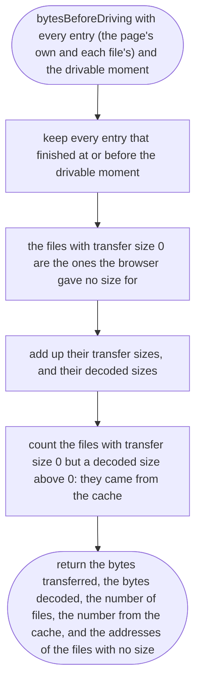

## askedSize

Why the game needs it: the cheapest honest size for a file the browser gave none for: ask the server what it sends, without downloading the file (a HEAD request, its Content-Length; with compression this is the packed size, what the player really downloads).

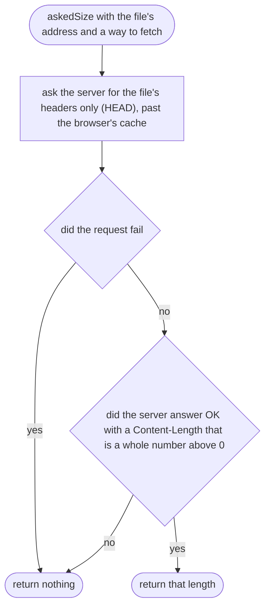

## countedSize

Why the game needs it: when the server will not say a size, download the file again past the cache and count its bytes. The browser unpacks compressed files, so this is the unpacked size, more than the real download; the report says so.

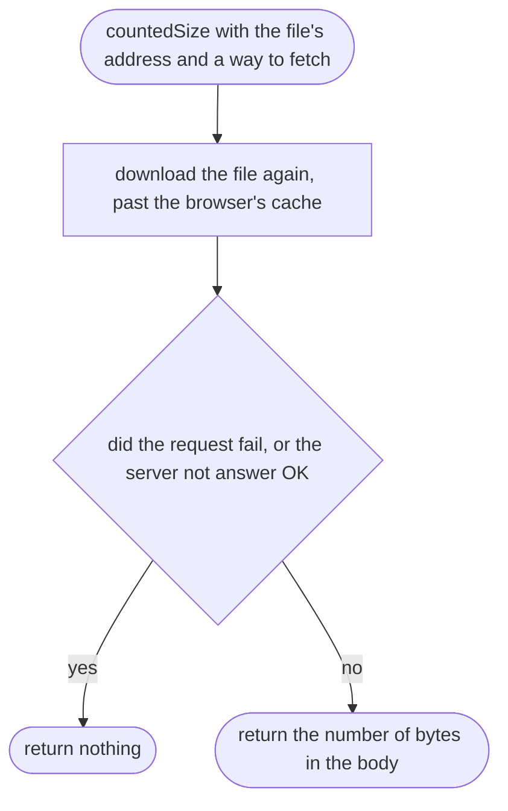

## serverSizeOf

Why the game needs it: ask first, because it downloads nothing; count only when the server will not say; and say which way the size was found.

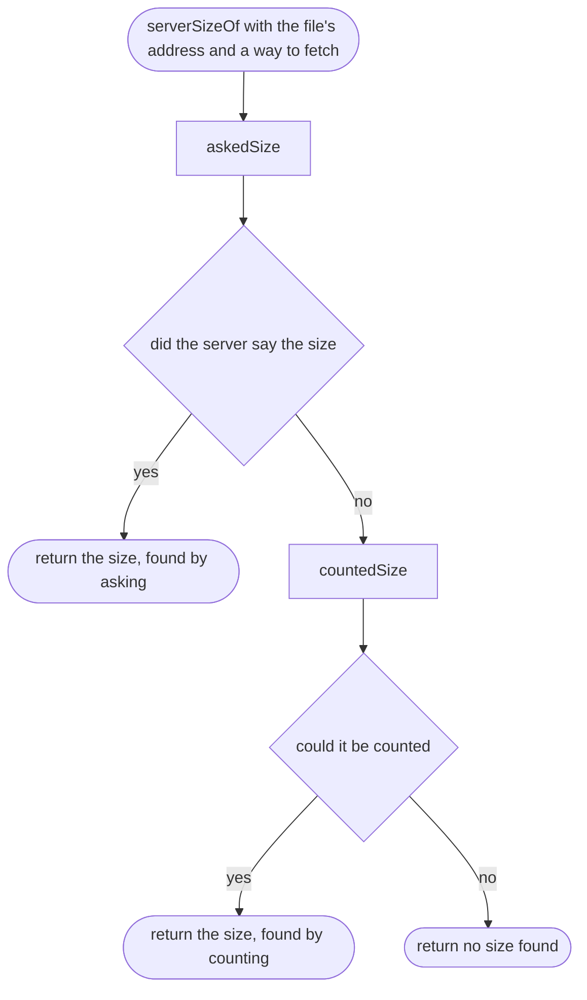

## serverSizes

Why the game needs it: the sizes of every file the browser gave none for, six at a time so a very large city does not send thousands of requests at once, added up by how each was found.

```mermaid
flowchart TD
  s(["serverSizes with the addresses and a way to fetch"])
  a{"are there addresses left"}
  b["serverSizeOf the next six at once, and wait for them"]
  c(["return, by foundBy, for asked and for counted: how many files and how many bytes; and how many had no size found"])
  s --> a
  a -->|"yes"| b --> a
  a -->|"no"| c
```

## foundBy

Why the game needs it: the report gives, for each way a size was found, how many files and how many bytes.

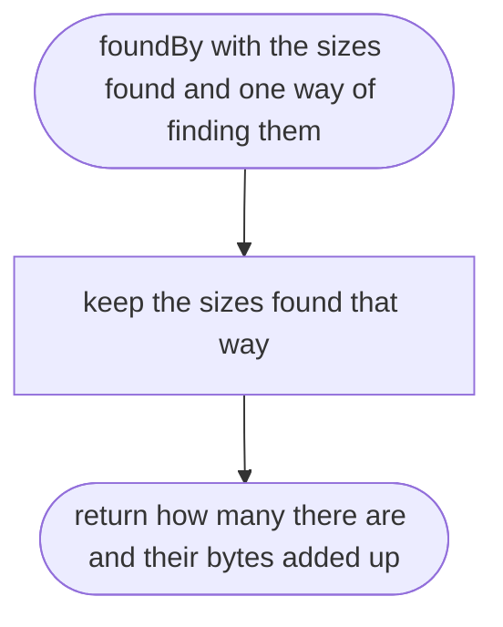

## percentileOf

Why the game needs it: the slowest frames matter more than the average, because they are the stutters a player feels.

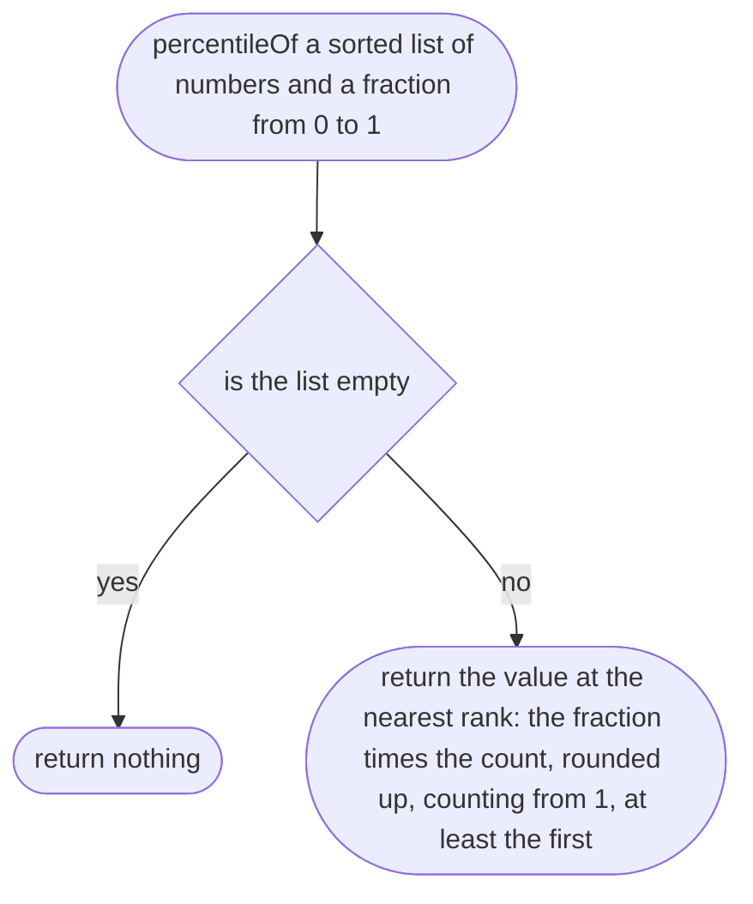

## frameRateSummary

Why the game needs it: three numbers a designer can read: the usual frame rate, the frame rate in the worst moments, and how many frames fell below 30 a second.

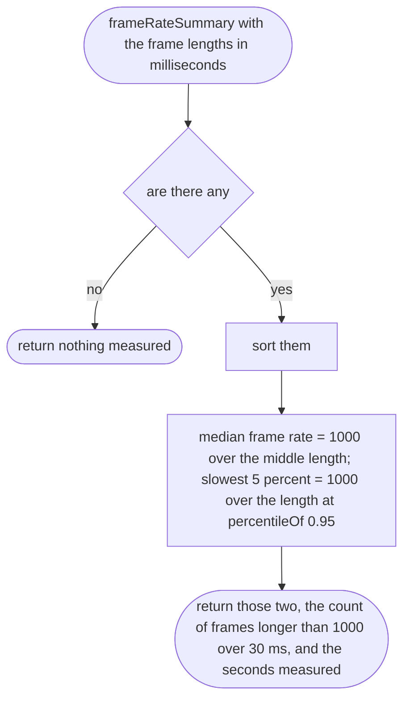

## recordFrame

Why the game needs it: collects frame lengths for exactly 60 seconds of driving after the drivable moment, then stops, so the report is the same length every time.

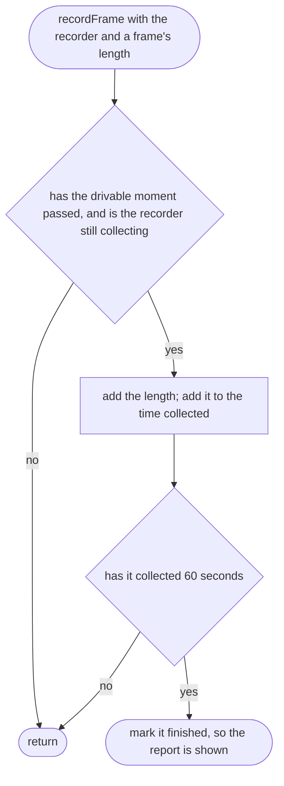

## megabytes

Why the game needs it: every size on the panel reads the same way, as the 30 MB target is written.

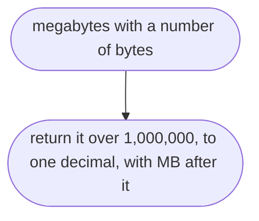

## downloadLines

Why the game needs it: never a confident number the browser did not give. When every size was given, the browser's figures as before; when some were not, it says how many it gave, then the total with the server's sizes and which way each was found.

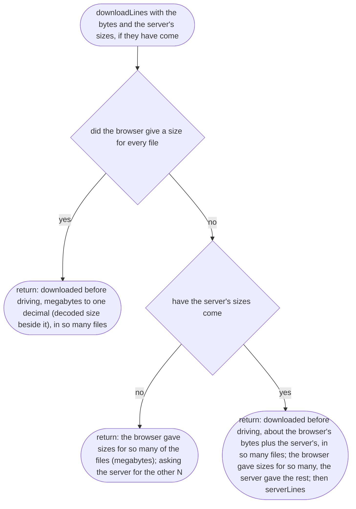

## serverLines

Why the game needs it: one line per way a size was found, and only the ways that were used, so the owner knows how far to trust the total.

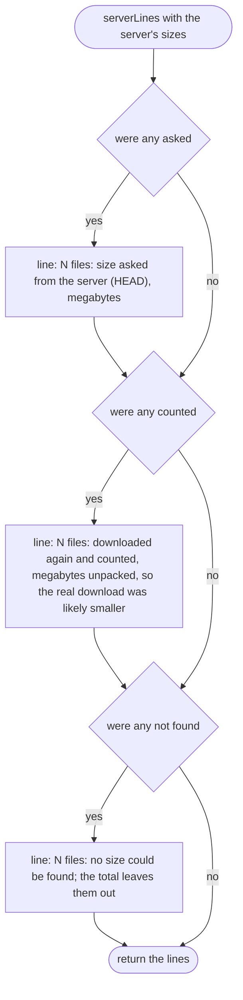

## measureReportLines

Why the game needs it: the numbers on screen, in words, with the warnings that make them honest.

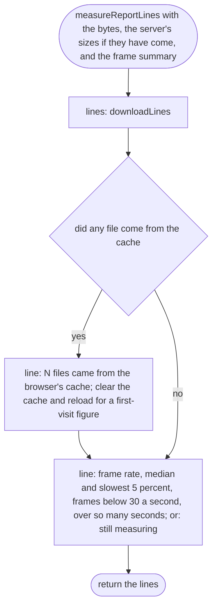
