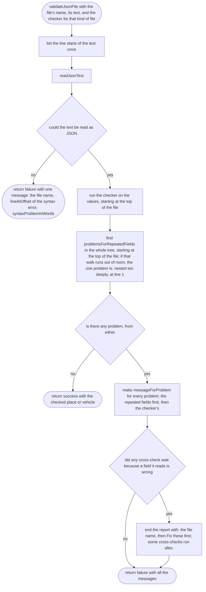
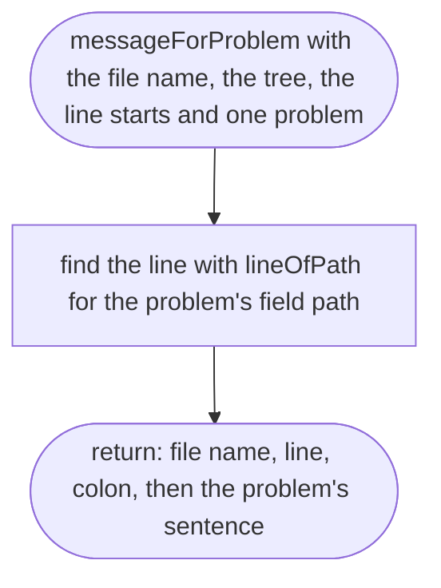

# src/place/check-file.ts

Status: approved. Judged by the delegated approver (docs/roles/approver.md, rounds in docs/reviews/002b/), with the owner's decisions of 2026-10-11.

New in scope 002b (items 2d, 2f, 2h, and E1: a field written twice). Checks one file from its name and raw text, the same way for places and vehicles, and turns every problem into a message that starts with the file and the line. The pictures drawn from the code will be in `docs/flows/src/place/check-file.md`.

## validateJsonFile

Why the game needs it: whoever writes a place file gets one report naming every mistake by file and line, whether the file is a place or a vehicle. A field written twice is reported in the same report, first, because it explains which copy the other messages are about.

## messageForProblem

Why the game needs it: every message reads the same way, `yaba.json line 12:` then the sentence, so the place-maker can jump straight to the line.

