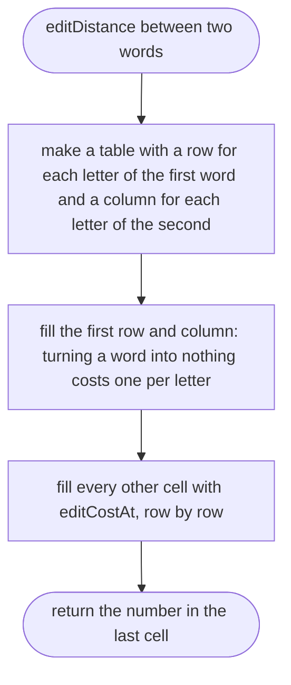
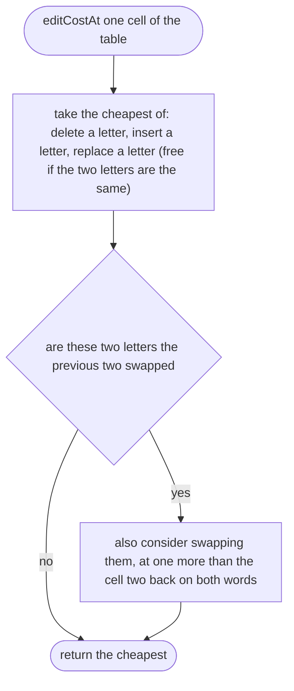
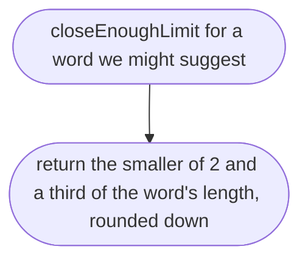
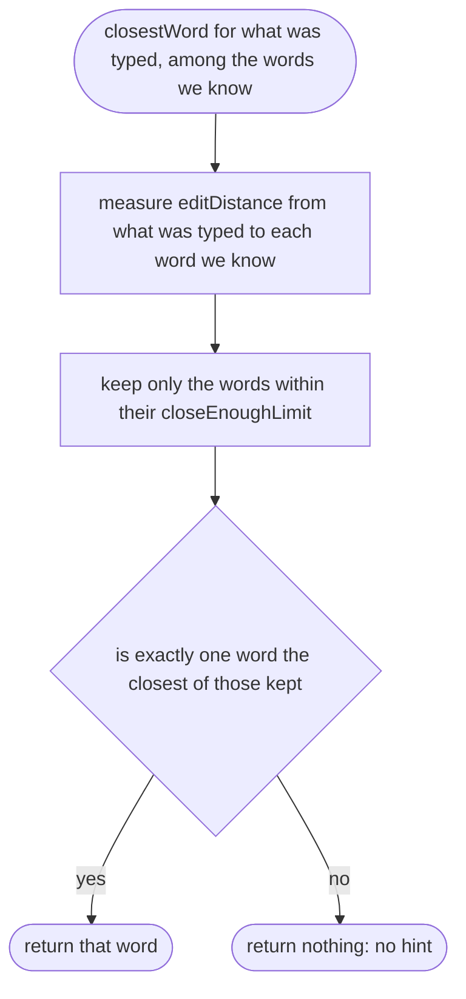

# src/place/closest-word.ts

Status: draft. Waiting for approval; the approval commit changes this line to `Status: approved`.

New in scope 002b (item 2b). Finds the word someone most likely meant, for "Did you mean `name`?". The distance is the optimal string alignment distance, the restricted form of Damerau–Levenshtein; the sources and their limits are in `research/33-json-lines.md`. The pictures drawn from the code will be in `docs/flows/src/place/closest-word.md`.

## editDistance

Why the game needs it: measures how many slips of the fingers turn what was typed into a word we know, so `nmae` is one slip from `name`.

## editCostAt

Why the game needs it: one step of the distance; it is what lets a swap of two neighbouring letters count as one slip, not two.

## closeEnoughLimit

Why the game needs it: a guess is only offered when it is very likely right; short words allow fewer slips, so `id` is never "corrected" to something else.

## closestWord

Why the game needs it: picks the one word to suggest, or none when nothing is close or two words are equally close, so the hint never sends someone the wrong way.

