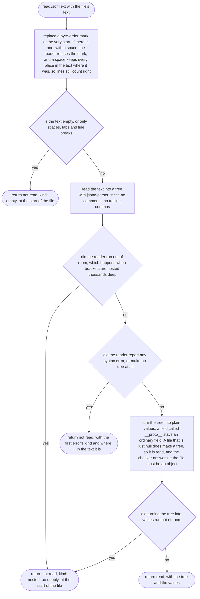
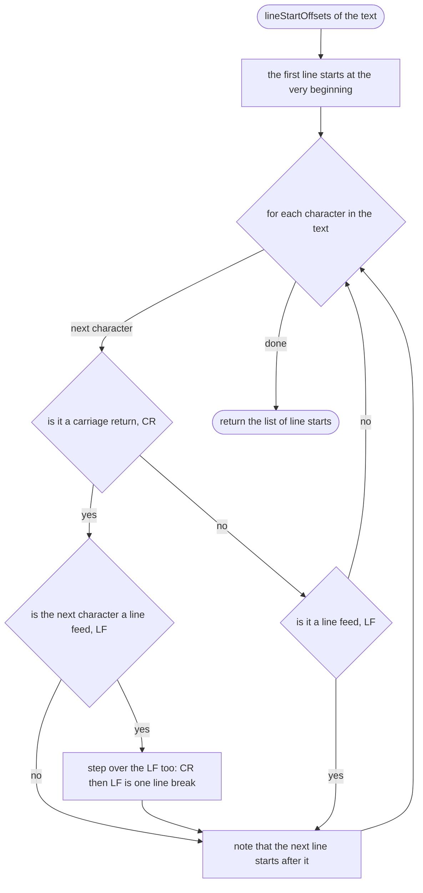
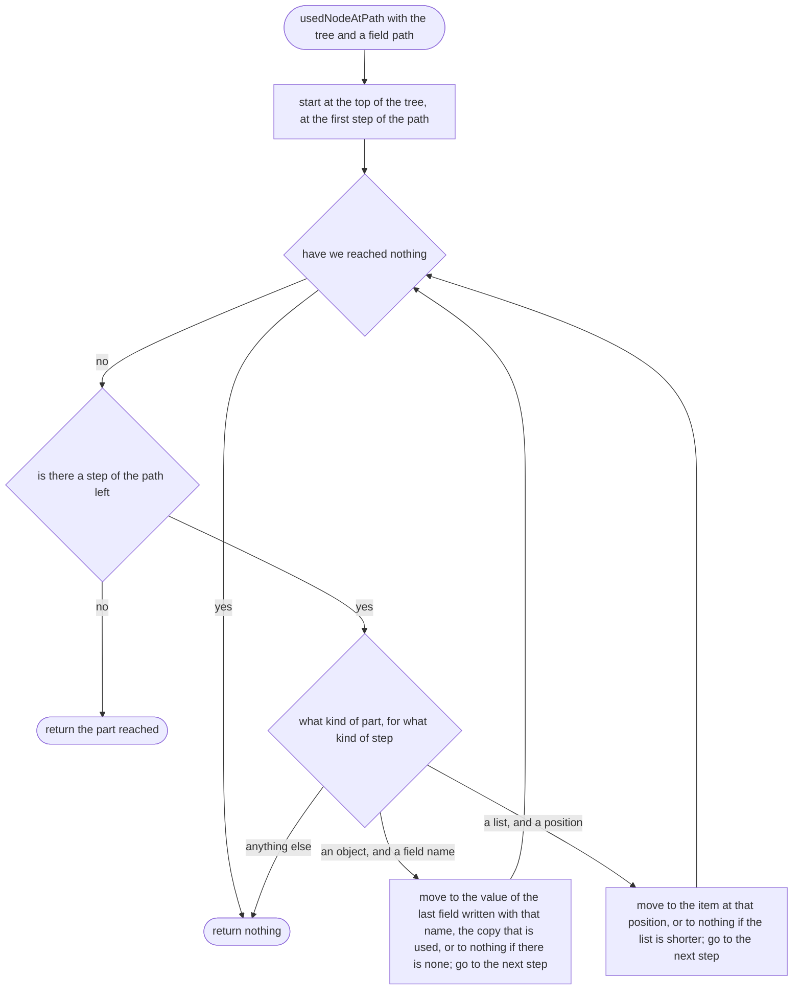
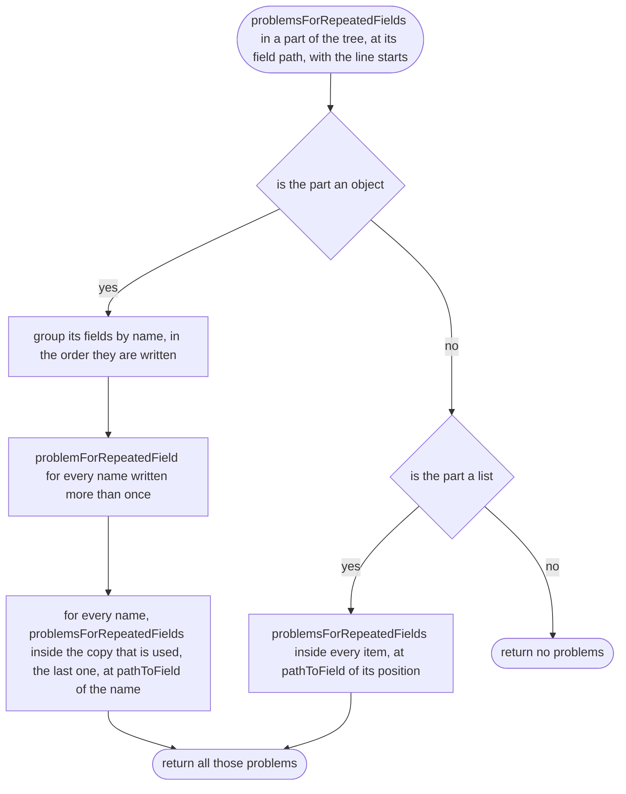
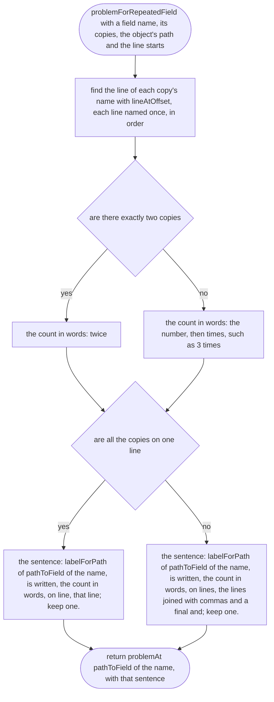
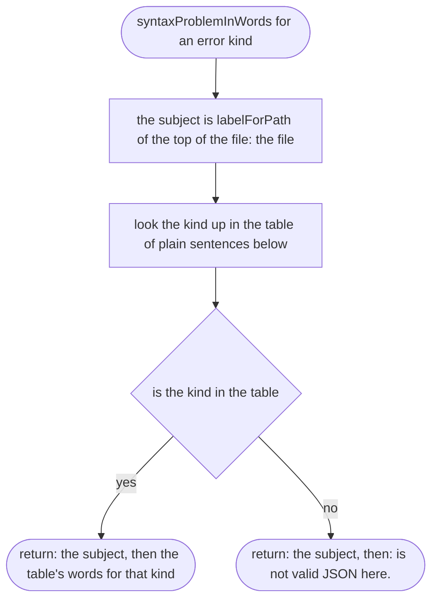

# src/place/json-text.ts

Status: approved. Judged by the delegated approver (docs/roles/approver.md, rounds in docs/reviews/002b/), with the owner's decisions of 2026-10-11.

New in scope 002b (item 2d). Reads the raw text of a place or vehicle file once, with jsonc-parser 3.3.1 (MIT, see `research/33-json-lines.md`), and keeps where every field sits so each message can name its line. The pictures drawn from the code will be in `docs/flows/src/place/json-text.md`.

Round 2 (after the approver's report): a byte-order mark, an empty file and a file nested too deeply are each handled; a line break is defined; every broken-JSON sentence is written out below; and a field written twice is reported, with every message pointing at the copy that is used. What jsonc-parser does in each case was run, not guessed: `research/33-json-lines.md`, "Round 2 measurements".

## readJsonText

Why the game needs it: a place-maker edits the file by hand, so a missing comma must come back as "line 7", not as a crash or a vague "bad file". A file the game can read must also pass here: the browser drops an invisible byte-order mark at the start of a file (Windows Notepad writes one), so we accept it too. Only "out of room" becomes the "nested too deeply" message; any other crash is a fault in our code and stays a crash, so it is seen and fixed.

## lineStartOffsets

Why the game needs it: finding a line must stay quick in a very large place file with many problems, so the line starts are listed once. A line break is what the place-maker's editor shows as one: CR then LF, `\r\n` (Windows), counts once, and LF `\n` alone (Mac, Linux) or CR `\r` alone (old Macs) count once each. Counting `\r` and `\n` separately would double every line number in a file saved on Windows. This is TypeScript's `computeLineStarts` (Apache-2.0, technique only), except that TypeScript also breaks lines at two rare Unicode characters (line separator and paragraph separator); we do not, because common editors keep those on the same line, and the line we name must be the line the place-maker sees.

## lineAtOffset

Why the game needs it: turns a place in the text into the line number the place-maker sees in their editor, counting from 1.

## lineOfPath

Why the game needs it: every message points at the line of the field it is about; a missing field points at the line where its object starts. For a field written twice, it points at the copy whose value is used (the last), so the line named is the line the checker read.

## usedNodeAtPath

Why the game needs it: when a field is written twice, the reader keeps the value of the last copy, so the line we name must be the last copy's too; otherwise a message about `98` would point at a line that says `9.8`. jsonc-parser's own `findNodeAtLocation` (MIT) finds the first copy; this is the same walk, technique only, taking the last.

## problemsForRepeatedFields

Why the game needs it: a field written twice (`"gravityMs2": 9.8` near the top, `"gravityMs2": 98` further down) is read as the last one with no word said, so the place-maker would never know which number the game uses. Like two players wearing the same shirt number: we name both and ask them to keep one. It looks in every object, including objects inside lists.

## problemForRepeatedField

Why the game needs it: one plain sentence names every line the field is written on, so the place-maker can find each copy: "`gravityMs2` is written twice, on lines 9 and 31; keep one." The message itself is put on the line of the copy that is used (line 31 here), like every other message about that field.

## syntaxProblemInWords

Why the game needs it: the reader's error codes ("CommaExpected") mean nothing to a place-maker; each one becomes a plain sentence that says what to fix. The subject comes from `labelForPath`, the one place that calls the top of the file "the file" (item 2d), so these messages name it the same way as every other message.

### The table of broken-JSON sentences

For the owner to read once. Every row was tried on jsonc-parser 3.3.1 with our strict settings (`research/33-json-lines.md`, "Round 2 measurements"); "Line named" says which line the message points at, because the reader often notices a mistake only after it.

A message reads `yaba.json line 8:` and then the words in the last column, which follow "the file". For example:

> yaba.json line 8: the file is not valid JSON here: a comma is missing before this point, at the end of the line above or earlier on this line. A number that starts with 0, such as `01`, or a list opened with `[` and not closed with `]`, also causes this.

| Kind (the reader's code) | When it happens | Line named | The file … |
| --- | --- | --- | --- |
| CommaExpected | A comma left out between two fields or two items. Also `01`, and a list whose `]` is missing before a `}`. | The **next** field's line, not the line missing the comma. | is not valid JSON here: a comma is missing before this point, at the end of the line above or earlier on this line. A number that starts with 0, such as `01`, or a list opened with `[` and not closed with `]`, also causes this. |
| ColonExpected | `"name" "Yaba"`, with no colon. | That line. | is not valid JSON here: a colon `:` is missing between a field's name and its value. |
| PropertyNameExpected | A comma after the last field before `}`, or two commas in a row. | The line of the `}` (usually the line after the extra comma). | is not valid JSON here: a field name in double quotes is expected here. If a comma just before this has no field after it, take that comma away. |
| ValueExpected | A field with no value (`"gravityMs2": ,`), or a comma after the last item of a list. | That line, or the line of the `]`. | is not valid JSON here: a value is expected: a number, text in double quotes, `true`, `false`, `null`, a list in `[ ]` or an object in `{ }`. If a comma just before this has nothing after it, take that comma away. |
| InvalidSymbol | Single quotes `'Yaba'`; curly quotes “Yaba” (from Word or a phone); a name with no quotes; `True`; `NaN`; `+1`; `.5`; `0x10`; a stray letter. | That line. | is not valid JSON here: something here is not allowed in JSON. Names and text need straight double quotes, `"like this"`, not single quotes or curly “ ” quotes; `true`, `false` and `null` are written in lower case; a number is plain digits, such as `9.8` or `0.5`. |
| InvalidNumberFormat | A number the reader cannot turn into a value. We could not make this happen; it has a sentence so no code is ever shown. | That line. | is not valid JSON here: this number cannot be read; write it in plain digits, such as `9.8`. |
| UnexpectedEndOfNumber | `1.` or `1e`. | That line. | is not valid JSON here: this number stops too soon, such as `1.` or `1e`; finish it (`1.5`) or take off the last character (`1`). |
| UnexpectedEndOfString | Text with no closing `"`, or text that runs onto the next line. | The line where the text starts. | is not valid JSON here: text that starts here is never closed with a `"`. Text must start and end with a double quote on the same line. |
| InvalidCharacter | A tab or another invisible control character inside text, often pasted in. | That line. | is not valid JSON here: this text holds a tab or another invisible character that is not allowed between quote marks; delete it (write a tab as `\t` if you need one). |
| InvalidEscapeCharacter | A backslash followed by a letter JSON does not know, such as `"C:\places"`. | That line. | is not valid JSON here: a backslash `\` in this text is followed by a letter JSON does not know. To write a backslash itself, write two: `\\`. |
| InvalidUnicode | A broken `\u` code, such as `\u12G4`. | That line. | is not valid JSON here: a `\u` code in this text needs exactly four characters from 0 to 9 and a to f, such as `\u00e9`; or type the letter itself, such as `é`. |
| CloseBraceExpected | A `{` never closed with `}`. | The **last** line of the file, far from the open `{`. | is not valid JSON here: a `{` opened earlier is never closed with `}`. This is only noticed at the end of the file, so the missing `}` can be anywhere above; check that every `{` has its `}`. |
| CloseBracketExpected | A `[` never closed with `]`, at the end of the file. | The **last** line of the file. | is not valid JSON here: a list opened earlier with `[` is never closed with `]`. This is only noticed at the end of the file, so the missing `]` can be anywhere above; check that every `[` has its `]`. |
| EndOfFileExpected | Something after the last `}`: an extra `}`, or a second object. | The line where the extra part starts. | is not valid JSON here: the file should end before this. A file holds one object, from its first `{` to its matching `}`, and something comes after it, such as an extra `}` or a second object. |
| InvalidCommentToken | A comment, `// …` or `/* … */`. | That line. | is not valid JSON here: comments (`//` or `/* */`) are not allowed in this file; take the comment out. |
| UnexpectedEndOfComment | A `/*` comment never closed. With our strict reading the comment is refused first, so this should not appear; it has a sentence so no code is ever shown. | That line. | is not valid JSON here: a comment `/*` is never closed, and comments are not allowed in this file; take it out. |
| empty (ours) | The file is empty, or only spaces and blank lines. | Line 1. | is empty. A place or vehicle file starts with `{` and ends with `}`. |
| nested too deeply (ours) | Brackets inside brackets thousands deep, so the reader runs out of room (about 2,560 deep in Node 22; a browser may differ). | Line 1. | has brackets nested too deeply to read: thousands of `{` or `[` inside one another. A place or vehicle file needs only a few levels. |
| (any kind not in this table) | Only if a later jsonc-parser adds a new code. | Where the reader says. | is not valid JSON here. |

A byte-order mark at the start is no longer an error at all (see `readJsonText`), so it has no row.
