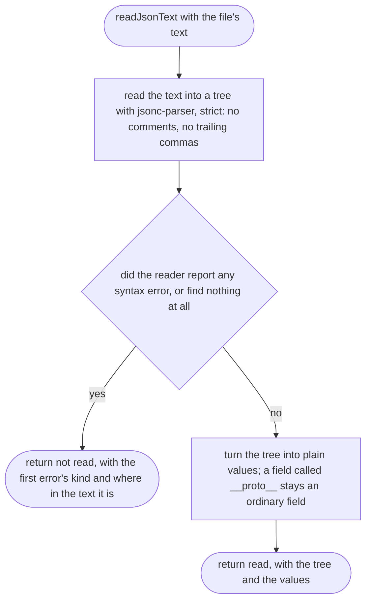
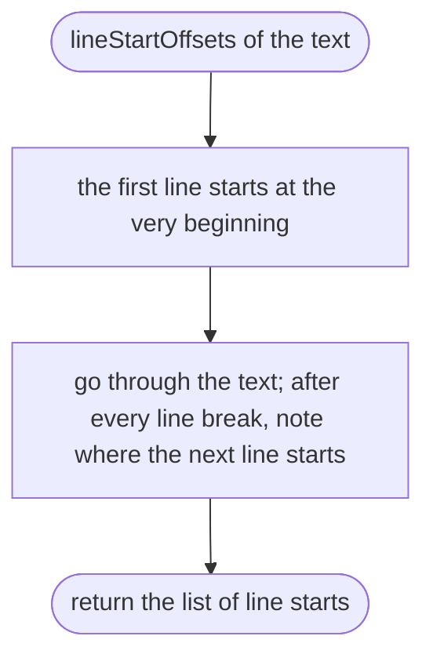
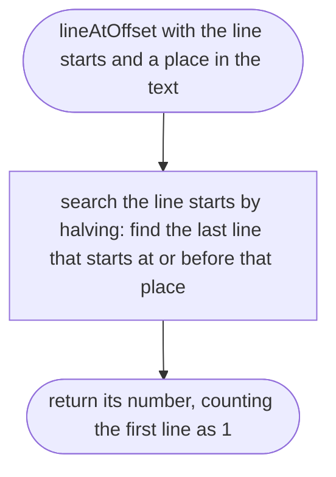
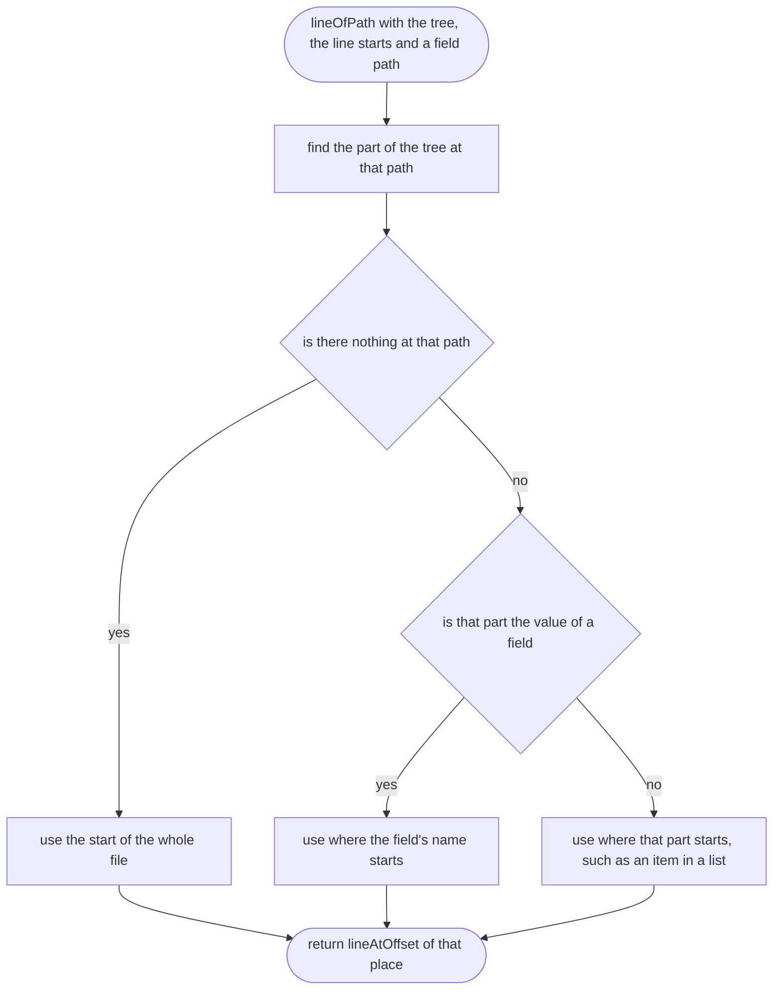
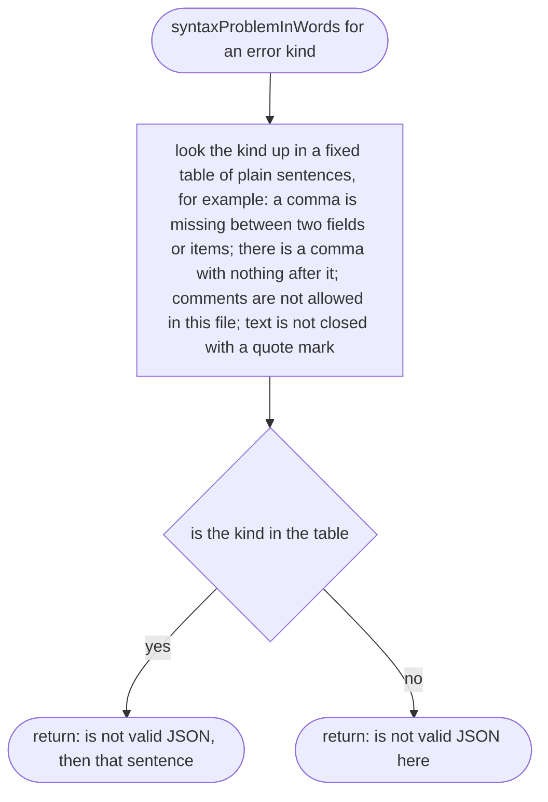

# src/place/json-text.ts

Status: draft. Waiting for approval; the approval commit changes this line to `Status: approved`.

New in scope 002b (item 2d). Reads the raw text of a place or vehicle file once, with jsonc-parser 3.3.1 (MIT, see `research/33-json-lines.md`), and keeps where every field sits so each message can name its line. The pictures drawn from the code will be in `docs/flows/src/place/json-text.md`.

## readJsonText

Why the game needs it: a place-maker edits the file by hand, so a missing comma must come back as "line 7", not as a crash or a vague "bad file".

## lineStartOffsets

Why the game needs it: finding a line must stay quick in a very large place file with many problems, so the line starts are listed once.

## lineAtOffset

Why the game needs it: turns a place in the text into the line number the place-maker sees in their editor, counting from 1.

## lineOfPath

Why the game needs it: every message points at the line of the field it is about; a missing field points at the line where its object starts.

## syntaxProblemInWords

Why the game needs it: the reader's error codes ("CommaExpected") mean nothing to a place-maker; each one becomes a plain sentence that says what to fix.

