# src/place/parse.ts

Status: draft. Waiting for approval; the approval commit changes this line to `Status: approved`.

The design for each function, written in plain words. The pictures drawn from the code are in `docs/flows/src/place/parse.md`.

Redrawn for scope 002b: new names (item 1) and the new behaviour (item 2). What changed, design by design, is in `CHANGES-002b.md` next to this file.

How the pieces fit, in plain words:

- A **checker** looks at one value at one **field path** (a list of field names and list positions, such as `skyPosition`, `lat`; the top of the file is the empty path). It returns either the value, or a list of **problems**. A problem is a field path and one sentence. The file name and line are added later, in one place (`check-file.md`), because only the whole file knows its lines.
- A failure also says whether some **cross-check waited** because a field it reads is wrong, so the report can end "Fix these first; some cross-checks run after."
- Names of fields and suggested words are shown in back-quotes, `like this`. A value that was found is shown as it is written in JSON, so the text `"9.8"` and the number `9.8` look different.
- A function inside another one (shown as `outer > inner`) is inside because it needs what the outer one was given (a range, a list of words, a shape).

## previewForError

Why the game needs it: a message quotes what was found without filling the screen when someone pastes a whole paragraph into a field.

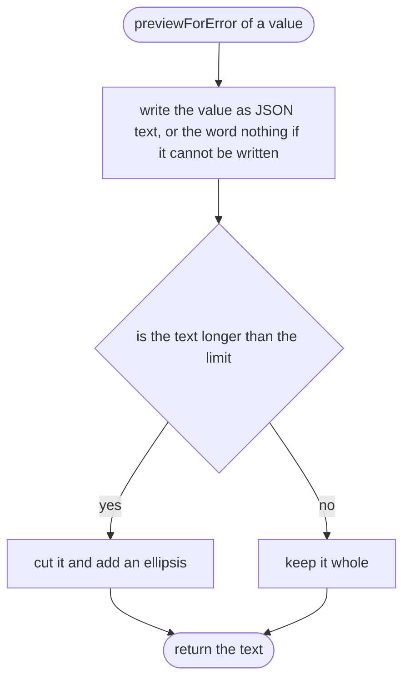

## accept

Why the game needs it: marks a value as checked and good, so it can be used.


## problemAt

Why the game needs it: every problem remembers which field it is about, so the line can be found for it later.

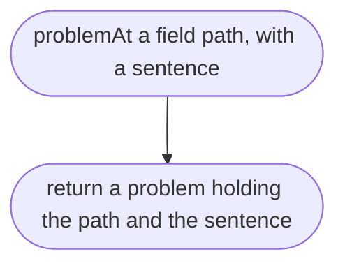

## reject

Why the game needs it: one sentence says what a field must be and what was found, with a hint only when the fix is obvious.

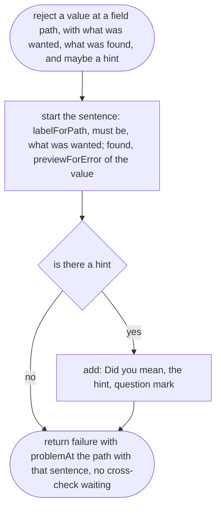

## labelForPath

Why the game needs it: the one and only place that decides the top of the file is called "the file"; every other field is named by its path.


## pathToField

Why the game needs it: names a field inside an object or a list, so its problems point to the right line.

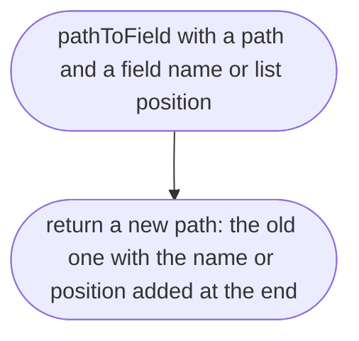

## requireText

Why the game needs it: a name or a note must actually say something.


## checkTextIsNotBlank

Why the game needs it: catches a field left as empty quotes or spaces.

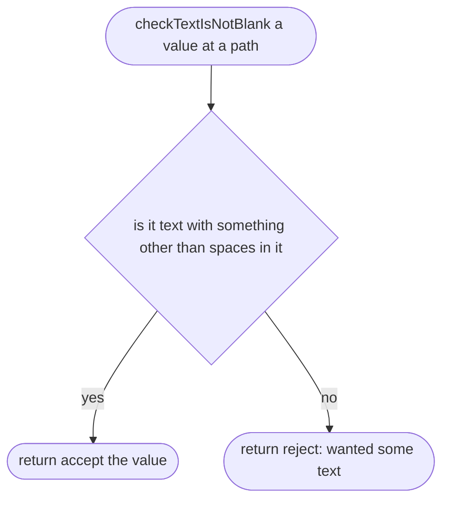

## requireTextMatching

Why the game needs it: some text has a set form, such as a web link or an id.

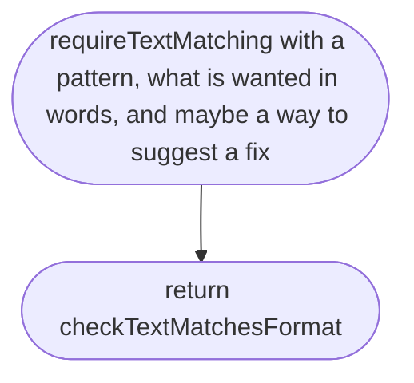

## requireTextMatching > checkTextMatchesFormat

Why the game needs it: says what form the text must take and, when the fix is obvious, offers it.


## requireNumberBetween

Why the game needs it: physical numbers like gravity must be real numbers in a sensible range, in a stated unit.


## requireNumberBetween > checkNumberInRange

Why the game needs it: says the range and the unit, and catches the common slip of a misplaced decimal point.

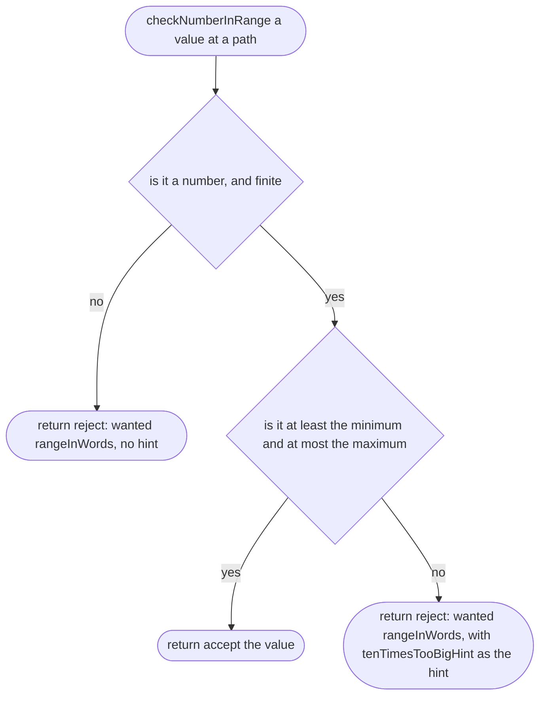

## rangeInWords

Why the game needs it: the place-maker sees the range and the unit together, such as "a number from 1 to 30 m/s²".

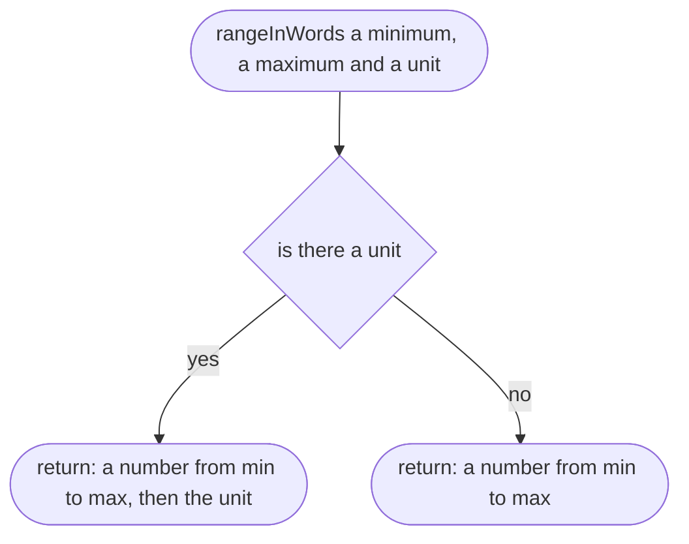

## tenTimesTooBigHint

Why the game needs it: 98 for gravity is almost always 9.8 with the point in the wrong place; we say so, and only then.

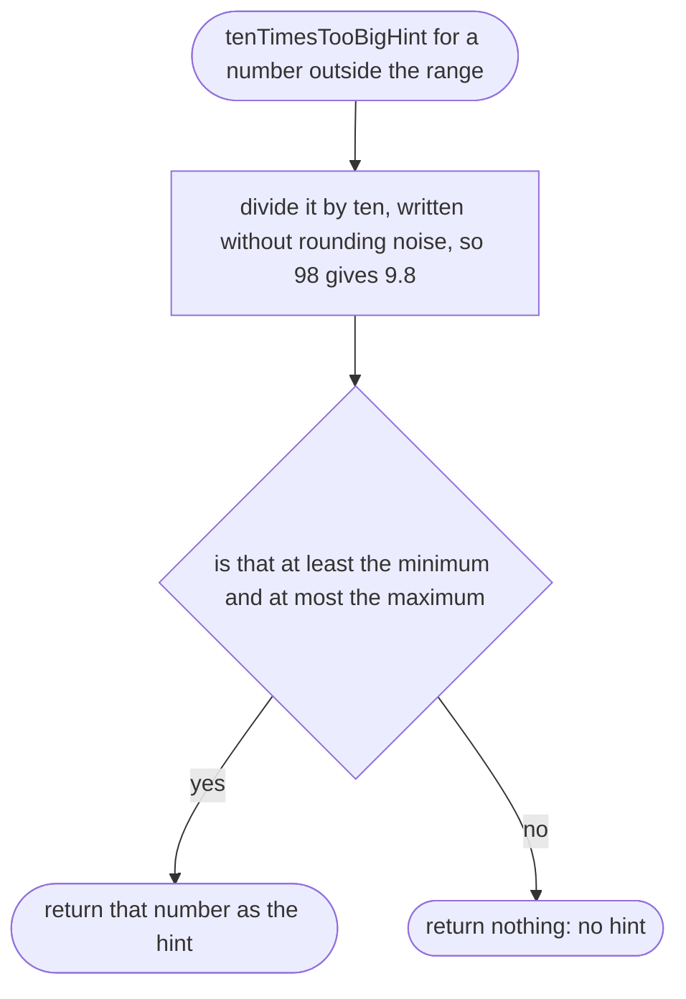

## requireOneOf

Why the game needs it: some fields take one word from a fixed list, such as the driving side.


## requireOneOf > isAllowedWord

Why the game needs it: says whether a value is exactly one of the allowed words.


## requireOneOf > checkIsAllowedWord

Why the game needs it: lists the allowed words and, for a typing slip like `rihgt`, offers the word that was meant.


## requireListOf

Why the game needs it: lists like data sources must hold enough items, each checked the same way.

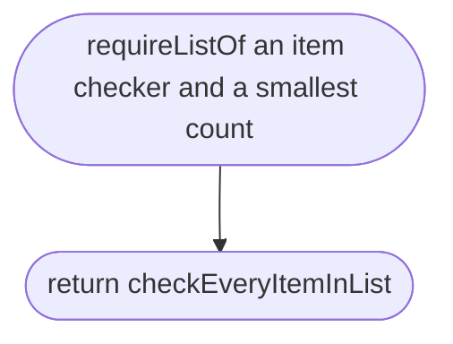

## requireListOf > checkEveryItemInList

Why the game needs it: says how many items were found against how many are needed, and checks every item, not just the first bad one.

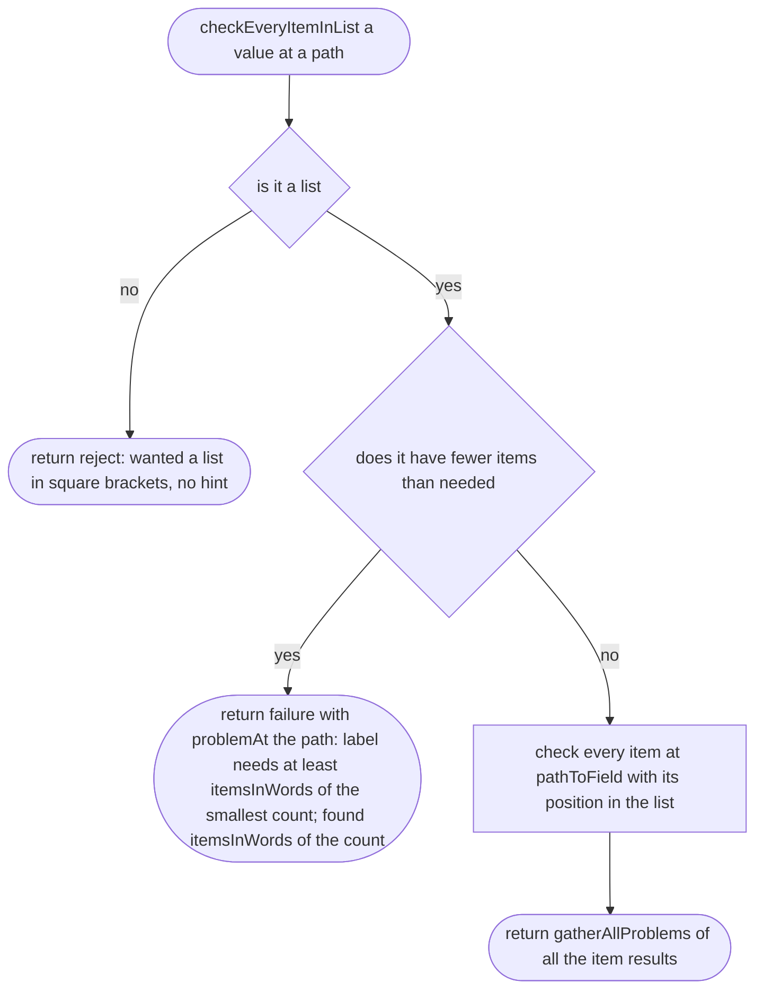

## itemsInWords

Why the game needs it: "1 item" and "3 items" read as English, not "1 item(s)".

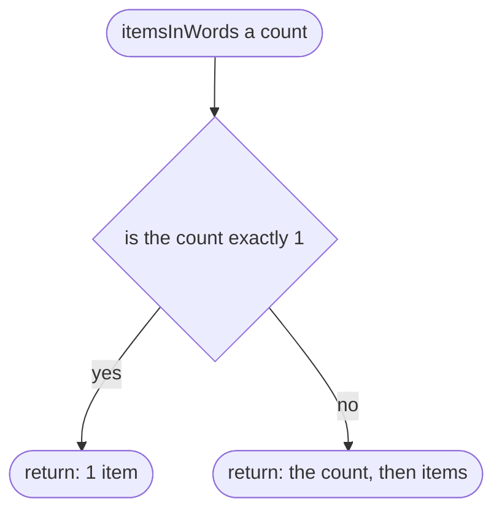

## gatherAllProblems

Why the game needs it: one inspection reports every problem in a list or a file, not just the first.

```mermaid
flowchart TD
  s(["gatherAllProblems from several check results"])
  a["collect the problems of every result with problemsFromOneCheck"]
  b{"is there any problem"}
  c(["return failure with all the problems; a cross-check waited if any result says so"])
  d(["return accept the list of values, with valueFromOneCheck"])
  s --> a
  a --> b
  b -->|"yes"| c
  b -->|"no"| d
```

## problemsFromOneCheck

Why the game needs it: picks the problems out of one result.

```mermaid
flowchart TD
  s(["problemsFromOneCheck one result"])
  a{"did it fail"}
  b(["return its problems"])
  c(["return no problems"])
  s --> a
  a -->|"yes"| b
  a -->|"no"| c
```

## valueFromOneCheck

Why the game needs it: picks the checked value out of one result.

```mermaid
flowchart TD
  s(["valueFromOneCheck one result"])
  a{"did it pass"}
  b(["return a list holding its value"])
  c(["return an empty list"])
  s --> a
  a -->|"yes"| b
  a -->|"no"| c
```

## isRecord

Why the game needs it: tells an object with fields apart from a list, a number or nothing.

```mermaid
flowchart TD
  s(["isRecord a value"])
  a(["return true only for an object, never nothing, never a list"])
  s --> a
```

## missingFields

Why the game needs it: finds every field the file should have and does not, by the file's own fields only, so a word like `constructor` is never mistaken for a field.

```mermaid
flowchart TD
  s(["missingFields of a record, for a shape"])
  a(["return every field name of the shape that the record does not have as its own field"])
  s --> a
```

## unknownFieldsWithGuesses

Why the game needs it: a misspelt field such as `nmae` is matched to the field that was meant, `name`, instead of being ignored.

```mermaid
flowchart TD
  s(["unknownFieldsWithGuesses for a record, a shape and the missing fields"])
  a["take every own field of the record that is not an own field of the shape, including constructor, toString and __proto__"]
  b(["return each one with closestWord to it among the missing fields, or no guess"])
  s --> a
  a --> b
```

## problemsForUnknownFields

Why the game needs it: one message per unknown field; the full list of fields only when nothing was close.

```mermaid
flowchart TD
  s(["problemsForUnknownFields with the unknown fields and their guesses, the shape and the path"])
  a["for each unknown field, at pathToField of its name"]
  b{"does it have a guess"}
  c["problemAt: label is not a field. Did you mean, the guess in back-quotes?"]
  d["problemAt: label is not a field here, then the fields are, every field of the shape"]
  e(["return all those problems"])
  s --> a
  a --> b
  b -->|"yes"| c
  b -->|"no"| d
  c --> e
  d --> e
```

## problemsForMissingFields

Why the game needs it: says plainly that a field is missing, and stays quiet when the "Did you mean" message already covers it.

```mermaid
flowchart TD
  s(["problemsForMissingFields with the missing fields, the guesses and the path of the object"])
  a["leave out every missing field that some unknown field guessed"]
  b(["return, for each one left, problemAt the object's path: label of the field is missing"])
  s --> a
  a --> b
```

## requireRecord

Why the game needs it: a place file, and parts of it like the sky position, are objects with a known set of fields.

```mermaid
flowchart TD
  s(["requireRecord a shape: each field name with its checker"])
  a(["return checkRecord"])
  s --> a
```

## requireRecord > checkRecord

Why the game needs it: checks every field at once and reports misspelt, unknown, missing and wrong fields together.

```mermaid
flowchart TD
  s(["checkRecord a value at a path"])
  a{"isRecord"}
  b(["return reject: wanted an object in curly brackets, no hint"])
  c["find missingFields, then unknownFieldsWithGuesses"]
  d["check every field the record has, with its own checker, at pathToField of its name"]
  e["put together: problemsForUnknownFields, problemsForMissingFields, and problemsFromOneField of every field checked"]
  f{"is there any problem"}
  g(["return failure with all the problems; a cross-check waited if any field says so"])
  h(["return accept the object built from nameAndValueFromOneField of every field"])
  s --> a
  a -->|"no"| b
  a -->|"yes"| c
  c --> d
  d --> e
  e --> f
  f -->|"yes"| g
  f -->|"no"| h
```

## problemsFromOneField

Why the game needs it: picks the problems out of one field's result.

```mermaid
flowchart TD
  s(["problemsFromOneField one field's result"])
  a{"did it fail"}
  b(["return its problems"])
  c(["return no problems"])
  s --> a
  a -->|"yes"| b
  a -->|"no"| c
```

## nameAndValueFromOneField

Why the game needs it: picks the field's name and checked value out of one field's result.

```mermaid
flowchart TD
  s(["nameAndValueFromOneField one field's result"])
  a{"did it pass"}
  b(["return a list holding the name with its value"])
  c(["return an empty list"])
  s --> a
  a -->|"yes"| b
  a -->|"no"| c
```

## addCrossFieldRule

Why the game needs it: some rules read several fields together (a bike cannot be a boat); they belong to the object they read.

```mermaid
flowchart TD
  s(["addCrossFieldRule with a shape, the fields the rule reads, and the rule"])
  a["make the plain checker with requireRecord of the shape"]
  b(["return checkFieldsThenRule"])
  s --> a
  a --> b
```

## addCrossFieldRule > checkFieldsThenRule

Why the game needs it: a rule runs as soon as the fields it reads are good, alongside every other check, and every broken rule is listed in the same report.

```mermaid
flowchart TD
  s(["checkFieldsThenRule a value at a path"])
  a["run the plain checker"]
  b{"did it pass"}
  c["run the rule on the checked object"]
  d{"did the rule find any problem"}
  e(["return the plain result"])
  f(["return failure with the rule's problems, each with the object's path put in front"])
  g["find valuesReadByRule"]
  h{"are all the fields the rule reads good"}
  i(["return failure with the plain problems and the rule's problems, the object's path put in front of the rule's"])
  j(["return failure with the plain problems, marked: a cross-check waited"])
  s --> a
  a --> b
  b -->|"yes"| c
  c --> d
  d -->|"no"| e
  d -->|"yes"| f
  b -->|"no"| g
  g --> h
  h -->|"yes"| i
  h -->|"no"| j
```

## valuesReadByRule

Why the game needs it: a rule only runs on fields that passed their own checks, so it never trips over a broken value.

```mermaid
flowchart TD
  s(["valuesReadByRule with a value, the shape, the fields the rule reads and the path"])
  a{"is the value a record"}
  b(["return nothing: the rule must wait"])
  c["check each field the rule reads with its own checker from the shape, if the record has it as its own field"]
  d{"is every one of them present and good"}
  e(["return those fields with their checked values"])
  s --> a
  a -->|"no"| b
  a -->|"yes"| c
  c --> d
  d -->|"yes"| e
  d -->|"no"| b
```

## requireShortId

Why the game needs it: ids join files together (a place names its road rules by id), so they must be short and written one way only.

```mermaid
flowchart TD
  s(["requireShortId"])
  a(["return requireTextMatching with the id rule: lower-case letters and digits, single dashes only between them, at most 32 characters; described in words with an example, `yaba`; suggester shortIdSuggestion"])
  s --> a
```

## shortIdSuggestion

Why the game needs it: `Yaba` and `omole phase 1` are near misses; we offer `yaba` and `omole-phase-1` so the fix is one copy and paste.

```mermaid
flowchart TD
  s(["shortIdSuggestion for some text"])
  a["make it lower case and take accents off letters, so Ọ̀yọ́ becomes oyo"]
  b["turn every run of characters that are not a letter or digit into one dash, and drop dashes at the start and end"]
  c{"does the result follow the id rule, and is it different from the text"}
  d(["return the result"])
  e(["return nothing: no suggestion, for example when it is still over 32 characters"])
  s --> a
  a --> b
  b --> c
  c -->|"yes"| d
  c -->|"no"| e
```
