# src/place/parse.ts

Status: draft

(Before scope 005: approved, judged by the delegated approver, docs/reviews/002c/, with the owner's decision of 2026-10-11. Scope 005 adds `requireNumberAbove` and `sourceCountProblem` at the end of this file; nothing above them changes.)

The design for each function, written in plain words. The pictures drawn from the code are in `docs/flows/src/place/parse.md`.

Redrawn for scope 002b: new names (item 1) and the new behaviour (item 2). What changed, design by design, is in `docs/reviews/002b/CHANGES.md`.

Changed for scope 002c: a number checked against a range no longer gets the ten-times hint (item 4; the hint moved to the planet check in `place.md`, the only place it is right); `tenTimesTooBigHint` leaves this file; two new checkers, `requireNumberAtLeast` and `requireKnownId`. What changed is in `docs/reviews/002c/CHANGES.md`.

How the pieces fit, in plain words:

- A **checker** looks at one value at one **field path** (a list of field names and list positions, such as `skyPosition`, `lat`; the top of the file is the empty path). It returns either the value, or a list of **problems**. A problem is a field path and one sentence. The file name and line are added later, in one place (`check-file.md`), because only the whole file knows its lines.
- A failure also says whether some **cross-check waited** because a field it reads is wrong, so the report can end "Fix these first; some cross-checks run after."
- Names of fields and suggested words are shown in back-quotes, `like this`. A value that was found is shown as it is written in JSON, so the text `"9.8"` and the number `9.8` look different.
- A function inside another one (shown as `outer > inner`) is inside because it needs what the outer one was given (a range, a list of words, a shape).

## previewForError

Why the game needs it: a message quotes what was found without filling the screen when someone pastes a whole paragraph into a field, and never shows a number the reader could not hold (such as `1e400`) as `null`, which would look like an empty field.

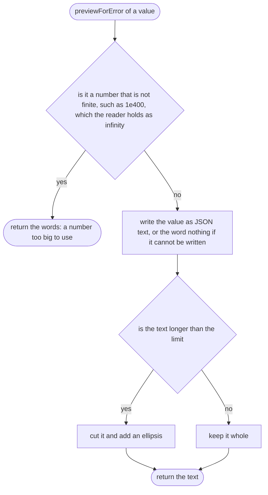

## accept

Why the game needs it: marks a value as checked and good, so it can be used.

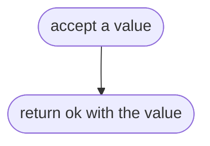

## problemAt

Why the game needs it: every problem remembers which field it is about, so the line can be found for it later.


## reject

Why the game needs it: one sentence says what a field must be and what was found, with a hint only when the fix is obvious.


## labelForPath

Why the game needs it: the one and only place that decides the top of the file is called "the file"; every other field is named by its path.

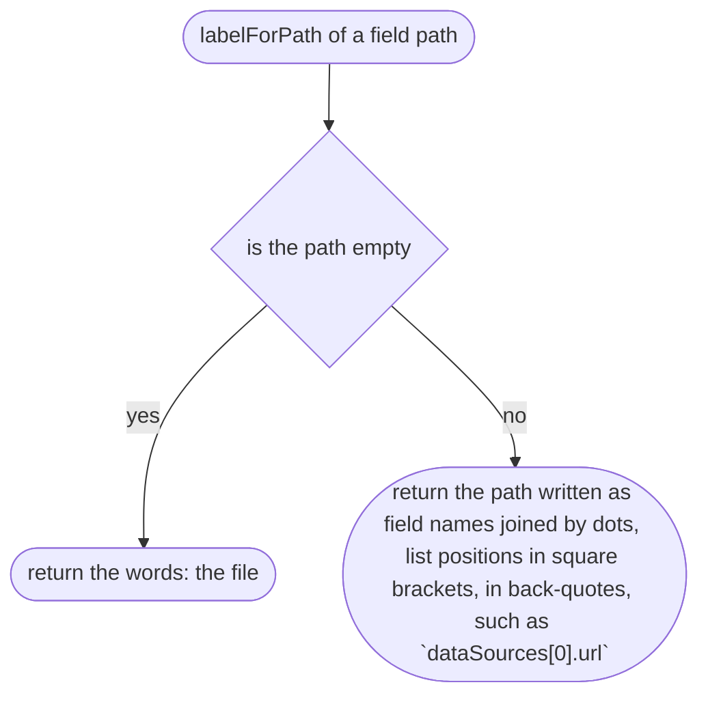

## pathToField

Why the game needs it: names a field inside an object or a list, so its problems point to the right line.


## requireText

Why the game needs it: a name or a note must actually say something.

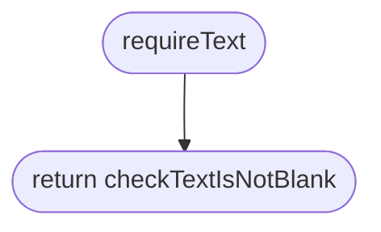

## checkTextIsNotBlank

Why the game needs it: catches a field left as empty quotes or spaces.


## requireTextMatching

Why the game needs it: some text has a set form, such as a web link or an id.


## requireTextMatching > checkTextMatchesFormat

Why the game needs it: says what form the text must take and, when the fix is obvious, offers it.

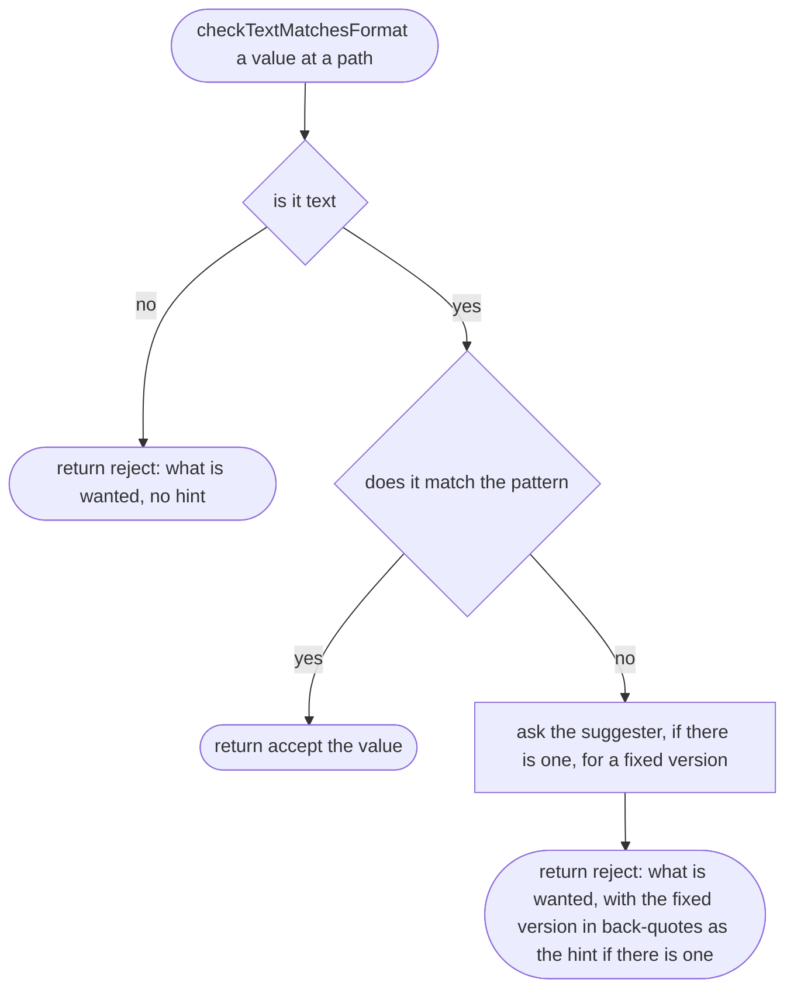

## requireNumberBetween

Why the game needs it: numbers with fixed limits, such as a latitude (−90 to 90 degrees), must be real numbers in that range, in a stated unit.

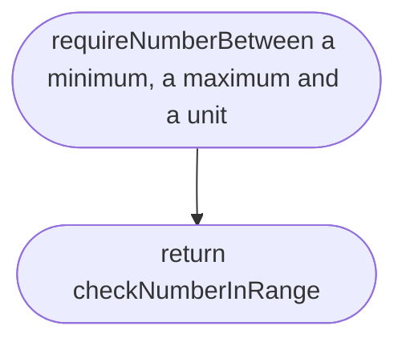

## requireNumberBetween > checkNumberInRange

Why the game needs it: says the range and the unit. It gives no "Did you mean": a latitude of 91 is not 9.1 with the point in the wrong place, and a wrong hint is worse than none (scope 002c, item 4). The hint for a slipped point is offered only for physics constants, against their planet's range (`place.md`, `decimalPointSlipHint`).

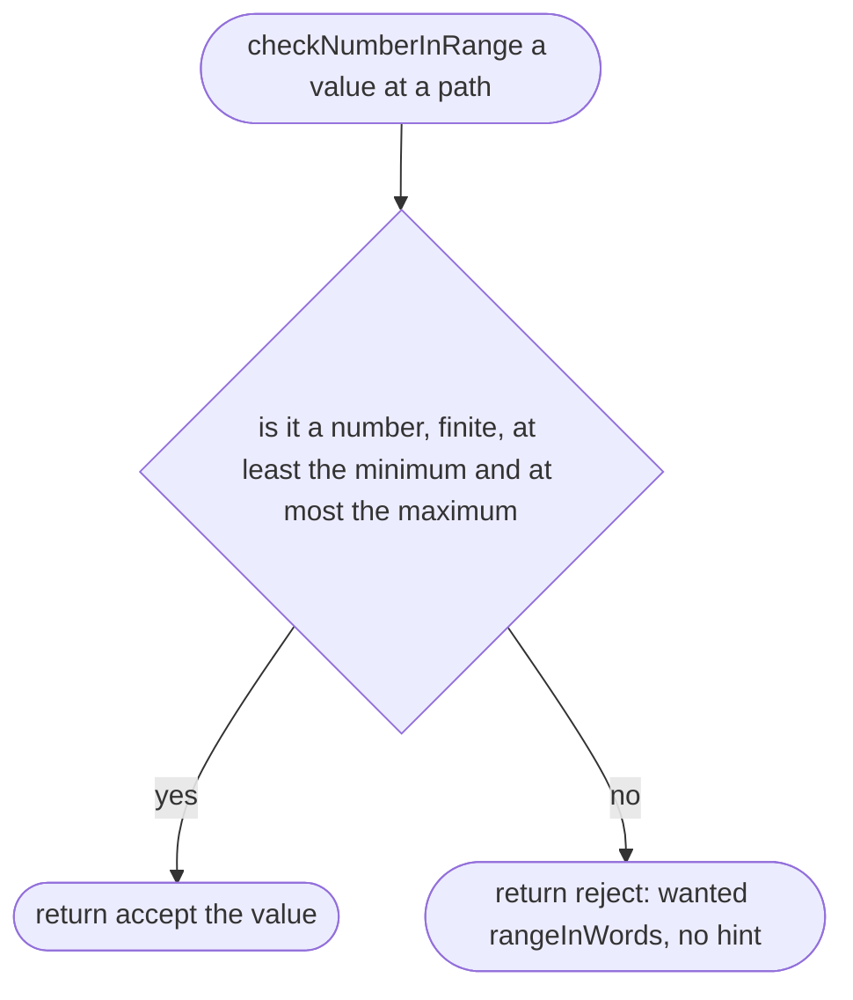

## requireNumberAtLeast

Why the game needs it: some numbers only have a floor of their own, such as a place's gravity (never below 0) whose real range comes from its planet, or a planet range's own `min` and `max`. A place's gravity of 980 must reach the planet check, which knows the right hint, instead of being stopped early by a made-up ceiling.

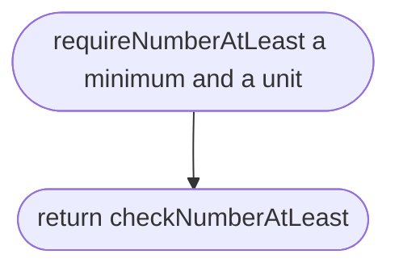

## requireNumberAtLeast > checkNumberAtLeast

Why the game needs it: says the floor and the unit, such as "a number of at least 0 m/s²", when the value is not a number (text such as `"9.8"`, or nothing) or is below the floor.

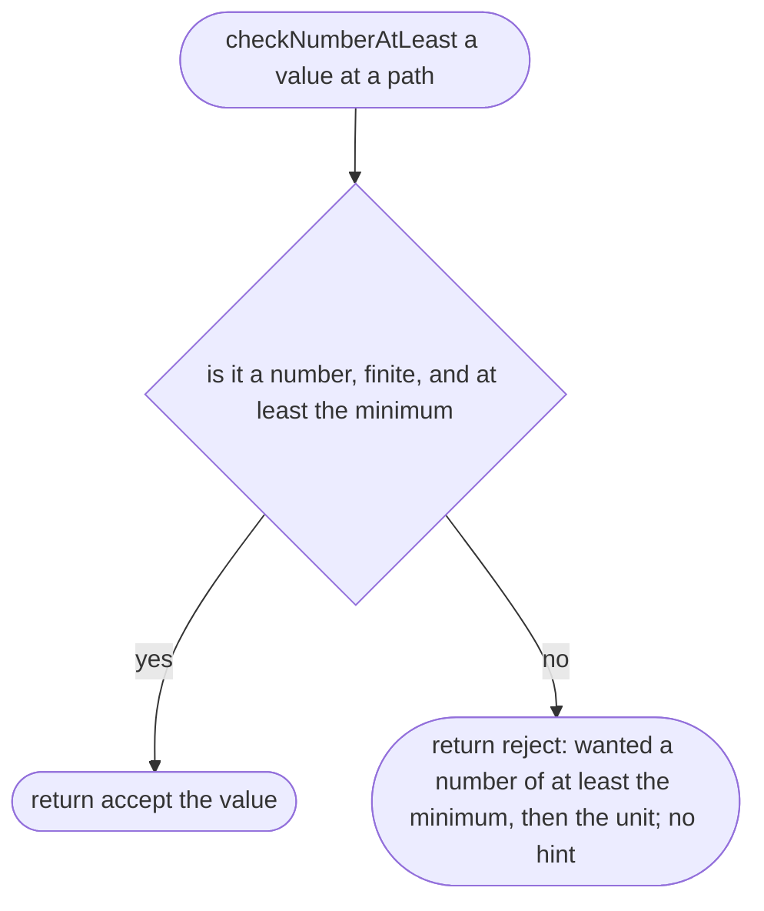

## rangeInWords

Why the game needs it: the place-maker sees the range and the unit together, such as "a number from -90 to 90 degrees".


## requireOneOf

Why the game needs it: some fields take one word from a fixed list, such as the driving side.

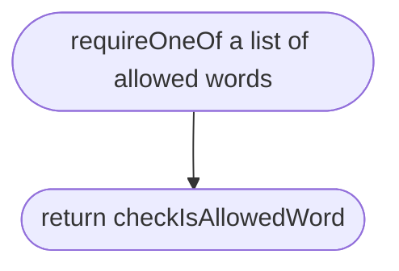

## requireOneOf > isAllowedWord

Why the game needs it: says whether a value is exactly one of the allowed words.

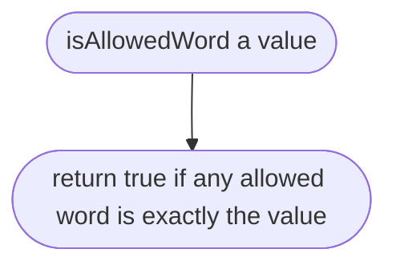

## requireOneOf > checkIsAllowedWord

Why the game needs it: lists the allowed words and, for a typing slip like `rihgt`, offers the word that was meant.

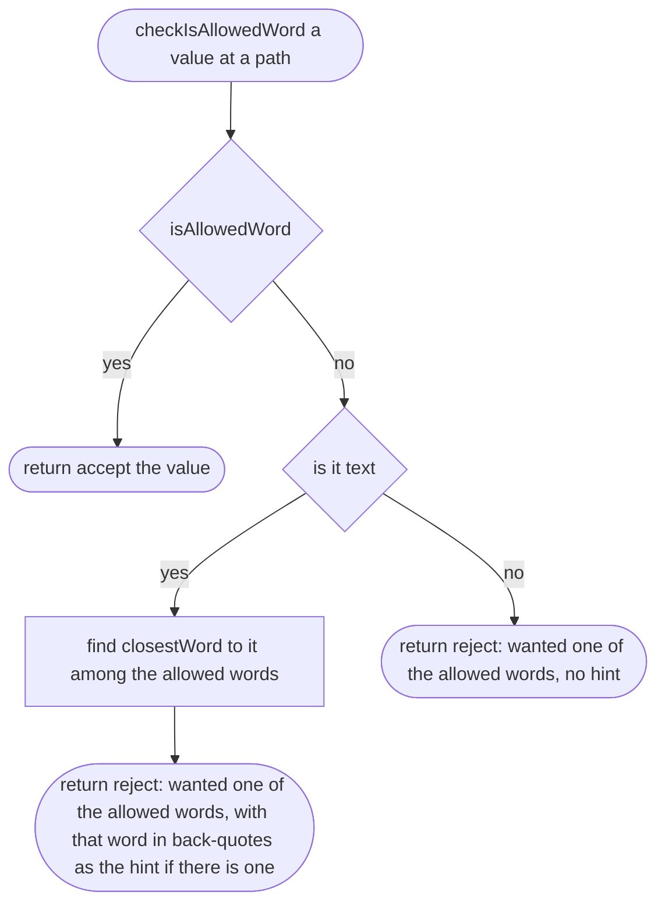

## requireKnownId

Why the game needs it: some ids name another file, such as a place's `planet` naming `planets/earth.json`. A slip there (`eart`) must be caught with a "Did you mean `earth`?", the same as a misspelt word, because a place on a planet that does not exist cannot be checked against anything. The kind of thing is given in words, one and many (`planet`, `planets`), so the message reads as English and the engine names no particular planet.

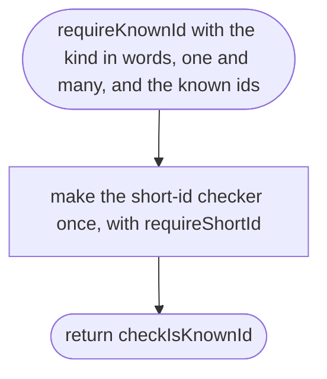

## requireKnownId > checkIsKnownId

Why the game needs it: first the id must be written the id way (so `Earth` gets "Did you mean `earth`?" from the id rule); then it must be one we know. The message says plainly that there is no such thing, offers the closest known id when there is exactly one close, and otherwise lists the known ids, so the place-maker can pick one. With none known at all it says so, rather than printing an empty list.

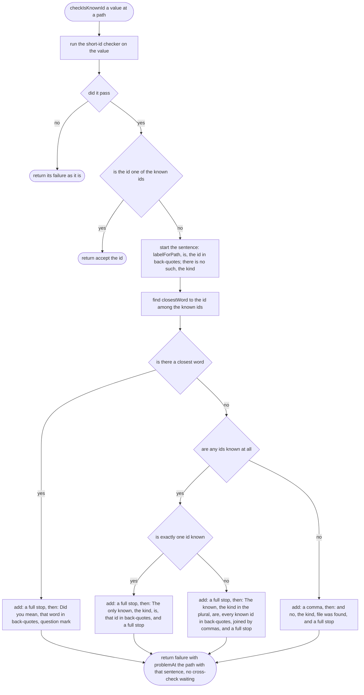

Examples, for a place's `planet`:

> yaba.json line 4: `planet` is `eart`; there is no such planet. Did you mean `earth`?
>
> yaba.json line 4: `planet` is `mars`; there is no such planet. The only known planet is `earth`.
>
> yaba.json line 4: `planet` is `earth`; there is no such planet, and no planet file was found.

## requireListOf

Why the game needs it: lists like data sources must hold enough items, each checked the same way.

```mermaid
flowchart TD
  s(["requireListOf an item checker and a smallest count"])
  a(["return checkEveryItemInList"])
  s --> a
```

## requireListOf > checkEveryItemInList

Why the game needs it: says how many items were found against how many are needed, and checks every item, not just the first bad one. A list that is too short still has its items checked, so the place-maker hears about a bad item in the same report, not on the next run.

```mermaid
flowchart TD
  s(["checkEveryItemInList a value at a path"])
  a{"is it a list"}
  b(["return reject: wanted a list in square brackets, no hint"])
  e["check every item at pathToField with its position in the list"]
  g["gatherAllProblems of all the item results"]
  c{"does it have fewer items than needed"}
  f(["return that gathered result"])
  d(["return failure with problemAt the path: label needs at least itemsInWords of the smallest count; found itemsInWords of the count. Then the items' problems from problemsFromOneCheck of the gathered result; a cross-check waited if the gathered result says so"])
  s --> a
  a -->|"no"| b
  a -->|"yes"| e
  e --> g
  g --> c
  c -->|"no"| f
  c -->|"yes"| d
```

## itemsInWords

Why the game needs it: "1 item" and "3 items" read as English, not "1 item(s)".

```mermaid
flowchart TD
  s(["itemsInWords a count"])
  a{"is the count exactly 1"}
  b(["return: 1 item"])
  c(["return: the count, then items"])
  s --> a
  a -->|"yes"| b
  a -->|"no"| c
```

## gatherAllProblems

Why the game needs it: one inspection reports every problem in a list or a file, not just the first.

```mermaid
flowchart TD
  s(["gatherAllProblems from several check results"])
  a["collect the problems of every result with problemsFromOneCheck"]
  b{"is there any problem"}
  c(["return failure with all the problems; a cross-check waited if any result says so"])
  d(["return accept the list of values, with valueFromOneCheck"])
  s --> a
  a --> b
  b -->|"yes"| c
  b -->|"no"| d
```

## problemsFromOneCheck

Why the game needs it: picks the problems out of one result.

```mermaid
flowchart TD
  s(["problemsFromOneCheck one result"])
  a{"did it fail"}
  b(["return its problems"])
  c(["return no problems"])
  s --> a
  a -->|"yes"| b
  a -->|"no"| c
```

## valueFromOneCheck

Why the game needs it: picks the checked value out of one result.

```mermaid
flowchart TD
  s(["valueFromOneCheck one result"])
  a{"did it pass"}
  b(["return a list holding its value"])
  c(["return an empty list"])
  s --> a
  a -->|"yes"| b
  a -->|"no"| c
```

## isRecord

Why the game needs it: tells an object with fields apart from a list, a number or nothing.

```mermaid
flowchart TD
  s(["isRecord a value"])
  a(["return true only for an object, never nothing, never a list"])
  s --> a
```

## missingFields

Why the game needs it: finds every field the file should have and does not, by the file's own fields only, so a word like `constructor` is never mistaken for a field.

```mermaid
flowchart TD
  s(["missingFields of a record, for a shape"])
  a(["return every field name of the shape that the record does not have as its own field"])
  s --> a
```

## unknownFieldsWithGuesses

Why the game needs it: a misspelt field such as `nmae` is matched to the field that was meant, `name`, instead of being ignored.

```mermaid
flowchart TD
  s(["unknownFieldsWithGuesses for a record, a shape and the missing fields"])
  a["take every own field of the record that is not an own field of the shape, including constructor, toString and __proto__"]
  b(["return each one with closestWord to it among the missing fields, or no guess"])
  s --> a
  a --> b
```

## problemsForUnknownFields

Why the game needs it: one message per unknown field; the full list of fields only when nothing was close.

```mermaid
flowchart TD
  s(["problemsForUnknownFields with the unknown fields and their guesses, the shape and the path"])
  a["for each unknown field, at pathToField of its name"]
  b{"does it have a guess"}
  c["problemAt: label is not a field. Did you mean, the guess in back-quotes?"]
  d["problemAt: label is not a field here, then the fields are, every field of the shape"]
  e(["return all those problems"])
  s --> a
  a --> b
  b -->|"yes"| c
  b -->|"no"| d
  c --> e
  d --> e
```

## problemsForMissingFields

Why the game needs it: says plainly that a field is missing, and stays quiet when the "Did you mean" message already covers it.

```mermaid
flowchart TD
  s(["problemsForMissingFields with the missing fields, the guesses and the path of the object"])
  a["leave out every missing field that some unknown field guessed"]
  b(["return, for each one left, problemAt the object's path: label of the field is missing"])
  s --> a
  a --> b
```

## requireRecord

Why the game needs it: a place file, and parts of it like the sky position, are objects with a known set of fields.

```mermaid
flowchart TD
  s(["requireRecord a shape: each field name with its checker"])
  a(["return checkRecord"])
  s --> a
```

## requireRecord > checkRecord

Why the game needs it: checks every field at once and reports misspelt, unknown, missing and wrong fields together.

```mermaid
flowchart TD
  s(["checkRecord a value at a path"])
  a{"isRecord"}
  b(["return reject: wanted an object in curly brackets, no hint"])
  c["find missingFields, then unknownFieldsWithGuesses"]
  d["check every field the record has, with its own checker, at pathToField of its name"]
  e["put together: problemsForUnknownFields, problemsForMissingFields, and problemsFromOneField of every field checked"]
  f{"is there any problem"}
  g(["return failure with all the problems; a cross-check waited if any field says so"])
  h(["return accept the object built from nameAndValueFromOneField of every field"])
  s --> a
  a -->|"no"| b
  a -->|"yes"| c
  c --> d
  d --> e
  e --> f
  f -->|"yes"| g
  f -->|"no"| h
```

## problemsFromOneField

Why the game needs it: picks the problems out of one field's result.

```mermaid
flowchart TD
  s(["problemsFromOneField one field's result"])
  a{"did it fail"}
  b(["return its problems"])
  c(["return no problems"])
  s --> a
  a -->|"yes"| b
  a -->|"no"| c
```

## nameAndValueFromOneField

Why the game needs it: picks the field's name and checked value out of one field's result.

```mermaid
flowchart TD
  s(["nameAndValueFromOneField one field's result"])
  a{"did it pass"}
  b(["return a list holding the name with its value"])
  c(["return an empty list"])
  s --> a
  a -->|"yes"| b
  a -->|"no"| c
```

## addCrossFieldRules

Why the game needs it: some rules read several fields together (a bike cannot be a boat); they belong to the object they read. One object can have several such rules (a place has two), so the rules come as a list and the object's own fields are checked only once.

```mermaid
flowchart TD
  s(["addCrossFieldRules with a shape and a list of rules, each rule with the fields it reads"])
  a["make the plain checker with requireRecord of the shape"]
  b(["return checkFieldsThenRules"])
  s --> a
  a --> b
```

## addCrossFieldRules > checkFieldsThenRules

Why the game needs it: the fields are checked once, then each rule runs as soon as the fields it reads are good, alongside every other check, and every broken rule is listed in the same report. A rule waiting for its fields never holds back another rule.

```mermaid
flowchart TD
  s(["checkFieldsThenRules a value at a path"])
  a["run the plain checker once"]
  b["for each rule, problemsFromOneRule with the plain result"]
  c["put together: problemsFromOneCheck of the plain result, then every rule's problems"]
  d{"is there any problem"}
  e(["return the plain result"])
  f(["return failure with all the problems; a cross-check waited if the plain result or any rule says so"])
  s --> a
  a --> b
  b --> c
  c --> d
  d -->|"no"| e
  d -->|"yes"| f
```

## addCrossFieldRules > problemsFromOneRule

Why the game needs it: one rule either runs, on fields that passed their own checks, or waits; it never runs on a broken value and never stops the other rules.

```mermaid
flowchart TD
  s(["problemsFromOneRule with one rule, the plain result, the value and its path"])
  a{"did the plain check pass"}
  b["run the rule on the checked object"]
  c["find valuesReadByRule for this rule"]
  d{"are all the fields the rule reads good"}
  e["run the rule on those fields"]
  f(["return no problems, marked: this cross-check waited"])
  g(["return the rule's problems, each with the object's path put in front, not waiting"])
  s --> a
  a -->|"yes"| b
  a -->|"no"| c
  c --> d
  d -->|"yes"| e
  d -->|"no"| f
  b --> g
  e --> g
```

## valuesReadByRule

Why the game needs it: a rule only runs on fields that passed their own checks, so it never trips over a broken value.

```mermaid
flowchart TD
  s(["valuesReadByRule with a value, the shape, the fields the rule reads and the path"])
  a{"is the value a record"}
  b(["return nothing: the rule must wait"])
  c["check each field the rule reads with its own checker from the shape, if the record has it as its own field"]
  d{"is every one of them present and good"}
  e(["return those fields with their checked values"])
  s --> a
  a -->|"no"| b
  a -->|"yes"| c
  c --> d
  d -->|"yes"| e
  d -->|"no"| b
```

## requireShortId

Why the game needs it: ids join files together (a place names its road rules by id), so they must be short and written one way only.

```mermaid
flowchart TD
  s(["requireShortId"])
  a(["return requireTextMatching with the id rule: letters a to z in lower case and digits 0 to 9, with single dashes only between them, at most 32 characters; described in words with an example, `yaba`; suggester shortIdSuggestion"])
  s --> a
```

## shortIdSuggestion

Why the game needs it: `Yaba` and `omole phase 1` are near misses; we offer `yaba` and `omole-phase-1` so the fix is one copy and paste. A suggestion is only offered when it keeps every letter: Hausa's hooked letters (`ɓ ɗ ƙ ƴ`), and letters such as `ø`, `ß` or `ł`, have no accent to take off, and dropping them would offer a wrong id (`Ɗanbatta` as `anbatta`). A wrong hint is worse than none.

```mermaid
flowchart TD
  s(["shortIdSuggestion for some text"])
  a["make it lower case and take accents off letters, so Ọ̀yọ́ becomes oyo"]
  x{"is any letter or digit left that is not a to z or 0 to 9, such as ɗ or ß"}
  b["turn every run of characters that are not a to z or 0 to 9 into one dash, and drop dashes at the start and end"]
  c{"does the result follow the id rule, and is it different from the text"}
  d(["return the result"])
  e(["return nothing: no suggestion, for example when it is still over 32 characters"])
  s --> a
  a --> x
  x -->|"yes"| e
  x -->|"no"| b
  b --> c
  c -->|"yes"| d
  c -->|"no"| e
```

## requireNumberAbove

New in scope 005. Why the game needs it: a car's mass, size or power of exactly 0 is never real and would divide by zero in the physics; "at least 0" is not enough, and a made-up ceiling would be a guess.

```mermaid
flowchart TD
  s(["requireNumberAbove a minimum and a unit"])
  a(["return checkNumberAbove"])
  s --> a
```

## requireNumberAbove > checkNumberAbove

Why the game needs it: says the floor and the unit, such as "a number above 0 kg", when the value is not a number or is not above the floor.

```mermaid
flowchart TD
  s(["checkNumberAbove a value at a path"])
  a{"is it a number, finite, and above the minimum"}
  b(["return accept the value"])
  c(["return reject: wanted a number above the minimum, then the unit; no hint"])
  s --> a
  a -->|"yes"| b
  a -->|"no"| c
```

## sourceCountProblem

New in scope 005, moved from `place.ts` (`sourceProblemForOneConstant`) so the place's constants and the vehicle's figures use one rule. Why the game needs it: the owner's data rule says each number has exactly one source.

```mermaid
flowchart TD
  s(["sourceCountProblem: one quantity, such as gravity or body.massKg, the list of sources, the list's field name, and the word for the thing (constant or figure)"])
  a["count the sources that name this quantity"]
  b{"how many"}
  c(["return a problem at the list: the list has no source for the quantity"])
  d(["return no problem"])
  e(["return a problem at the second source that names it: the list has that many sources for the quantity; each thing needs exactly one"])
  s --> a --> b
  b -->|"none"| c
  b -->|"exactly one"| d
  b -->|"more than one"| e
```
