# src/place/parse.ts

Status: draft. Waiting for the owner's approval; the approval commit changes this line to `Status: approved`.

The design for each function, written in plain words. The pictures drawn from the code are in `docs/flows/src/place/parse.md`.

## show

Turns any value into a short piece of text for an error message.

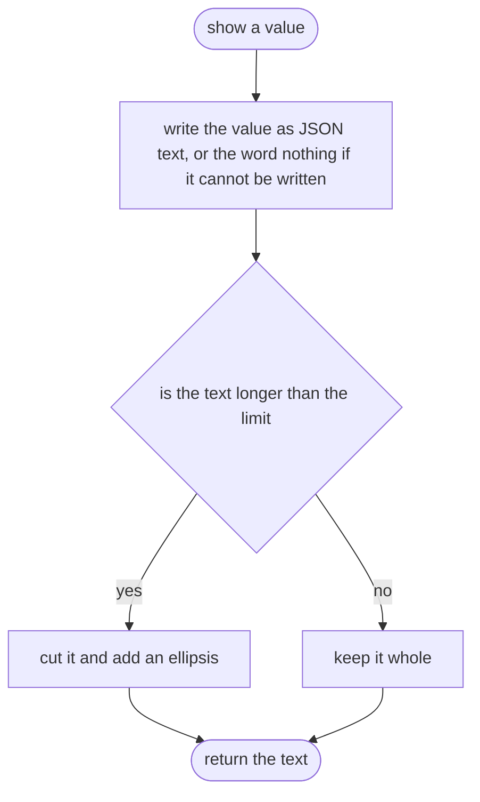

## good

Wraps a value as a success.

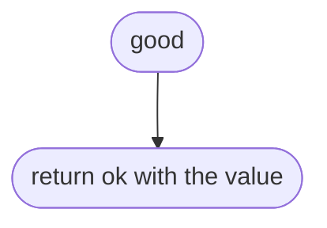

## bad

Builds a failure carrying one sentence: the path, what was wanted, what was got.

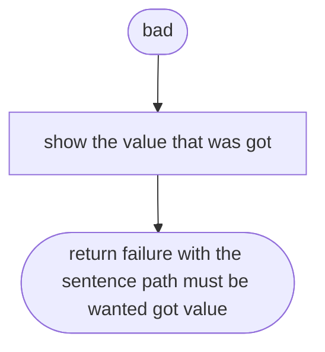

## someText

Builds a checker for text that is not blank.

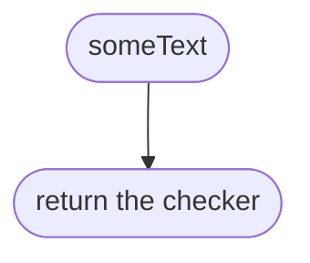

## someText > inner function 1

The checker.

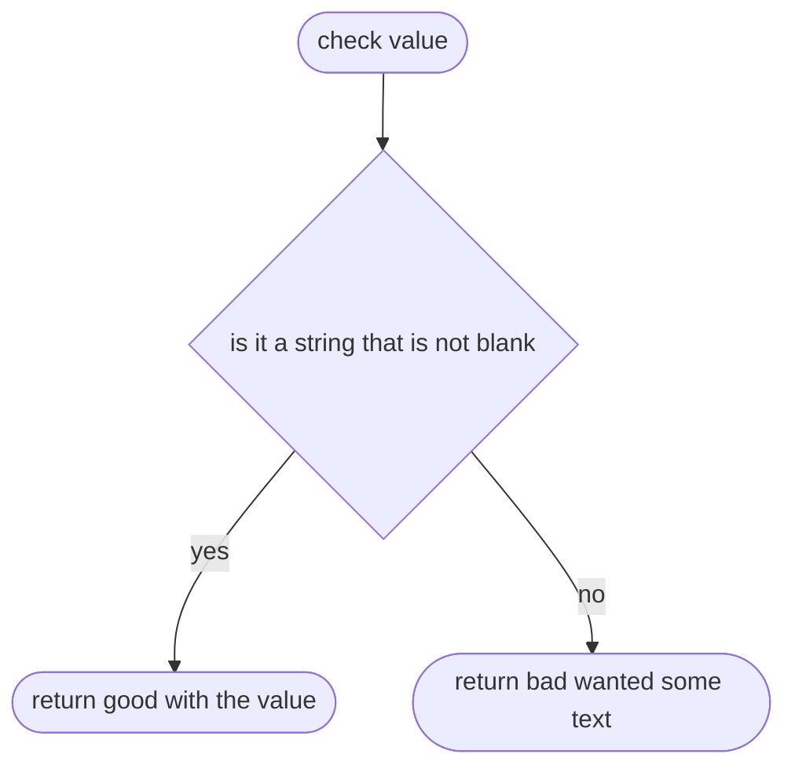

## textMatching

Builds a checker for text that matches a pattern.

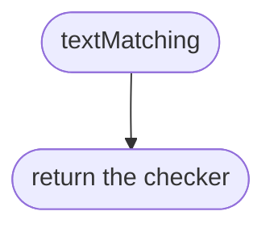

## textMatching > inner function 1

The checker.

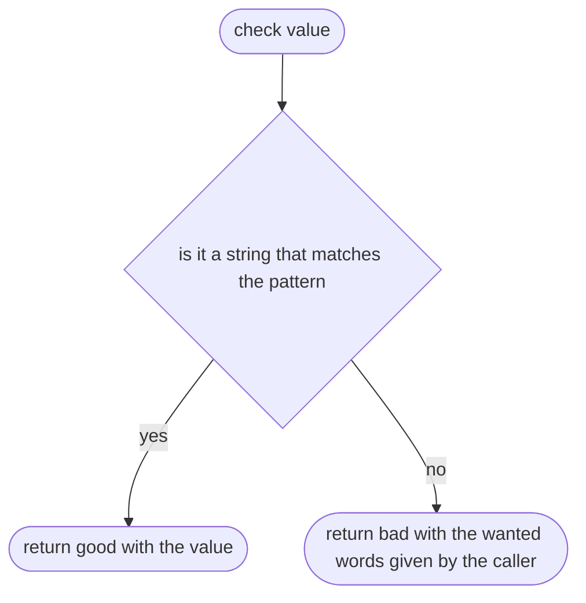

## numberBetween

Builds a checker for a real number inside a range.

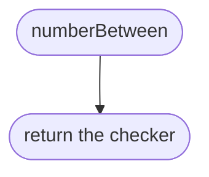

## numberBetween > inner function 1

The checker.

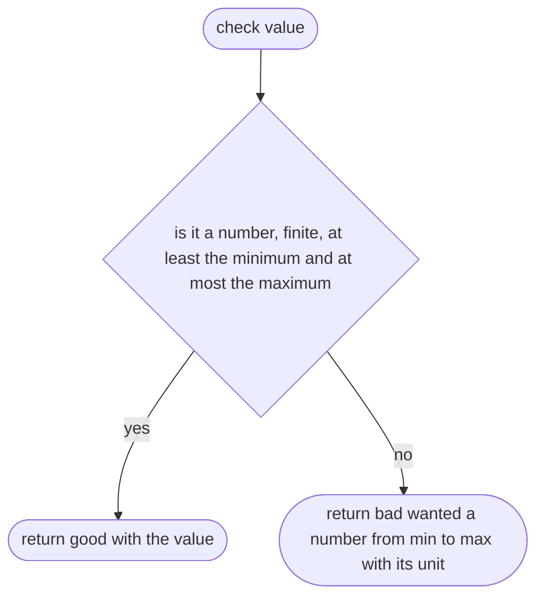

## oneOf

Builds a checker for one word out of a fixed list.

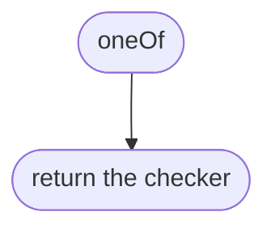

## oneOf > isOption

Says whether a value is one of the allowed words.

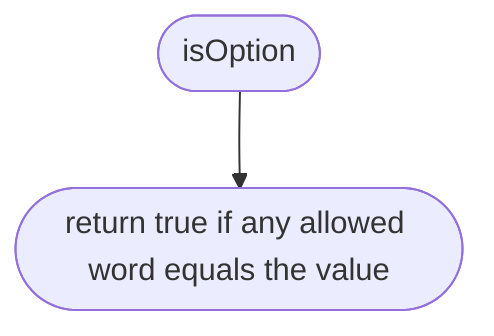

## oneOf > inner function 1

The checker.

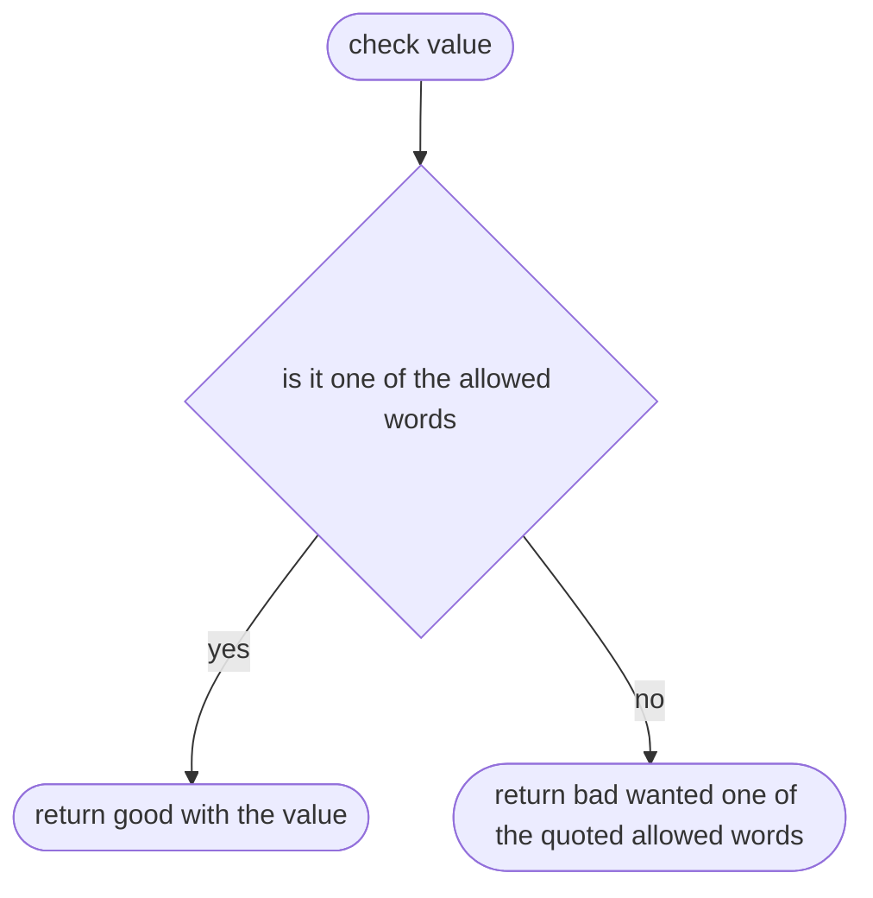

## listOf

Builds a checker for a list with at least a minimum number of items.

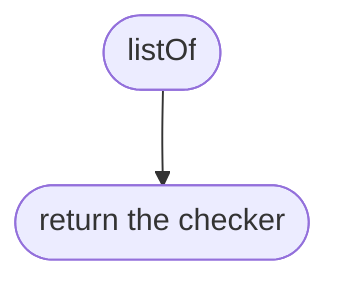

## listOf > inner function 1

The checker.

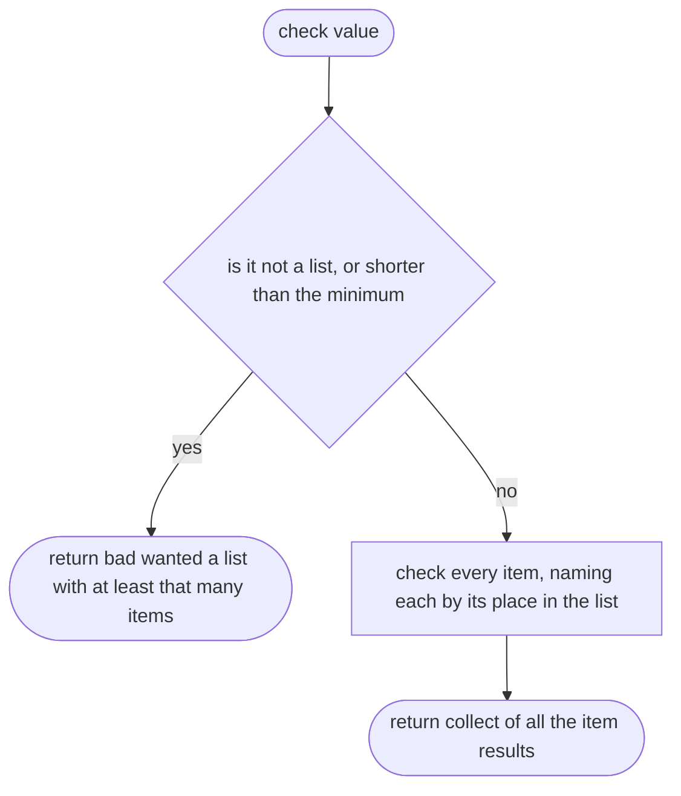

## collect

Joins the results of several checks into one.

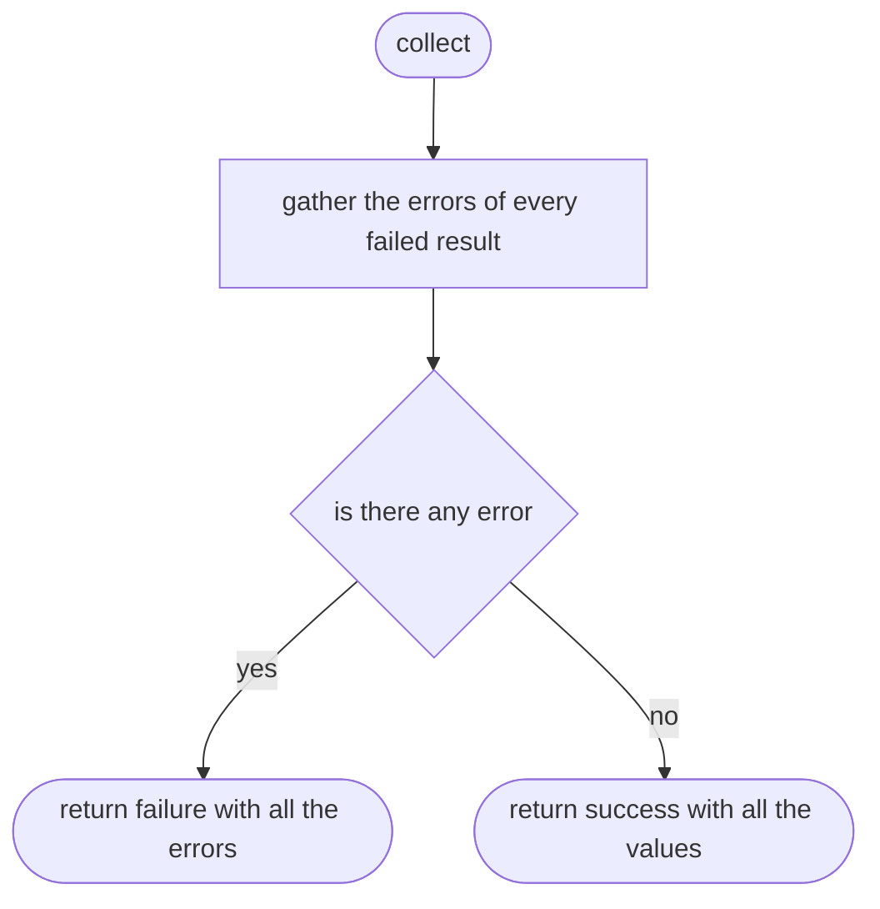

## collect > inner function 1

Picks the errors out of one result.

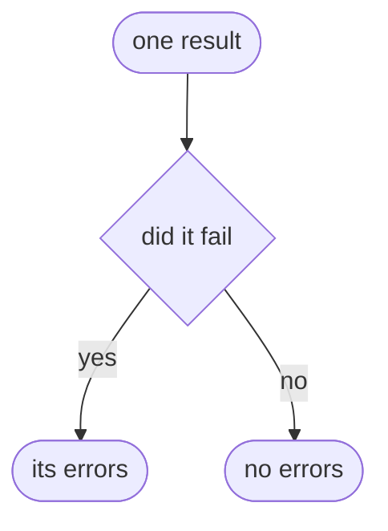

## collect > inner function 2

Picks the value out of one result.

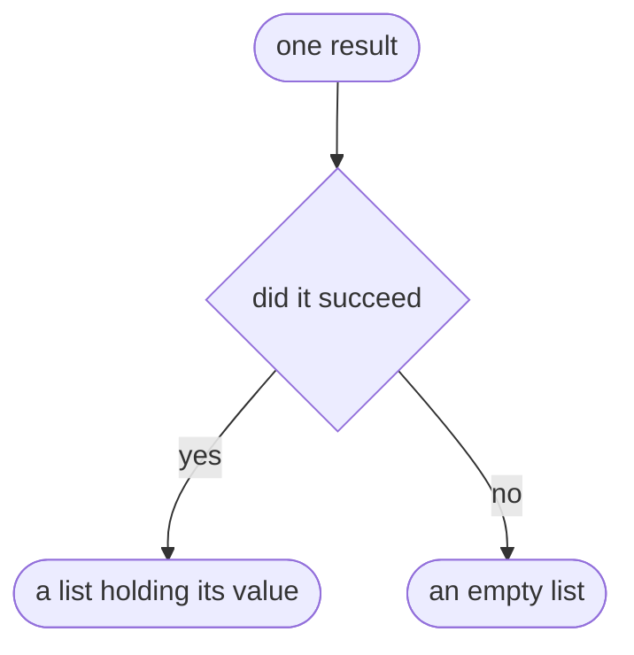

## isPlainObject

Says whether a value is an object that is not null and not a list.

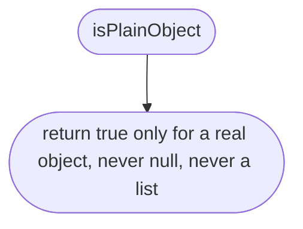

## unknownKeyErrors

Lists every field in the value that the shape does not know.

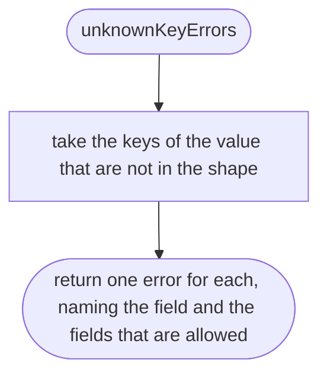

## join

Adds a field name to a path.

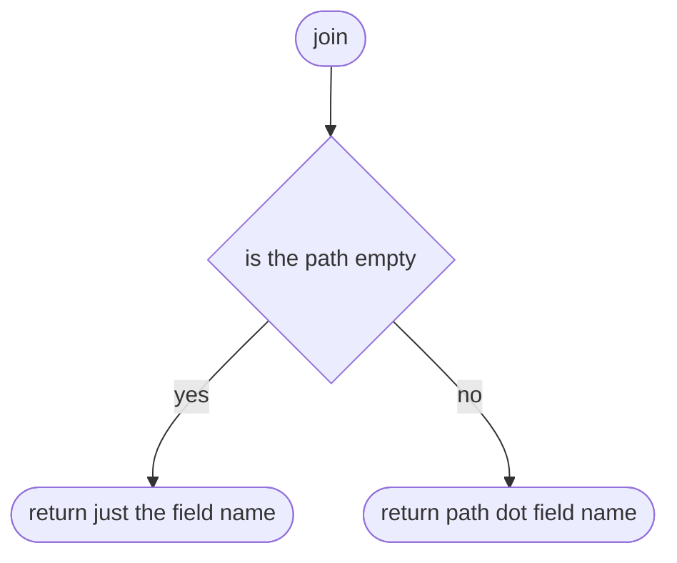

## object

Builds a checker for an object with known fields.

```mermaid
flowchart TD
  s(["object"])
  a(["return the checker"])
  s --> a
```

## object > inner function 1

The checker.

```mermaid
flowchart TD
  s(["check value"])
  a{"is it not a plain object"}
  b(["return bad wanted an object, calling the top level the file"])
  c["check every field with its own checker, at its own path"]
  d["add an error for every field the shape does not know"]
  e{"is there any error, from unknown fields or from field checks"}
  f(["return failure with all the errors"])
  g(["return success with the object built from the field values"])
  s --> a
  a -->|"yes"| b
  a -->|"no"| c
  c --> d
  d --> e
  e -->|"yes"| f
  e -->|"no"| g
```

## object > inner function 1 > inner function 1

Picks the errors out of one field result.

```mermaid
flowchart TD
  s(["one field result"])
  a{"did it fail"}
  b(["its errors"])
  c(["no errors"])
  s --> a
  a -->|"yes"| b
  a -->|"no"| c
```

## object > inner function 1 > inner function 2

Picks the key and value out of one field result.

```mermaid
flowchart TD
  s(["one field result"])
  a{"did it succeed"}
  b(["the key with its value"])
  c(["nothing"])
  s --> a
  a -->|"yes"| b
  a -->|"no"| c
```

## refine

Builds a checker that also applies a rule spanning several fields.

```mermaid
flowchart TD
  s(["refine"])
  a(["return the checker"])
  s --> a
```

## refine > inner function 1

The checker.

```mermaid
flowchart TD
  s(["check value"])
  a["run the plain checker first"]
  b{"did it fail"}
  c(["return that failure unchanged"])
  d["ask the rule for a problem sentence"]
  e{"did the rule find a problem"}
  f(["return failure with the sentence, at the path or the file"])
  g(["return the plain result"])
  s --> a
  a --> b
  b -->|"yes"| c
  b -->|"no"| d
  d --> e
  e -->|"yes"| f
  e -->|"no"| g
```

## shortId

Builds a checker for a short lower-case name.

```mermaid
flowchart TD
  s(["shortId"])
  a(["return a pattern checker for letters, digits and dashes, starting with a letter"])
  s --> a
```
