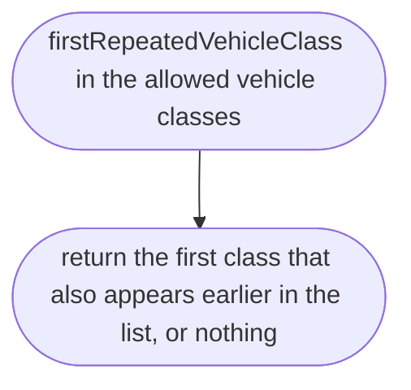
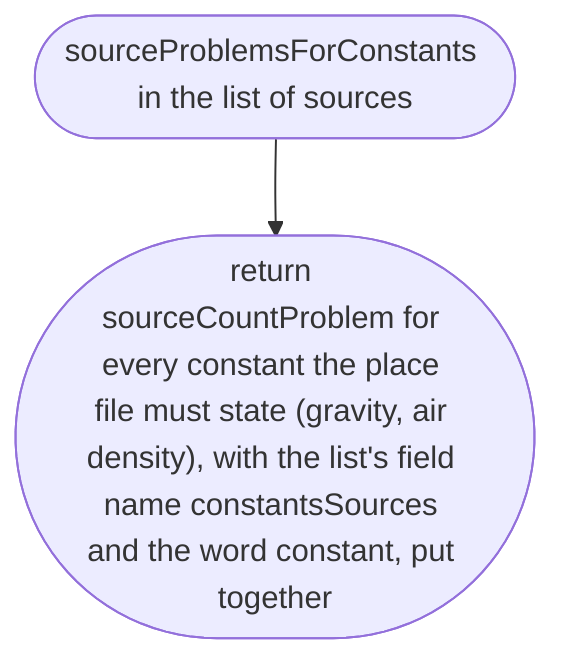
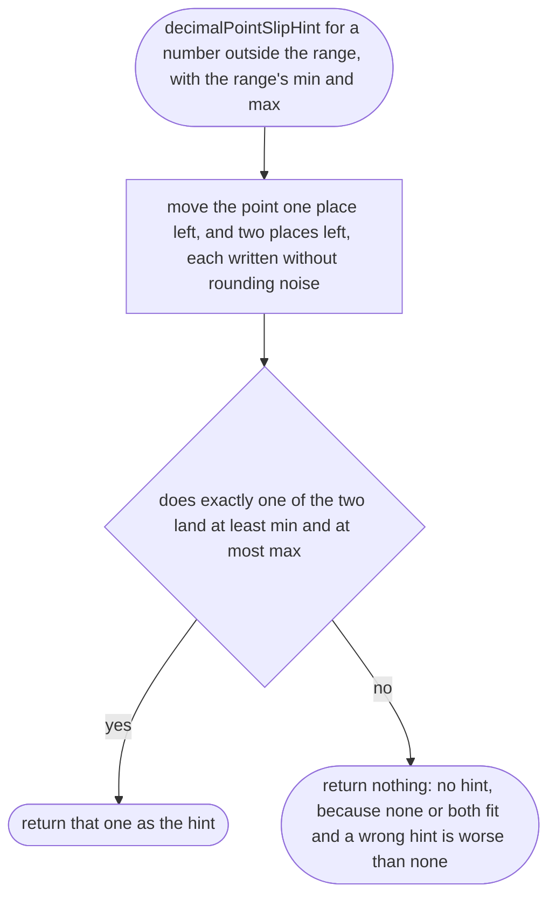
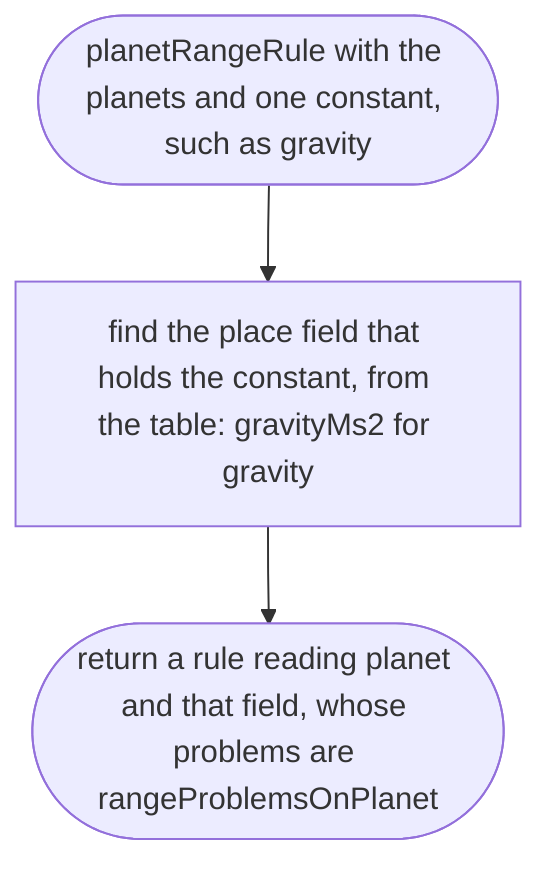
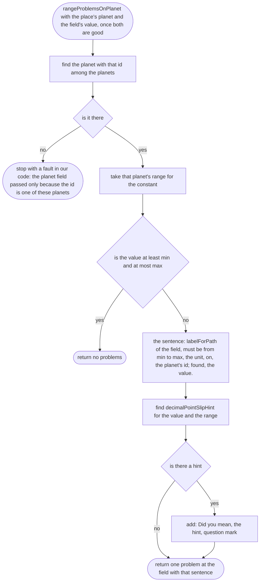
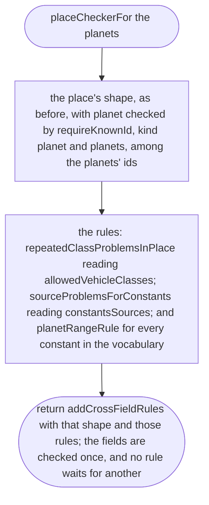
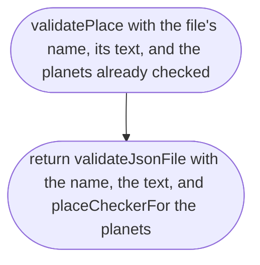

# src/place/place.ts

Status: draft

(Before scope 005: approved, judged by the delegated approver, docs/reviews/002c/, with the owner's decision of 2026-10-11, ranges per planet. The scope 005 change below makes the file a draft again.)

The design for each function, written in plain words. The pictures drawn from the code are in `docs/flows/src/place/place.md`.

Redrawn for scope 002b: new names (item 1) and the new behaviour (items 2d and 2f). What changed is in `docs/reviews/002b/CHANGES.md`. The place's fields and their checkers are unchanged; only how the file is read and reported changes.

Changed for scope 002c (item 3): a place is checked against its planet. What changed is in `docs/reviews/002c/CHANGES.md`. In plain words:

- `validatePlace` is now handed the planets, already checked by `validatePlanet` (`planet.md`). The engine never reads `planets/` itself and never names a planet: whoever loads the files (the game's loader, the tests) reads every planet file, checks it, and hands the good ones in. So a Mars town later needs a `planets/mars.json`, never a code change.
- `planet` must be the id of one of those planets (`requireKnownId`, `parse.md`): "`planet` is `eart`; there is no such planet. Did you mean `earth`?".
- `gravityMs2` and `airDensityKgM3` on their own only need to be a number of at least 0 in their unit (`requireNumberAtLeast`); the old 0 to 100 limit, which let 98 through, is gone. Their real range is the planet's, checked by one rule per constant (`planetRangeRule`). A table in the file says which place field holds which constant (`gravity` in `gravityMs2`, `airDensity` in `airDensityKgM3`); units come from the vocabulary's one table of units, the same one the planet file is checked against.
- When `planet` is wrong, the range rules wait (there is no range to check against), and the report ends with "Fix these first; some cross-checks run after.", as for any waiting rule, so gravity is never silently passed.

Changed for scope 005 (items 2, 3 and 4): two field changes, and one function moved to `parse.ts` (below, `sourceProblemsForConstants`). In plain words:

- **`skyPosition` becomes `centre`.** The map is now centred on a point of the place (the bake measures every road in metres from it, and the car starts on the road nearest it), and the sky is seen from a point of the place. Two fields could disagree, so there is one: `centre`, latitude and longitude, "where the map is centred and the sky is seen from". Same checker as before (`position`). Cascade: `places/finglas.json`, `places/yaba.json`, and the place tests that name `skyPosition` (the test-writer changes those; the coder may not).
- **New `laneWidthM` and `laneWidthSource`.** How wide one traffic lane is in this place, in metres, used by the bake when a road has no `width` tag. Lane width is a fact about the country's road standard (osm2lanes `locale.rs`: 3.5 m by default, 3.0 m in the UK; research/36), so it lives in the place file, never in engine code. `laneWidthM` is a number from 2 to 5 metres (`requireNumberBetween`, unit "m"; the range is a sanity check against slips such as 30 for 3.0, our own choice, recorded here). `laneWidthSource` is `{source, url, status}` with the same checkers as a constant's source, so the data rule applies: official, derived or owner-choice, never silent. Cascade: Finglas (Ireland's DMURS lane widths, research/world-drive/28) and Yaba and Omole (the Nigerian Highway Manual if the owner finds the figure; otherwise his recorded choice, see the scope 005 report).

## firstRepeatedVehicleClass

Why the game needs it: a vehicle class listed twice is a slip in the file, so we point at it.

## sourceProblemsForConstants

Why the game needs it: the owner's data rule says each physical constant has exactly one source, so nobody has to guess which one the number came from; every constant with no source and every constant with more than one is listed in the same report, not just the first.

Changed for scope 005: the vehicle file now needs the same rule for its figures, so the count for one quantity moved to `parse.ts` as `sourceCountProblem` (one rule, two users, so they can never drift apart). `sourceProblemForOneConstant` is deleted. The messages are word for word the same as before.

## repeatedClassProblemsInPlace

Why the game needs it: a vehicle class listed twice is reported in the same pass as every other mistake, as soon as the class list itself is good, whatever else in the file is wrong.

## decimalPointSlipHint

Why the game needs it: 98 for gravity is 9.8 with the point one place off, and 980 is 9.8 with it two places off; the scope asks for a correct hint for both. We say "Did you mean 9.8?" only when moving the point gives a value inside the planet's range, so the hint is right whenever it speaks. It is used only for physics constants checked against their planet, never for latitude or other numbers (scope 002c, item 4). The point is moved in the number's own text, not by dividing in binary, as before: dividing in binary prints 1.1 ÷ 10 as 0.11000000000000001, while `"1.1e-1"` reads as exactly 0.11 (run by us in Node 22).

A value too small (0.98 for 9.8) gets no hint in this scope.

## planetRangeRule

Why the game needs it: each constant a place states is checked against its own planet's range, one rule per constant, so a broken air density never holds back the gravity check, and each message points at its own line.

## planetRangeRule > rangeProblemsOnPlanet

Why the game needs it: says the planet's range, the planet and the unit in one sentence, with the hint only when it is right: "`gravityMs2` must be from 9.76 to 9.84 m/s² on earth; found 98. Did you mean 9.8?".

If two planet files share an id, the first one handed in is used; catching that is the loader's job (see the report for scope 002c).

## placeCheckerFor

Why the game needs it: the place checker depends on which planets exist, which only the loader knows, so it is built from the planets each time a place is checked. Everything else in it is as before.

## validatePlace

Why the game needs it: adding a town is adding a file; this is the referee that checks it, by file name and line, against the planet it is on.

