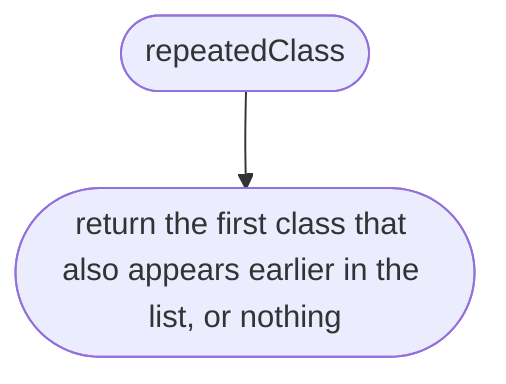
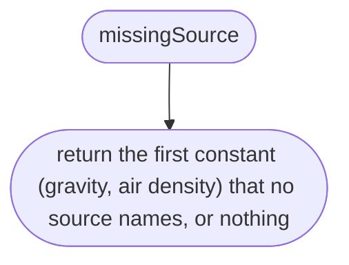
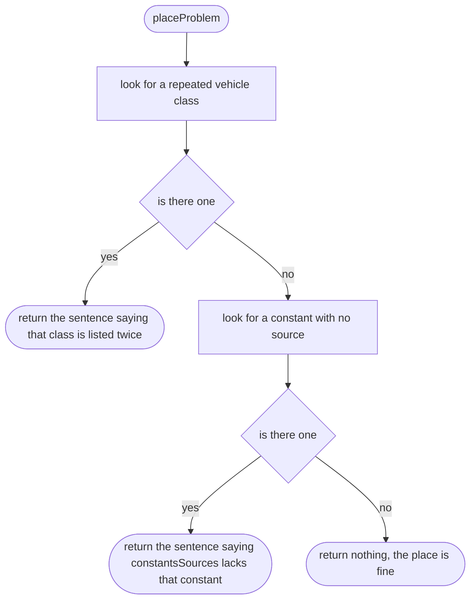
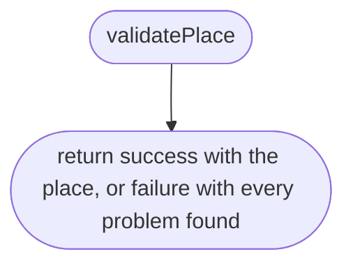

# src/place/place.ts

Status: draft. Waiting for the owner's approval; the approval commit changes this line to `Status: approved`.

The design for each function, written in plain words. The pictures drawn from the code are in `docs/flows/src/place/place.md`.

## repeatedClass

Finds a vehicle class that is listed twice.

## missingSource

Finds a constant that has no source.

## placeProblem

Checks the rules that span several fields of a place.

## validatePlace

Checks a place file read from JSON.

