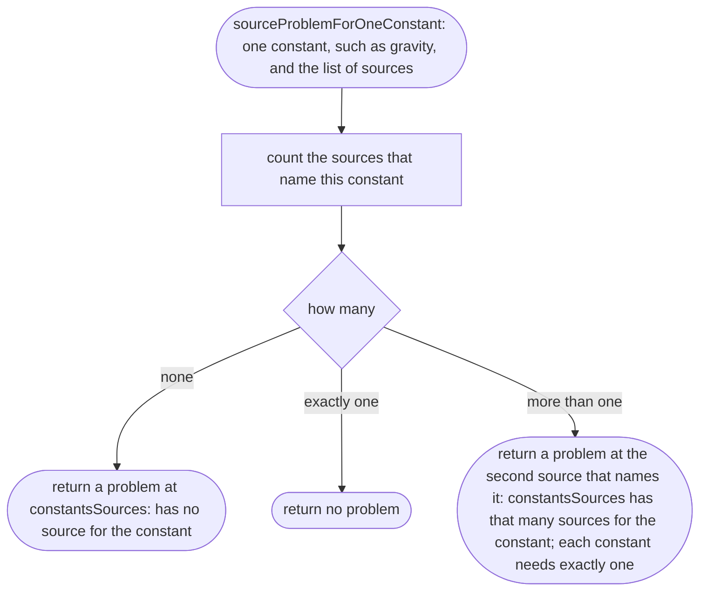
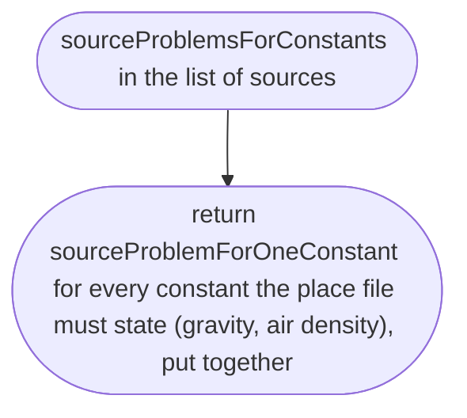
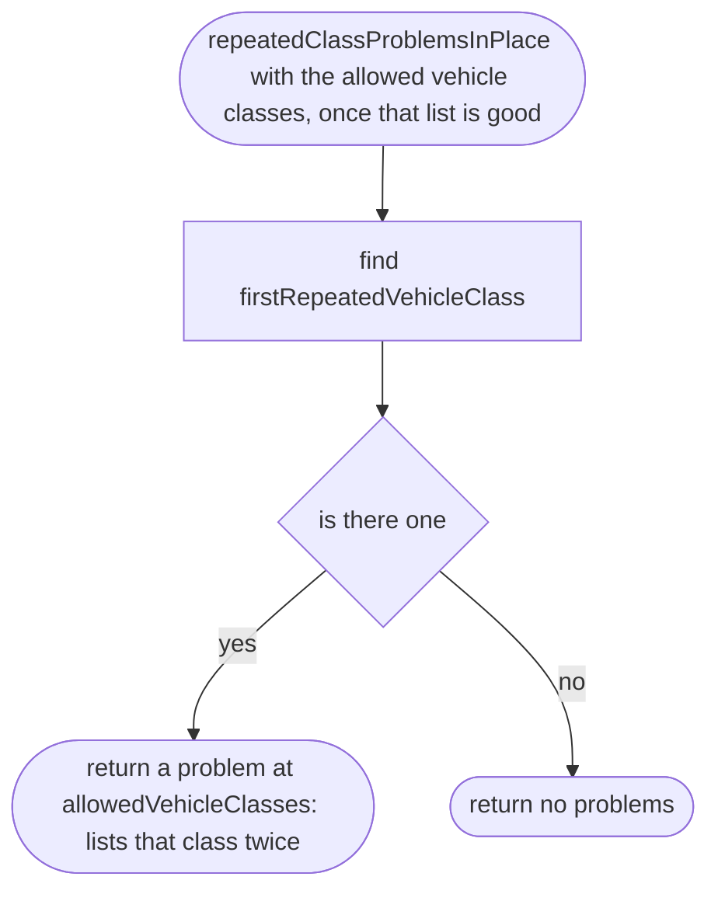
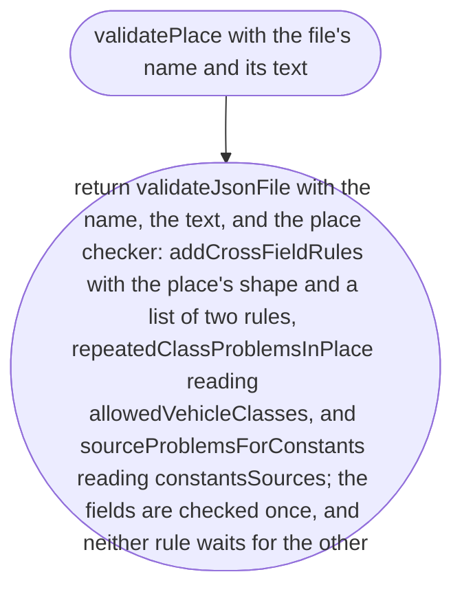

# src/place/place.ts

Status: draft. Waiting for approval; the approval commit changes this line to `Status: approved`.

The design for each function, written in plain words. The pictures drawn from the code are in `docs/flows/src/place/place.md`.

Redrawn for scope 002b: new names (item 1) and the new behaviour (items 2d and 2f). What changed is in `CHANGES-002b.md` next to this file. The place's fields and their checkers are unchanged; only how the file is read and reported changes.

## firstRepeatedVehicleClass

Why the game needs it: a vehicle class listed twice is a slip in the file, so we point at it.

## sourceProblemForOneConstant

Why the game needs it: the owner's data rule says each physical constant has exactly one source, so nobody has to guess which one the number came from.

## sourceProblemsForConstants

Why the game needs it: every constant with no source and every constant with more than one is listed in the same report, not just the first.

## repeatedClassProblemsInPlace

Why the game needs it: a vehicle class listed twice is reported in the same pass as every other mistake, as soon as the class list itself is good, whatever else in the file is wrong.

## validatePlace

Why the game needs it: adding a town is adding a file; this is the referee that checks it, by file name and line.

