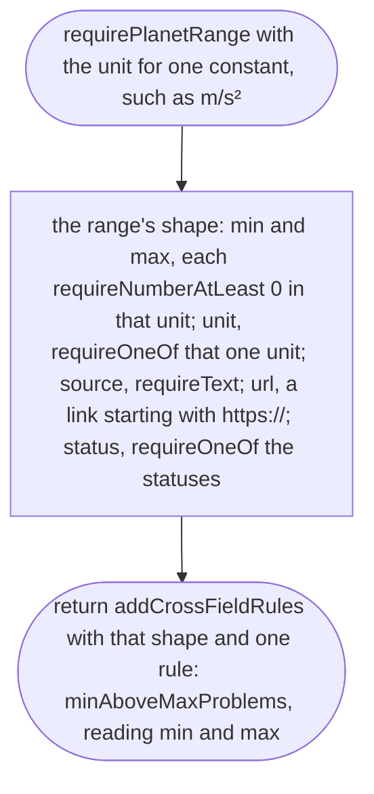
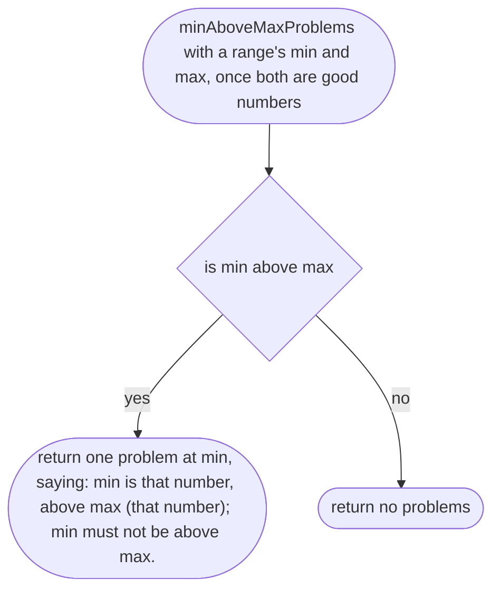
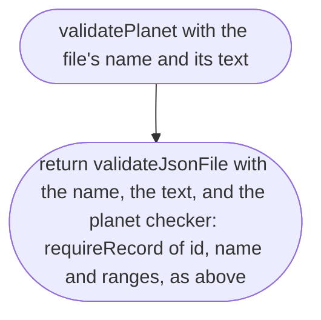

# src/place/planet.ts

Status: approved. Judged by the delegated approver (docs/roles/approver.md, docs/reviews/002c/), with the owner's decision of 2026-10-11 (ranges per planet).

New in scope 002c (items 1 and 2). The planet file: for each physical constant
a place states (gravity, air density), the range any place on that planet's
surface must sit inside, with where the range came from. It is data, the same
way a place is: the engine never says "Earth"; it reads `planets/earth.json`.
The pictures drawn from the code will be in `docs/flows/src/place/planet.md`.

What a planet file holds, in plain words (the checker's shape; values, not
functions, so they have no flow of their own):

- `id` (a short id, such as `earth`) and `name` (some text, such as `Earth`).
- `ranges`: one object with exactly one field per constant in the vocabulary
  (`gravity`, `airDensity`). Each is checked by `requirePlanetRange` with that
  constant's unit from the vocabulary's one table of units, so a missing,
  misspelt or extra constant gets the usual "is missing" or "Did you mean"
  message, and a constant listed twice gets the usual "written twice" message.
- Each range has `min`, `max` (each a number of at least 0, checked with
  `requireNumberAtLeast`), `unit` (exactly the unit for that constant, checked
  with `requireOneOf` of that one unit, so the file and the engine can never
  disagree about units), `source` and `url` (as in a place's
  `constantsSources`), and `status` (`official`, `derived` or `owner-choice`,
  the data rule).

## requirePlanetRange

Why the game needs it: a planet's range for one constant (gravity on Earth is
9.76 to 9.84 m/s²) is the referee's rulebook for every town on that planet, so
it must itself be checked: a number, in the right unit, with a source.

## minAboveMaxProblems

Why the game needs it: a range written back to front (`min` 9.84, `max` 9.76)
would refuse every town on the planet, and the place-maker would be told their
good gravity is wrong. We point at the range itself instead. A range of one
value (`min` equal to `max`) is allowed.

The sentence names `min` and `max` without the path in front (the rule only
knows the fields of its own range); the line number in front of the message
points at the right `min`, inside `gravity` or `airDensity`. Example:

> earth.json line 6: `min` is 9.84, above `max` (9.76); `min` must not be above `max`.

## validatePlanet

Why the game needs it: adding a planet is adding a file, like adding a town;
this is the referee that checks the planet file, by file name and line, the
same way as places and vehicles.

