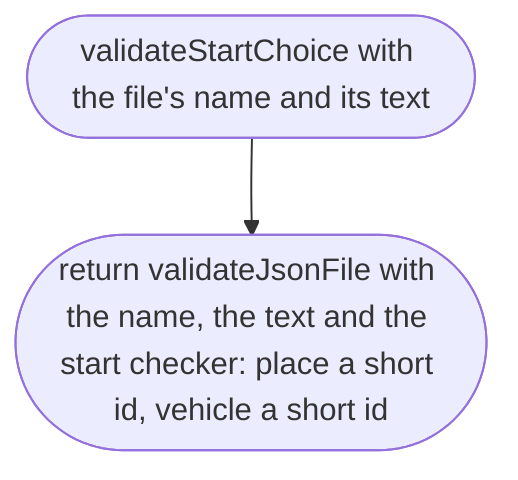
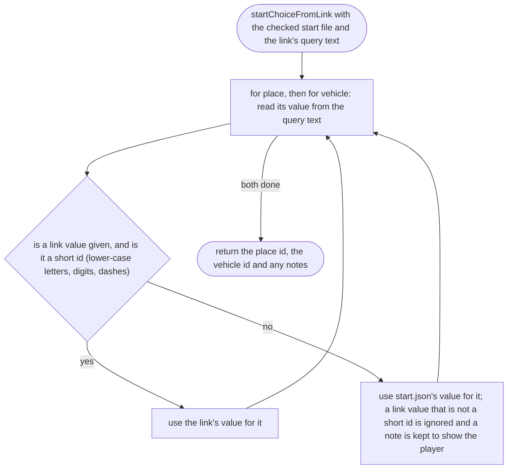

# src/place/start.ts

Status: draft

New in scope 005 (item 4). `start.json`, at the top of the repo, says which
place and which vehicle the game opens with, such as
`{"place": "omole", "vehicle": "hatchback"}`. It is data, so the engine
never names a place (CLAUDE.md, "The engine knows no place"); a link can ask
for others with `?place=` and `?vehicle=`. The pictures drawn from the code
will be in `docs/flows/src/place/start.md`.

## validateStartChoice

Why the game needs it: the first file the game reads; if it is wrong, the player is told which line, like any other file.

## startChoiceFromLink

Why the game needs it: the owner can send a link that opens another place or car without changing any file, and a misspelt link is caught by the file checks that follow, not here.

