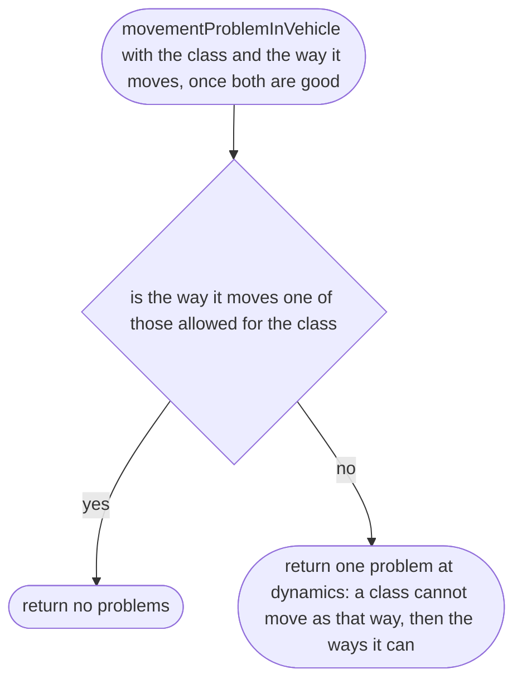
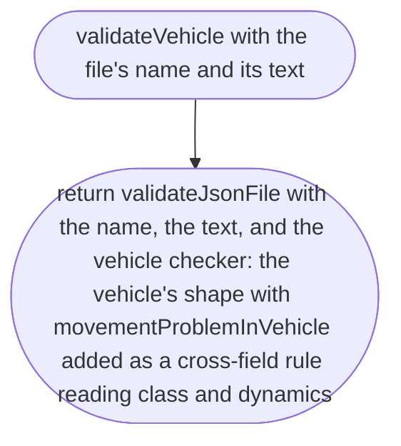

# src/place/vehicle.ts

Status: draft. Waiting for approval; the approval commit changes this line to `Status: approved`.

The design for each function, written in plain words. The pictures drawn from the code are in `docs/flows/src/place/vehicle.md`.

Redrawn for scope 002b: new names (item 1) and the same shape as `validatePlace` (item 2h). What changed is in `CHANGES-002b.md` next to this file.

## movementProblemInVehicle

Why the game needs it: a vehicle class can only move in the ways that suit it, so a bus that floats like a boat is refused.

## validateVehicle

Why the game needs it: a new kind of vehicle is a file, checked the same way as a place, by file name and line.

