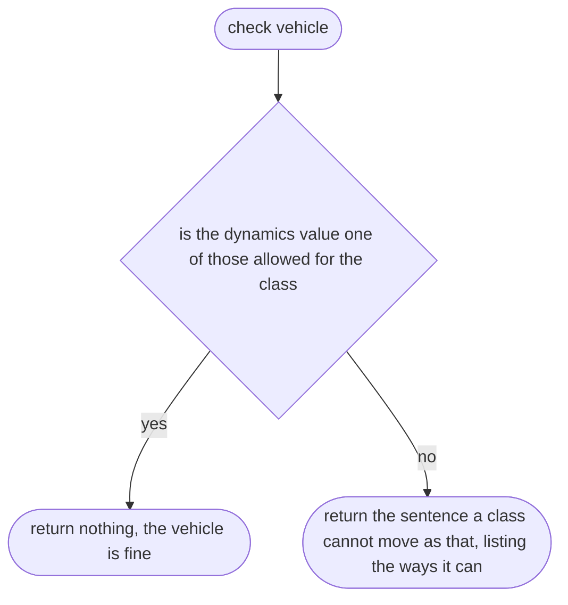
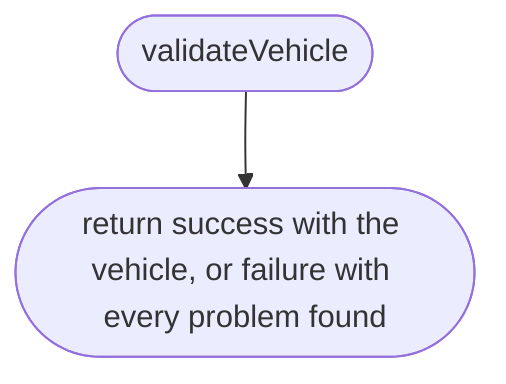

# src/place/vehicle.ts

Status: draft. Waiting for the owner's approval; the approval commit changes this line to `Status: approved`.

The design for each function, written in plain words. The pictures drawn from the code are in `docs/flows/src/place/vehicle.md`.

## module > inner function 1

The rule that a vehicle class can only move in the ways that suit it.

## validateVehicle

Checks a vehicle file read from JSON.

