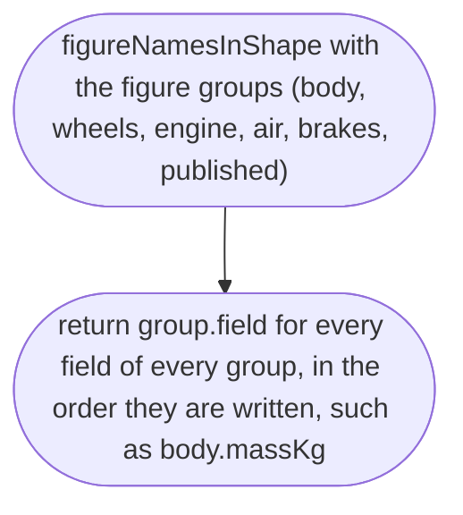
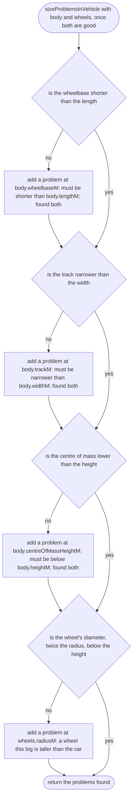
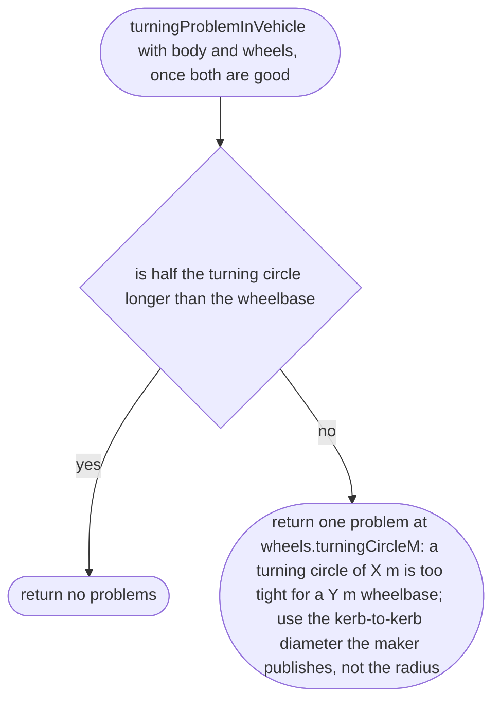
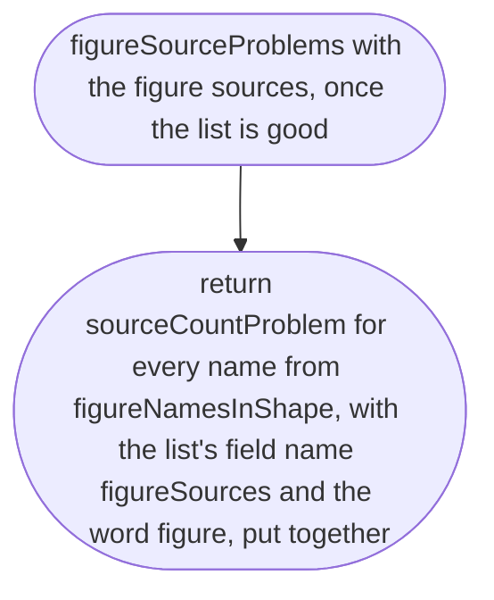
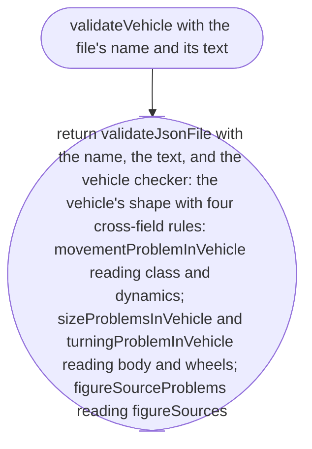

# src/place/vehicle.ts

Status: draft

(Before scope 005: approved, judged by the delegated approver, docs/reviews/002b/, with the owner's decisions of 2026-10-11. Scope 005 adds the vehicle's real numbers, so the file is a draft again.)

The design for each function, written in plain words. The pictures drawn from the code are in `docs/flows/src/place/vehicle.md`.

Redrawn for scope 002b: new names (item 1) and the same shape as `validatePlace` (item 2h). What changed is in `docs/reviews/002b/CHANGES.md`.

Changed for scope 005 (item 5): a vehicle file now carries the real-world figures the physics needs, each with exactly one source (the data rule, the same as a place's constants). In plain words:

- **Figures, in SI units, grouped.** Every figure is a number above 0 (`requireNumberAbove`, `parse.md`) in its unit, except shares and efficiency, which are from 0 to 1. The groups and fields:
  - `body`: `massKg` (kerb mass), `lengthM`, `widthM`, `heightM`, `wheelbaseM`, `trackM`, `centreOfMassHeightM`, `frontAxleLoadShare` (0 to 1).
  - `wheels`: `radiusM`, `turningCircleM` (kerb to kerb, as makers publish it), `suspensionTravelM`, `rideFrequencyHz`, `dampingRatio`, `tyreFriction` (peak, dry asphalt), `rollingResistance`.
  - `engine`: `peakPowerKw`, `peakTorqueNm`, `firstGearRatio`, `reverseGearRatio`, `finalDriveRatio`, `redlineRpm`, `drivetrainEfficiency` (0 to 1).
  - `air`: `dragCoefficient`, `frontalAreaM2`.
  - `brakes`: `frontShare` (0 to 1), `testFromSpeedMs`, `testStoppingDistanceM` (a published brake test: from this speed, stopped in this distance).
  - `published`: `testToSpeedMs`, `testTimeS` (a published acceleration test), `topSpeedMs`. The physics does not read these; the tests drive the car and compare.
- **`drivenAxle`**: `front`, `rear` or `both` (new vocabulary list `DRIVEN_AXLES`).
- **`figureSources`**: a list of `{quantity, source, url, status}`, where `quantity` is a figure's name such as `body.massKg`. Exactly one per figure, checked by `sourceCountProblem` (`parse.md`), so the report lists every figure with no source or two.
- **Speeds are in metres per second** in the file, never km/h, so no engine code reads a display unit (CLAUDE.md); the source text says what the maker published.
- **Every vehicle file needs these figures for now.** Only wheeled vehicles exist; when the first boat or plane arrives, the figures split by `dynamics` (a parking-lot line, not this scope).
- The figure names are worked out from the shape itself (`figureNamesInShape`), so the list of figures that need a source can never drift from the fields.

## movementProblemInVehicle

Why the game needs it: a vehicle class can only move in the ways that suit it, so a bus that floats like a boat is refused.

## figureNamesInShape

New in scope 005. Why the game needs it: every figure in the file must have a source, and the list of figures comes from the one place they are defined, so adding a figure can never skip the source check.

## sizeProblemsInVehicle

New in scope 005. Why the game needs it: a slipped digit in a size makes a car whose wheels stick out of its body or whose centre of mass is above its roof; the physics would run, and the car would feel wrong with no clue why.

## turningProblemInVehicle

New in scope 005. Why the game needs it: the steering angle is worked out from the turning circle and the wheelbase; a turning circle too small for the wheelbase has no real angle, and the car could not be steered.

## figureSourceProblems

New in scope 005. Why the game needs it: the data rule, every number traced: each figure has exactly one source.

## validateVehicle

Why the game needs it: a new kind of vehicle is a file, checked the same way as a place, by file name and line.

Changed for scope 005: three more cross-field rules.

