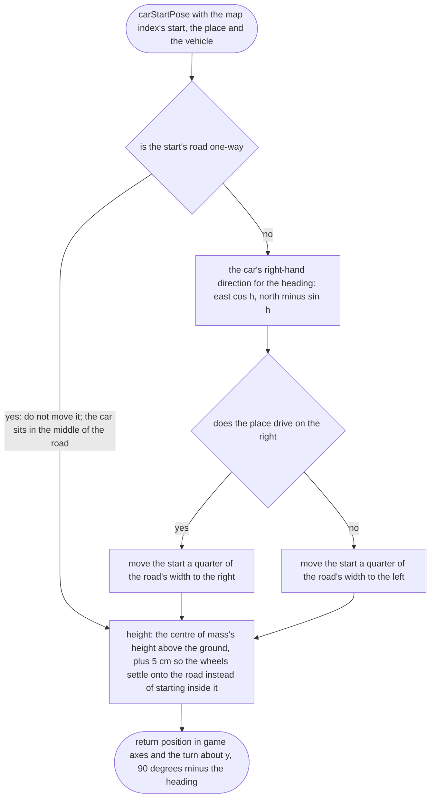
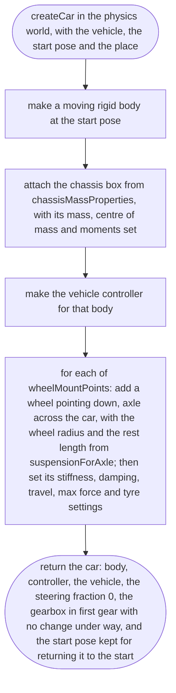
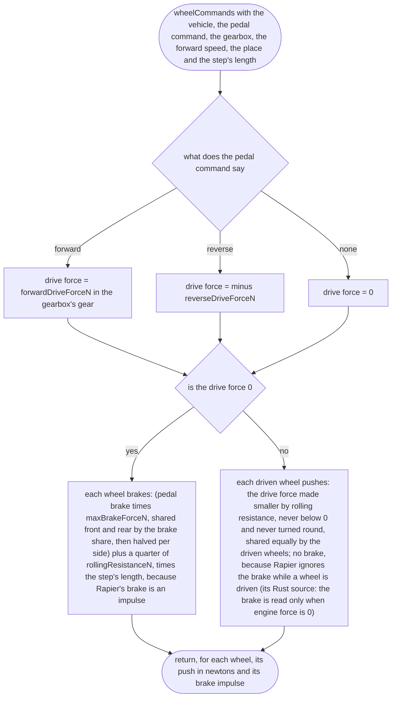
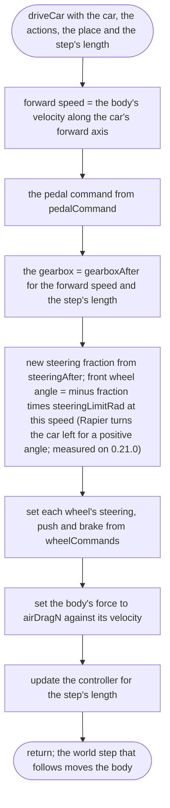
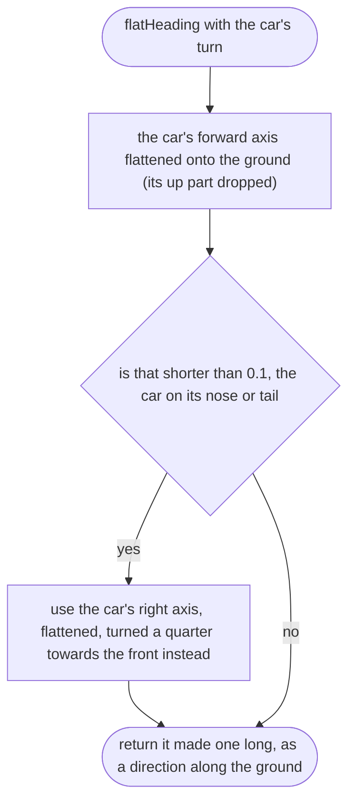
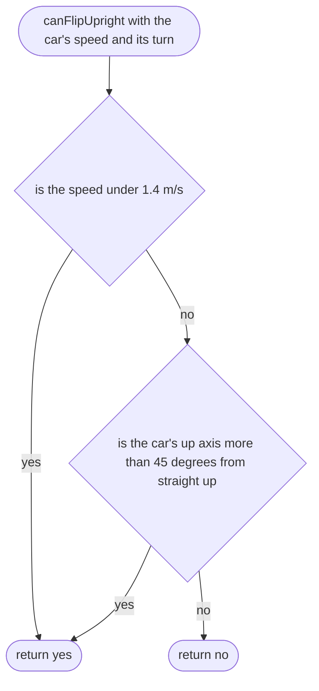
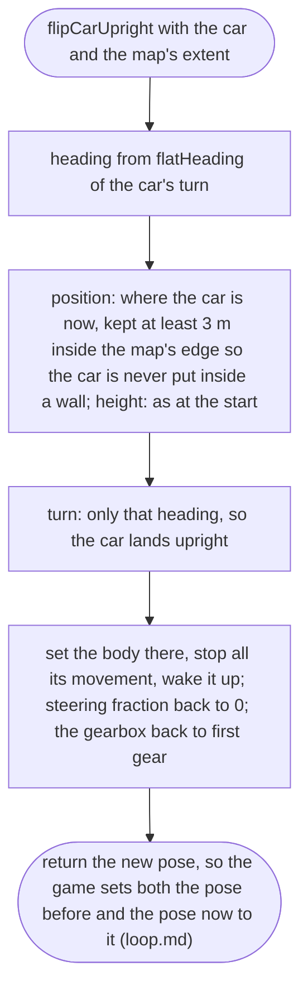
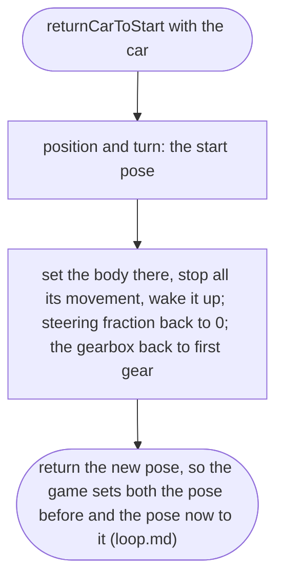
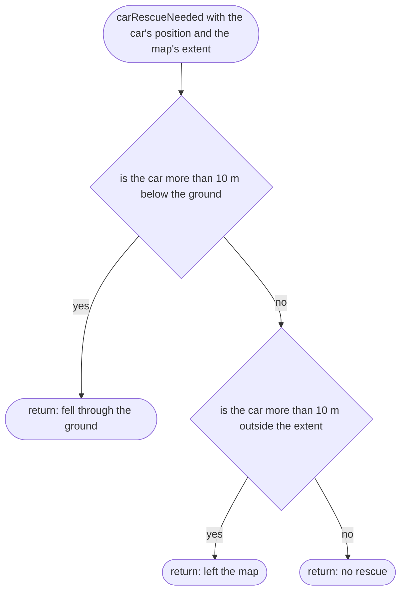

# src/vehicle/car.ts

Status: approved. Judged by the delegated approver (docs/reviews/slice-1-approver.md); its fixes F1 to F24 and the orchestrator's decisions on E1 to E3 applied in one pass.

New in scope 005 (items 4 and 5). The car in the physics world: a Rapier
rigid body with a `DynamicRayCastVehicleController` (Rapier 0.21.0 API, read
from its type files: `addWheel`, `setWheel…`, `updateVehicle`,
`currentVehicleSpeed`; `ColliderDesc.setMassProperties`; research/36
section 3). All numbers come from `rapier-settings.ts`, `drive-force.ts`,
`pedals.ts` and `steering.ts`. The pictures drawn from the code will be in
`docs/flows/src/vehicle/car.md`.

Turning map words into game axes: game x is east, y up, z south. A compass
heading h (degrees clockwise from north) points along (sin h, 0, −cos h);
the car's forward axis is its local +x, so the car's turn about y is
90° − h.

## carStartPose

Why the game needs it: the car is parked on the correct side of the street for the place (right in Lagos, left in Dublin), read from the place file, never from code.

Changed after the approver's F7: the start in the map index records the road's width and whether it is one-way (`tools/bake/start.md`), so on a two-way road the car sits in the middle of its own half, and on a one-way road in the middle of the road. The game no longer reads lane width; only the bake does.

## createCar

Why the game needs it: one car, with the real car's mass, size, wheels and springs, standing on the street.

## wheelCommands

Why the game needs it: from the pedals to a push and a brake on each wheel, as a plain calculation the tests can check without a physics world.

## driveCar

Why the game needs it: one physics step of driving: wheels turned, pushed or braked, air resistance on the body, then Rapier works out the rest.

Changed after the approver's F2 and F6, and the orchestrator's decision E1 (a). Forward speed is read from the body, not from `currentVehicleSpeed()`, which is the whole speed with a sign, so a car sliding sideways would read as fast forward or backward. Steering `+1` means right, and Rapier turns left for a positive angle, hence the minus; `updateCarModel` reads the angle back from the controller, so the wheels are drawn the right way with no other change. The gearbox (`drive-force.md`) is kept in the car between steps.

## flatHeading

New in scope 005 (approver's F8 and F12). Why the game needs it: putting the car upright and pointing the camera both need the way the car faces along the ground, and a car standing on its nose or tail has no such direction; without a fallback the result is not a number and the screen goes blank.

## canFlipUpright

New in scope 005 (orchestrator's decision E2 (b), 2026-10-11). Why the game needs it: Flip upright is for a car that is stuck, not a free emergency stop; pressed at 60 km/h by a thumb that slipped off the pedals it would stop the car dead. So it works only when the car has nearly stopped or has tipped over. The two limits are owner-choice (decision E2 (b)): under 1.4 m/s (about 5 km/h) and tipped more than 45 degrees, kept in `src/controls/feel.ts` with the other game-feel numbers.

## flipCarUpright

Why the game needs it: a car on its roof or stuck on its side is put back on its wheels where it is, facing the way it was facing, so the player can carry on. Split from the old `putCarBack` (approver's F8), so each name says what it does and there is no mode flag.

## returnCarToStart

Why the game needs it: a car that fell through the ground or left the map is put back where the game began, the one safe place known to be on a road. Split from the old `putCarBack` (approver's F8).

## carRescueNeeded

Why the game needs it: if the physics ever lets the car fall through the ground or past the map edge, the game notices and puts it back at the start, and says so, instead of leaving the player falling forever.

