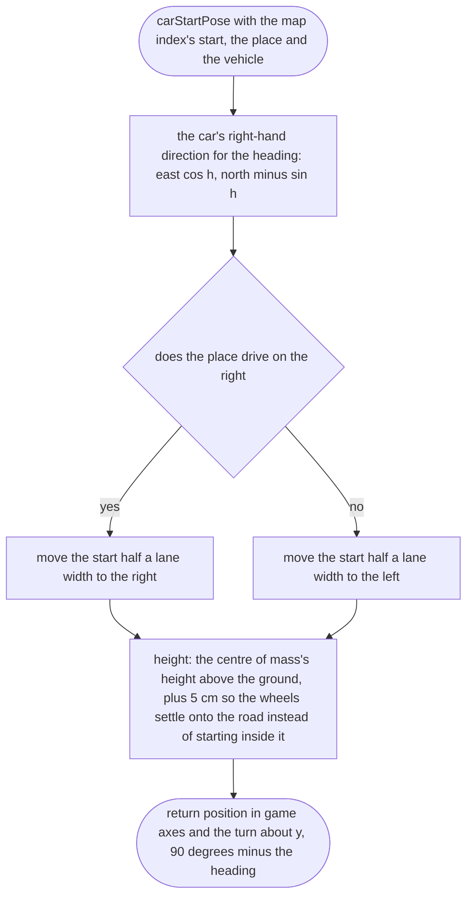
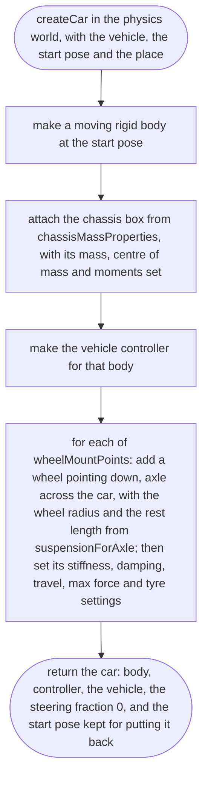
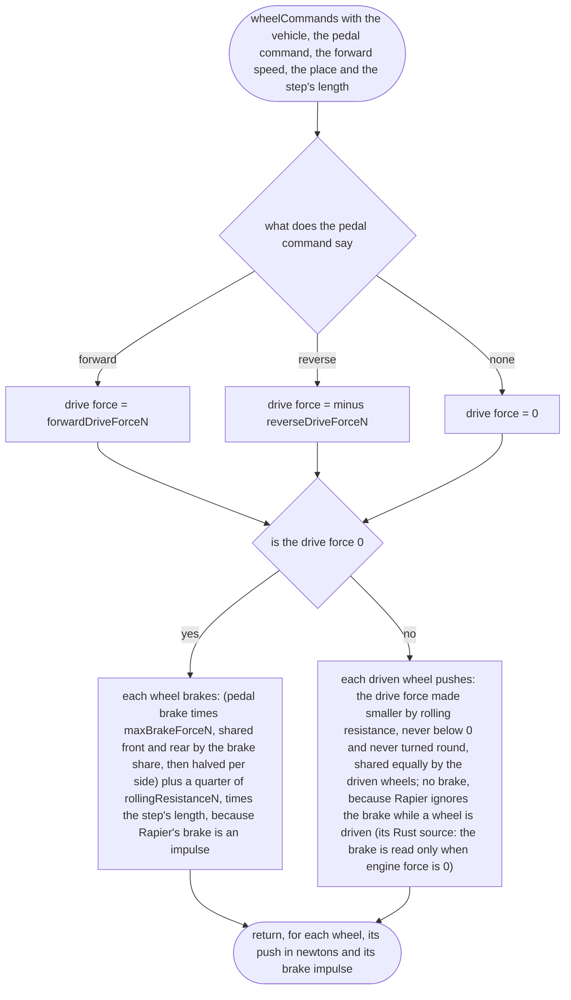
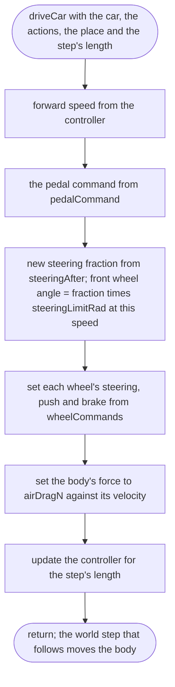
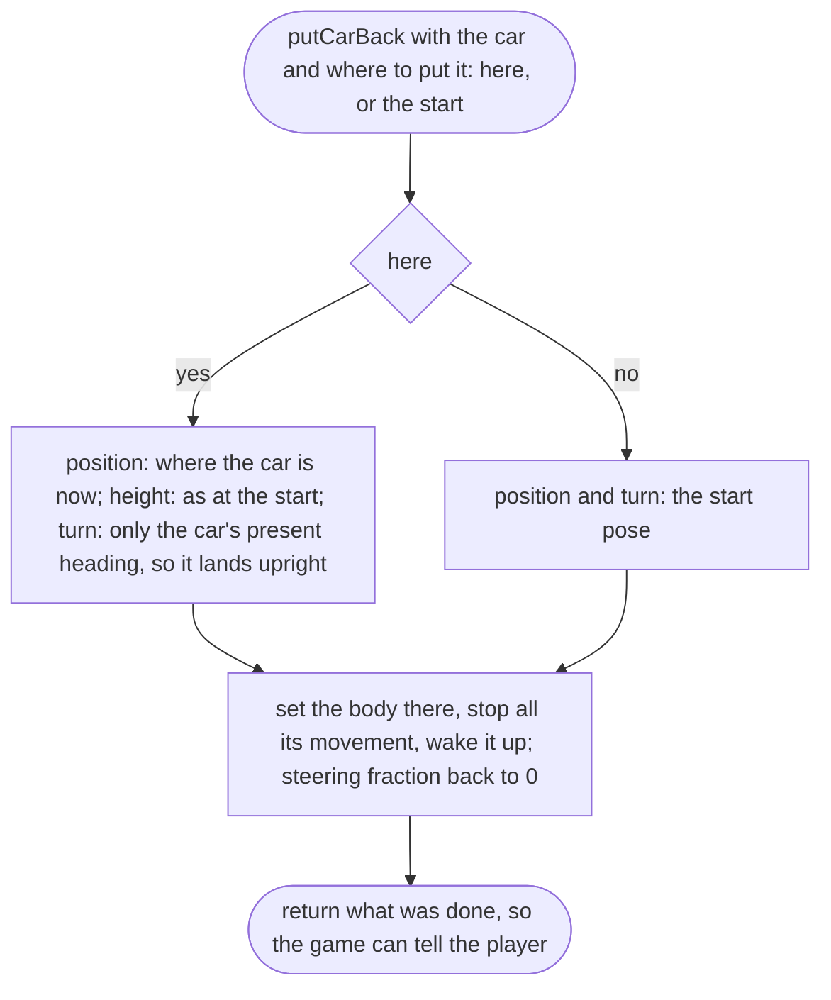

# src/vehicle/car.ts

Status: draft

New in scope 005 (items 4 and 5). The car in the physics world: a Rapier
rigid body with a `DynamicRayCastVehicleController` (Rapier 0.21.0 API, read
from its type files: `addWheel`, `setWheel…`, `updateVehicle`,
`currentVehicleSpeed`; `ColliderDesc.setMassProperties`; research/36
section 3). All numbers come from `rapier-settings.ts`, `drive-force.ts`,
`pedals.ts` and `steering.ts`. The pictures drawn from the code will be in
`docs/flows/src/vehicle/car.md`.

Turning map words into game axes: game x is east, y up, z south. A compass
heading h (degrees clockwise from north) points along (sin h, 0, −cos h);
the car's forward axis is its local +x, so the car's turn about y is
90° − h.

## carStartPose

Why the game needs it: the car is parked on the correct side of the street for the place (right in Lagos, left in Dublin), read from the place file, never from code.

## createCar

Why the game needs it: one car, with the real car's mass, size, wheels and springs, standing on the street.

## wheelCommands

Why the game needs it: from the pedals to a push and a brake on each wheel, as a plain calculation the tests can check without a physics world.

## driveCar

Why the game needs it: one physics step of driving: wheels turned, pushed or braked, air resistance on the body, then Rapier works out the rest.

## putCarBack

Why the game needs it: a car on its roof or stuck against the map edge is put back on its wheels where it is, facing the way it was facing, so the player can carry on.

## carRescueNeeded

Why the game needs it: if the physics ever lets the car fall through the ground or past the map edge, the game notices and puts it back at the start, and says so, instead of leaving the player falling forever.

