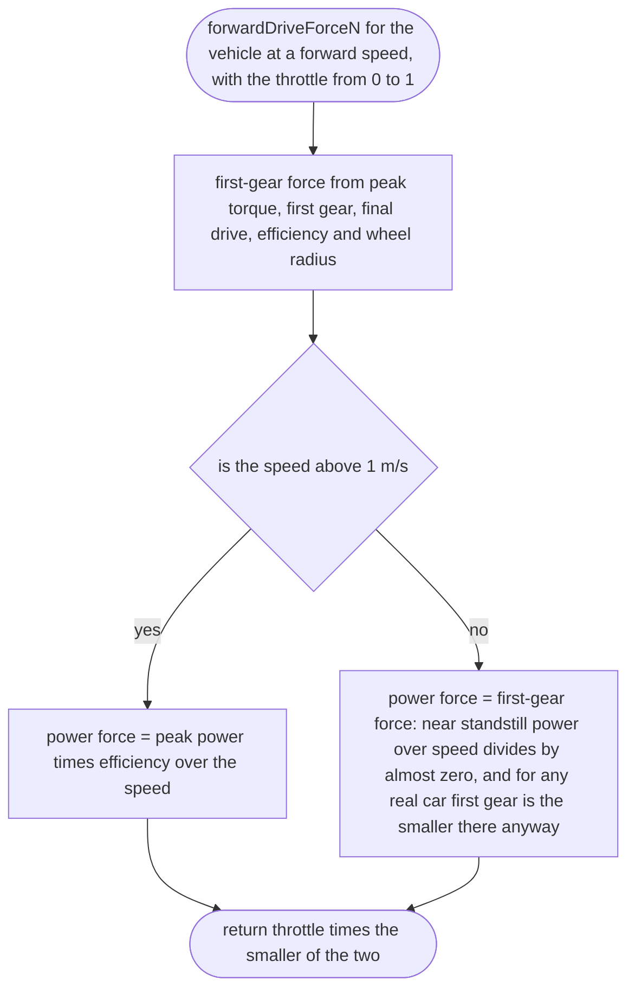
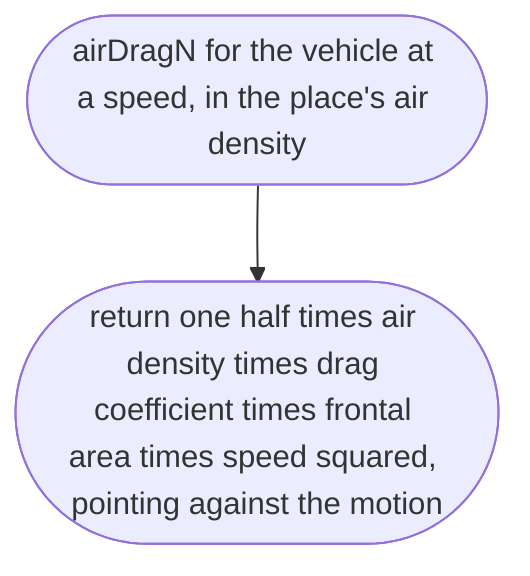
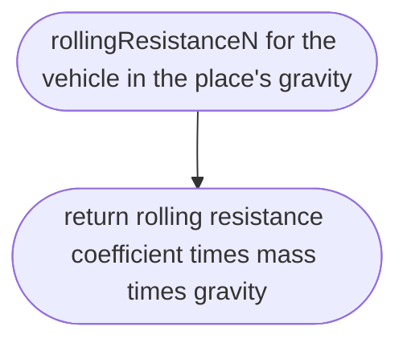

# src/vehicle/drive-force.ts

Status: draft

New in scope 005 (item 5). How hard the engine pushes and how hard the air and
road hold the car back, from the vehicle file's figures and the place's air
density and gravity (D-0009: physics constants come from the place). There is
no gearbox simulation in slice 1: going forward, the force is the smaller of
what first gear can give and what the engine's power can give at this speed,
which is the envelope a real gearbox follows; reverse has one gear and stops
pulling at its rev limit. Top speed and 0–100 then come out of the physics
and are tested against the published figures (research/36 section 3). The
pictures drawn from the code will be in `docs/flows/src/vehicle/drive-force.md`.

Standard formulas: wheel force = torque × gear ratio × final drive ×
efficiency ÷ wheel radius; power-limited force = power × efficiency ÷ speed;
road speed at the rev limit = redline (rev/min) × 2π × radius ÷ (60 × gear
ratio × final drive); air drag = ½ ρ Cd A v²; rolling resistance = Crr × m × g.

## forwardDriveForceN

Why the game needs it: the car pulls hard from a standstill and keeps pulling less as speed rises, until the air holds it at its real top speed.

## reverseDriveForceN

Why the game needs it: reverse is slow and strong like a real reverse gear, and stops pushing at its top speed rather than reversing at motorway speed.

## airDragN

Why the game needs it: air holds the car back more the faster it goes, and thinner air (a high place, later Mars) holds it back less; the density comes from the place file.

## rollingResistanceN

Why the game needs it: a car left rolling slows down and stops by itself, as on a real road.

