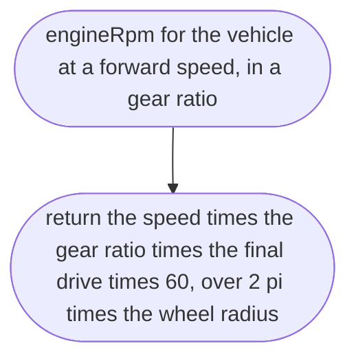
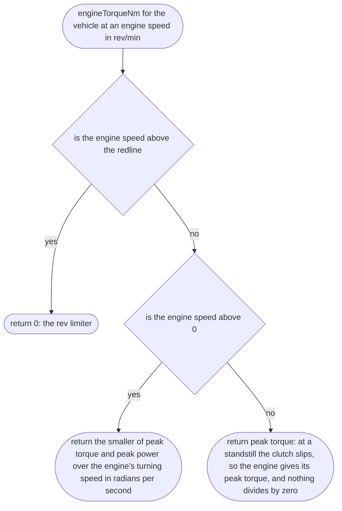
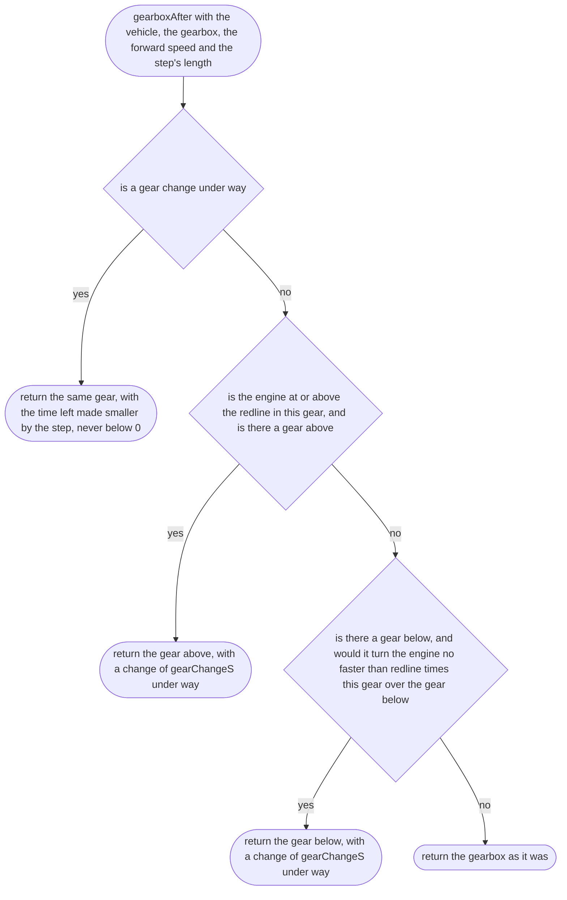
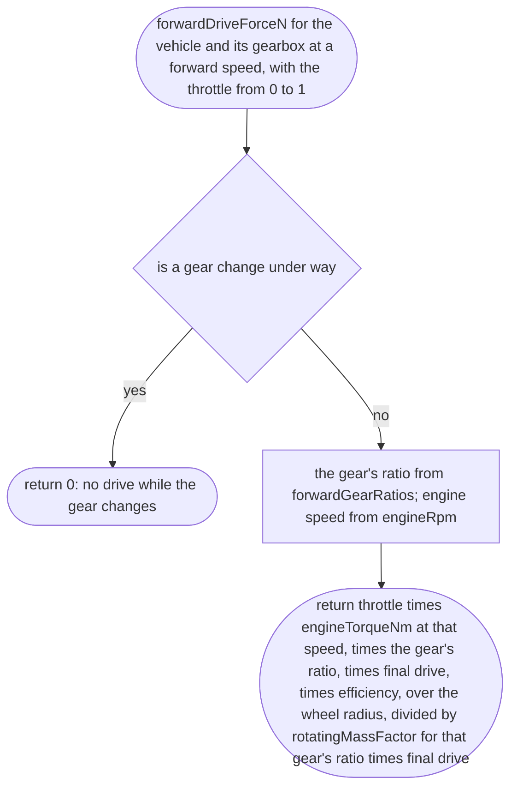
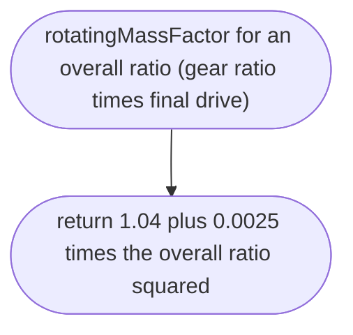
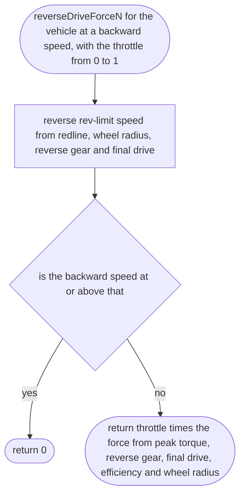

# src/vehicle/drive-force.ts

Status: approved. Judged by the delegated approver (docs/reviews/slice-1-approver.md); its fixes F1 to F24 and the orchestrator's decisions on E1 to E3 applied in one pass.

New in scope 005 (item 5). How hard the engine pushes and how hard the air and
road hold the car back, from the vehicle file's figures and the place's air
density and gravity (D-0009: physics constants come from the place).

Changed after the approver's E1, orchestrator's decision (a), 2026-10-11: the
real gears are modelled. Going forward, the car has every forward gear on the
maker's sheet (official) and changes gear by itself, as the two pedals have
no gear lever; each change takes `gearChangeS` with no drive (0.3 s for the
hatchback, owner-choice). The earlier design pulled with peak power at every
speed, as if the gearbox were perfect, and reached 100 km/h about 25 % sooner
than the brochure in the approver's measurement. Reverse has one gear and stops
pulling at its rev limit. Top speed and 0–100 then come out of the physics
and are tested against the published figures (research/36 section 3). Not
yet measured with the gears: whether 0–100 now lands within the test's ±15 %.
The pictures drawn from the code will be in `docs/flows/src/vehicle/drive-force.md`.

The engine's pull at a given engine speed is taken as the smaller of peak
torque and peak power over the engine's turning speed: flat torque, then
constant power. This is the envelope of the two published figures; its
weakness, named: a real engine has less torque low down and near the
redline, so the model is a little quick between gear changes. Above the
redline the engine gives nothing (the rev limiter).

The gearbox, kept in the car between steps: the gear it is in (1 is first)
and how long the gear change under way has left (0 when none). It changes
up when the engine reaches the redline in any gear but the top one. It
changes down when the gear below would turn the engine no faster than this
gear turns it straight after a change up into it (redline × this gear ÷ the
gear below). That gap is the gear step itself, so the gearbox never hunts
between two gears and no invented margin is needed.

Standard formulas: wheel force = torque × gear ratio × final drive ×
efficiency ÷ wheel radius; power-limited force = power × efficiency ÷ speed;
road speed at the rev limit = redline (rev/min) × 2π × radius ÷ (60 × gear
ratio × final drive); engine speed (rev/min) = road speed × gear ratio ×
final drive × 60 ÷ (2π × radius); torque in the constant-power part =
power ÷ (engine speed × 2π ÷ 60); air drag = ½ ρ Cd A v²; rolling resistance = Crr × m × g.

## engineRpm

New in scope 005 (decision E1 (a)). Why the game needs it: which gear the car is in, and how hard it pulls, both depend on how fast the engine turns at this road speed.

## engineTorqueNm

New in scope 005 (decision E1 (a)). Why the game needs it: the engine pulls with its peak torque low down and with its peak power higher up, and not at all past the redline, as the maker's two figures describe.

## gearboxAfter

New in scope 005 (decision E1 (a)). Why the game needs it: the car changes gear by itself like an automatic, at the moment a driver flooring it would, and each change takes a moment with no drive, so it picks up speed like the real car.

## forwardDriveForceN

Why the game needs it: the car pulls hard from a standstill, eases off a moment at each gear change, and pulls less in each higher gear, until the air holds it at its real top speed.

## rotatingMassFactor

Why the game needs it: a real car's engine, gearbox and wheels have to be spun up too, which makes it feel heavier when accelerating, most of all in first gear. Without this the car reached 100 km/h in 9.9 s against the published 12.9 s. Source: T. D. Gillespie, Fundamentals of Vehicle Dynamics (SAE, 1992), section 2, the "mass factor" approximation 1 + 0.04 + 0.0025 × (overall ratio)². Added by the orchestrator, 2026-10-11, after the coder measured the gap; not a number tuned to pass the test.

## reverseDriveForceN

Why the game needs it: reverse is slow and strong like a real reverse gear, and stops pushing at its top speed rather than reversing at motorway speed.

## airDragN

Why the game needs it: air holds the car back more the faster it goes, and thinner air (a high place, later Mars) holds it back less; the density comes from the place file.

## rollingResistanceN

Why the game needs it: a car left rolling slows down and stops by itself, as on a real road.

