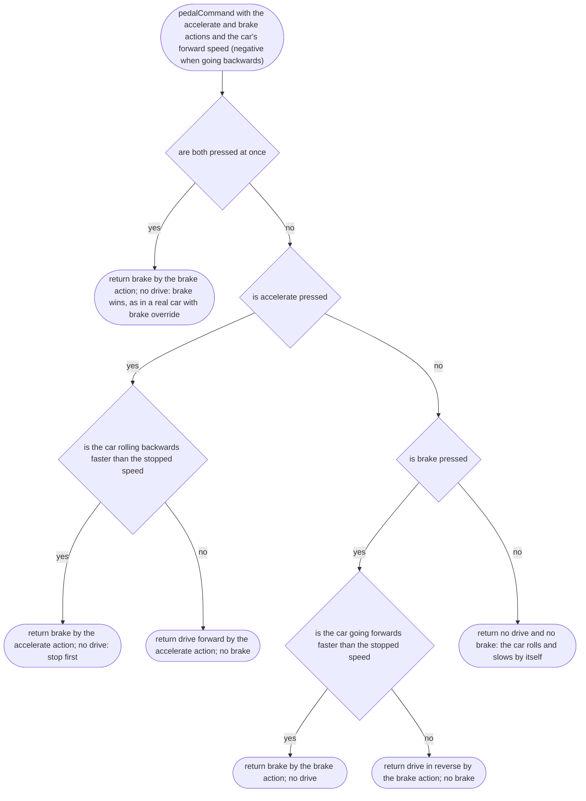

# src/vehicle/pedals.ts

Status: approved. Judged by the delegated approver (docs/reviews/slice-1-approver.md); its fixes F1 to F24 and the orchestrator's decisions on E1 to E3 applied in one pass.

New in scope 005 (items 5 and 6). Turns the accelerate and brake actions
into what the car does: drive forward, brake, or reverse. The scope's rule:
brake slows the car, and when stopped holding brake reverses. The other half,
pressing accelerate while rolling backwards brakes first, is the convention
in Bruno Simon's folio (`PhysicsVehicle.js`, techniques only; research/36).
The "stopped" speed is a game-feel number, the owner's choice, proposed at
0.5 m/s (under 2 km/h) in `src/controls/feel.ts`. The pictures drawn from the
code will be in `docs/flows/src/vehicle/pedals.md`.

## pedalCommand

Why the game needs it: two buttons do four jobs (go, slow down, reverse, slow a reversing car) without a gear lever, the way arcade and phone driving games work.

