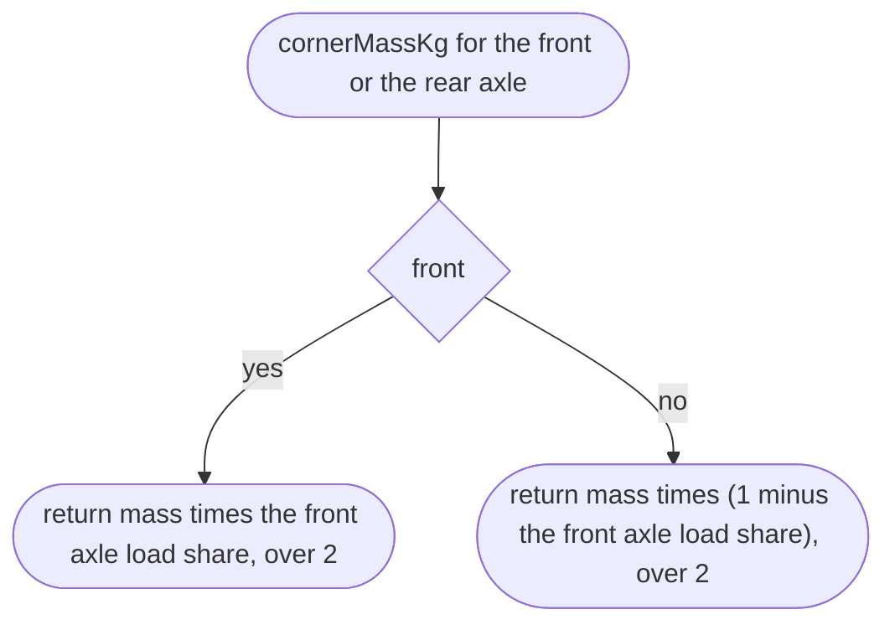
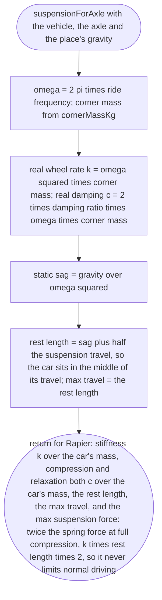
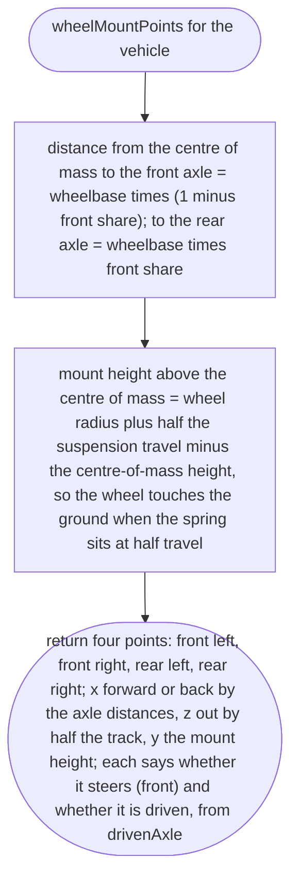
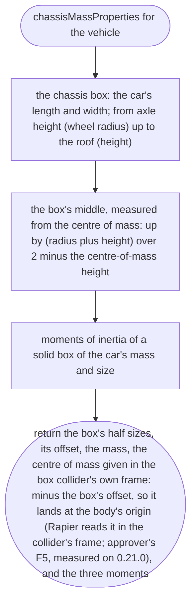
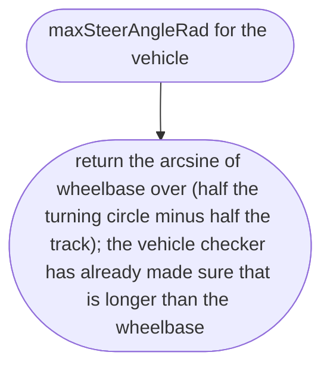
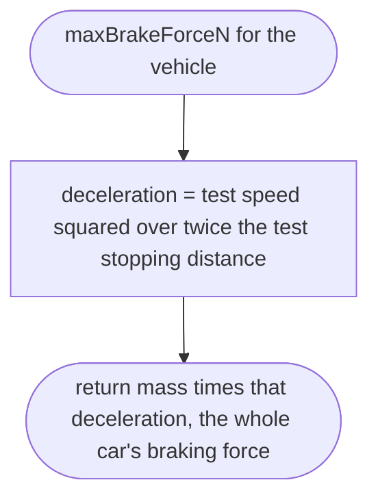
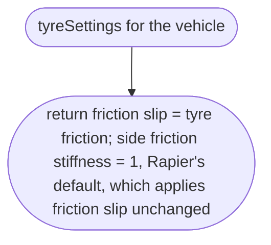

# src/vehicle/rapier-settings.ts

Status: approved. Judged by the delegated approver (docs/reviews/slice-1-approver.md); its fixes F1 to F24 and the orchestrator's decisions on E1 to E3 applied in one pass.

New in scope 005 (item 5). The vehicle file holds real-world figures in SI
units; Rapier's vehicle controller wants its own numbers. This file is the
only place that knows the difference, so a vehicle file still means something
if we ever change physics engine. Every conversion below comes from reading
Rapier's Rust source (`src/control/ray_cast_vehicle_controller.rs`,
Apache-2.0, research/36 section 3):

- spring and damper are multiplied by the whole car's mass
  (`wheel_suspension_force = force * chassis_mass`), so a real wheel rate is
  divided by the car's mass;
- engine force is newtons per wheel; brake is an impulse cap per step
  (newton-seconds), so a brake force is multiplied by the time step;
- friction slip is the tyre's friction coefficient.

Car axes (Rapier's defaults, `index_up_axis: 1`, `index_forward_axis: 0`):
x forward, y up, z to the car's right; the body's origin is the centre of
mass. The pictures drawn from the code will be in
`docs/flows/src/vehicle/rapier-settings.md`.

Standard formulas used, named here so the approver can check them: natural
frequency ω = 2πf; wheel rate k = ω² × corner mass; critical damping
c = 2ζ√(k m) = 2ζ ω m; static sag = g ÷ ω²; a box's moments of inertia
m(b² + c²) ÷ 12 (a solid box, a stated weakness: a real car's mass sits lower
and nearer the middle); steering angle from the turning circle with the
bicycle model, sin δ = wheelbase ÷ (turning circle ÷ 2 − track ÷ 2), because
the published kerb-to-kerb circle is traced by the outer front wheel, not the
middle of the front axle (approver's F3: 10.6 m against the published 10.2 m,
where the plain half circle gave 12.2 m, measured on Rapier 0.21.0); deceleration from a
brake test a = v² ÷ 2d.

## cornerMassKg

Why the game needs it: the front of a front-engined hatchback is heavier than the back, and each wheel's spring must hold its own share.

## suspensionForAxle

Why the game needs it: the car should sit level, bounce once over a bump and settle like a real hatchback, not float or rattle.

## wheelMountPoints

Why the game needs it: the wheels go where the real car's wheels are: the wheelbase apart, the track apart, placed around the centre of mass by the front-rear weight split.

## chassisMassProperties

Why the game needs it: the car's real mass and a low centre of mass make it lean and pitch like a car, not tip like a box.

## maxSteerAngleRad

Why the game needs it: the car turns as tightly as the real one, worked out from the turning circle the maker publishes. That circle is traced by the outer front wheel, so half the track comes off its radius (approver's F3).

A test the test-writer adds (F3): at full lock and walking pace, the turning circle is within ±10 % of the published one.

## maxBrakeForceN

Why the game needs it: the car stops in the distance a published brake test measured.

## tyreSettings

Why the game needs it: grip comes from the real tyre's friction, not Rapier's default of 10.5, which is about ten times real grip.

