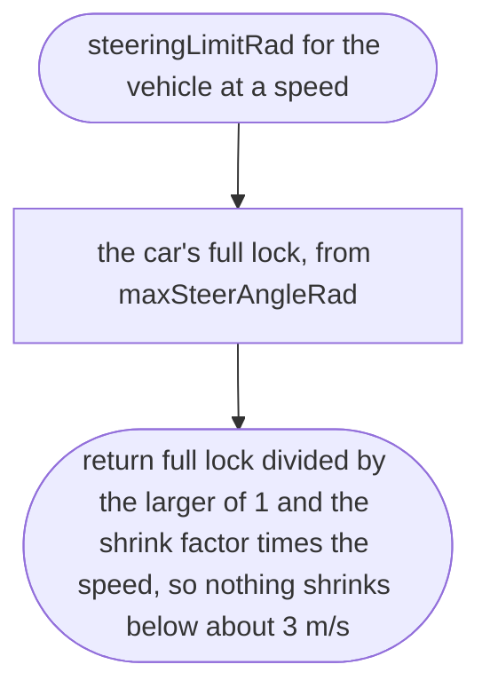
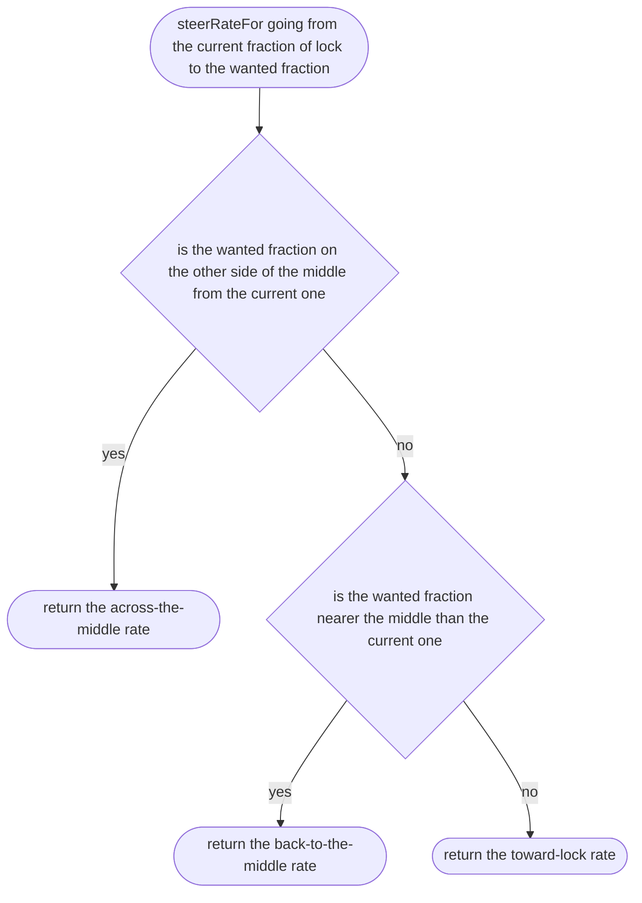
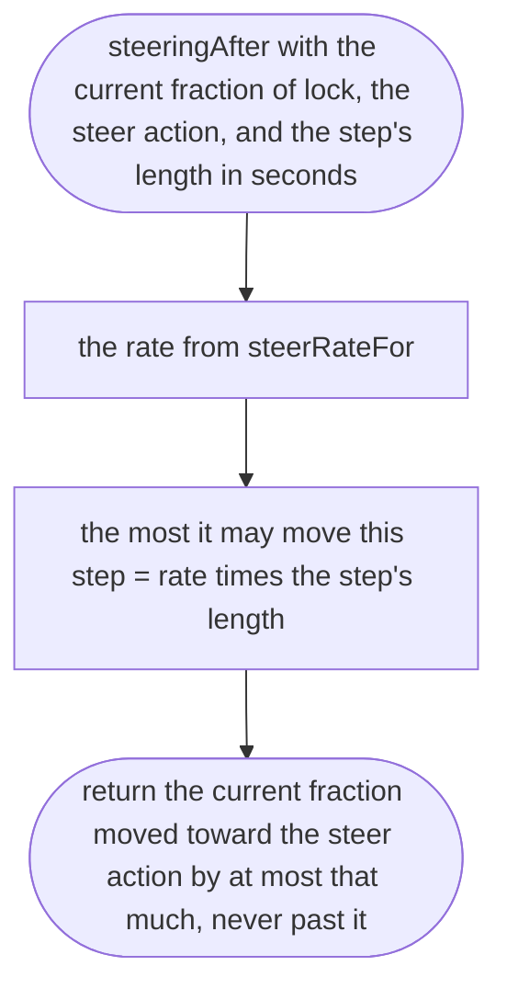

# src/vehicle/steering.ts

Status: approved. Judged by the delegated approver (docs/reviews/slice-1-approver.md); its fixes F1 to F24 and the orchestrator's decisions on E1 to E3 applied in one pass.

New in scope 005 (items 5 and 6). How far the front wheels turn. A key is
either on or off, and a thumb jumps; real steering wheels take time to turn,
so the wheels move toward what the player asks at a limited rate, faster when
coming back to the middle (rates from the F1 game in our
research/world-drive/12, item 3). At speed, full lock would spin the car on a
key press, so the lock shrinks as speed rises (Sketchbook `Car.ts:241-254`,
MIT, technique). The rates and the shrink factor are game-feel numbers, the
owner's choice, proposed in `src/controls/feel.ts`: toward lock 2.6 per
second, back to the middle 5 per second, across the middle 7 per second (as a
fraction of full lock), shrink factor 0.3 per m/s as in Sketchbook. The
pictures drawn from the code will be in `docs/flows/src/vehicle/steering.md`.

## steeringLimitRad

Why the game needs it: a full key press at 60 km/h turns the car into the next street, not into a spin.

## steerRateFor

Why the game needs it: letting go straightens the car quickly, and flicking from left to right feels sharp, while turning in stays smooth.

## steeringAfter

Why the game needs it: one small step of the wheels' turn every physics step, the same on a 60 Hz phone and a 120 Hz Mac.

