# src/world/buildings.ts

Status: approved by the orchestrator in one pass (Scope 006, lighter process, 2026-10-11).

New in scope 006 (items 1 and 2). The buildings file the bake writes for a
square and the game reads, its checker, and the walls and flat roofs drawn
from it. A bad file is skipped with a problem naming it, never a crash, like
a road file (`chunk.ts`). Extruding a footprint into walls and a flat roof is
the plain prism every OSM renderer starts from (OSM2World and Streets GL, MIT,
research/world-drive/24 section 3; technique only). The pictures drawn from
the code will be in `docs/flows/src/world/buildings.md`.

**Buildings file** `places/<id>/chunks/buildings_<east>_<north>.json`:
`{"format":1,"cell":{"east":3,"north":-2},"buildings":[{"heightCm":600,"shade":2,"rings":[[e0,n0,…],[hole…]],"roof":[a,b,c,…]}]}`.
Corners are whole centimetres from the square's south-west corner, and may
reach 200 m outside it (a building belongs to the square holding its middle).
The first ring is the outline, anticlockwise from above; the rest are holes,
clockwise. The roof lists three corner numbers per triangle, counting the
outline's corners first, then each hole's. Heights up to 300 m; shades 0 to 3.

Walls facing east or west are drawn a little lighter (tone 1) than walls
facing north or south (tone 0.86), our own choice, so two walls meeting at a
corner never look like one surface whatever the sun does.

## validateBuildingChunk

Why the game needs it: a damaged or half-downloaded buildings file must not crash the game or draw a spike across the sky; it is skipped and the player is told part of the map did not load.

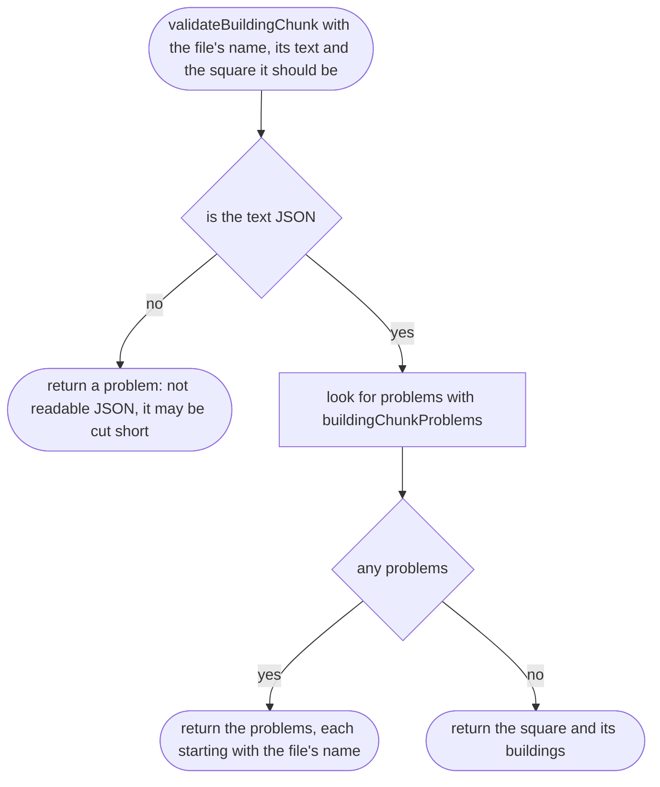

## buildingChunkProblems

Why the game needs it: each check catches one way a file goes wrong: an old format, the wrong square, a broken building.

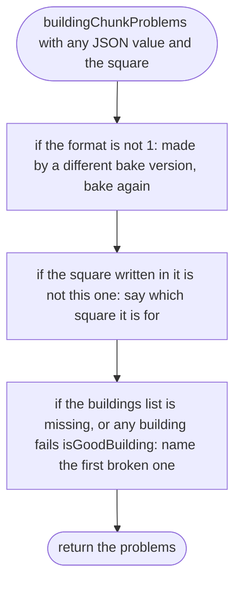

## isGoodBuilding

Why the game needs it: one wrong number (a height written as text, a roof corner that does not exist) would draw garbage; every number is checked.

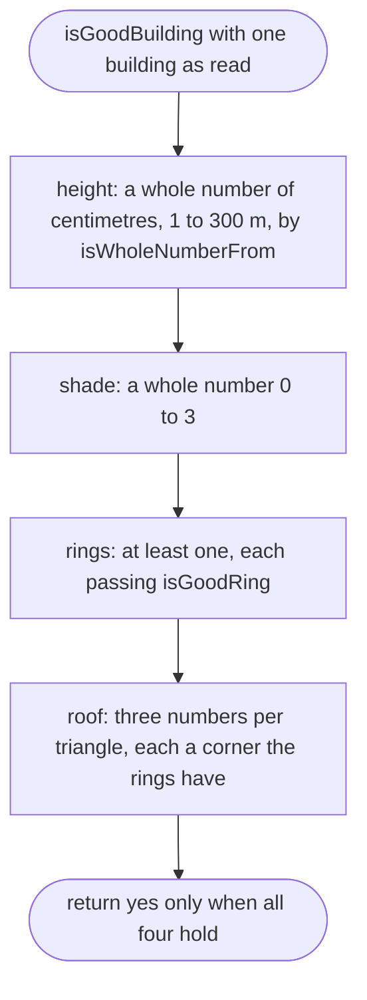

## isGoodBuilding > inner function 1

Counts the corners across the rings.

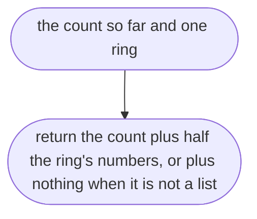

## isWholeNumberFrom

Why the game needs it: one check for every number in the file: whole, and within its range.

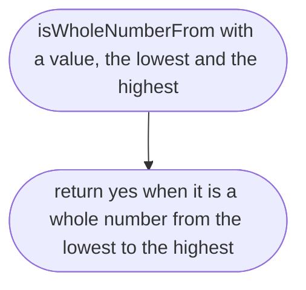

## isGoodRing

Why the game needs it: a ring needs three corners to have an inside, and each corner must be within reach of its square.

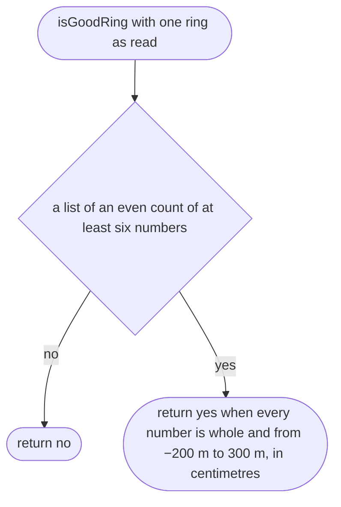

## surfaceSizes

Why the game needs it: the drawing lists are made once at their full size, not grown corner by corner.

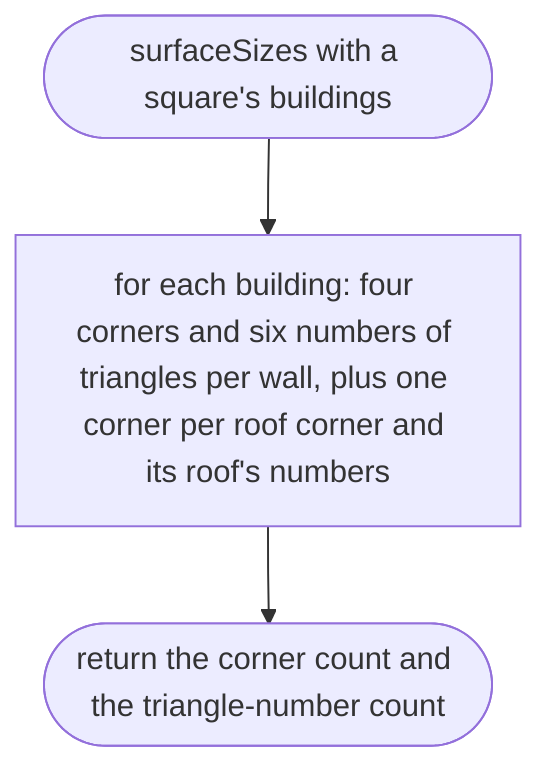

## buildingSurfaces

Why the game needs it: a square's buildings are drawn in one go, so the phone keeps up (scope 006, item 2).

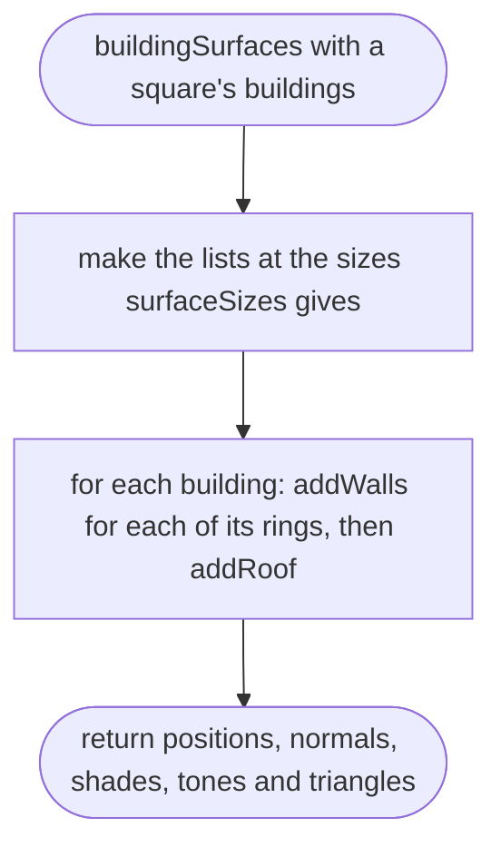

## addWalls

Why the game needs it: each side of a ring is one wall, lit flat, facing out of the building; a hole's walls face into its courtyard.

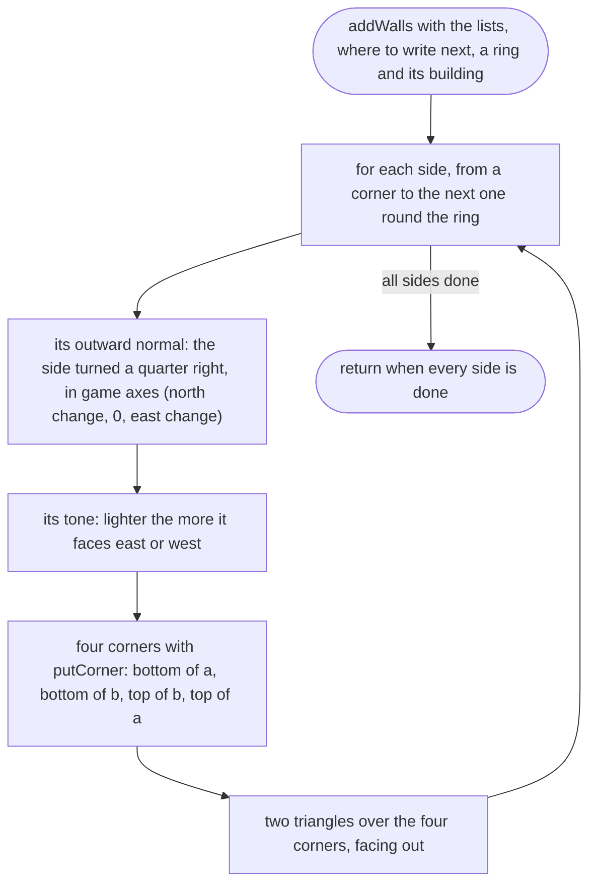

## addRoof

Why the game needs it: the flat roof closes the block at its height.

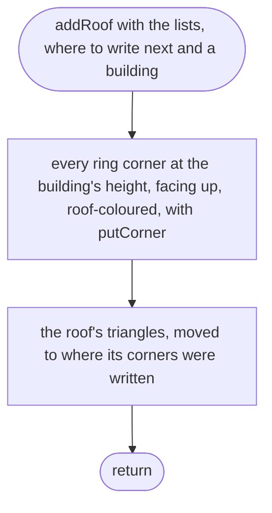

## putCorner

Why the game needs it: writes one corner's position, normal, shade and tone in one place, so the four lists never get out of step.

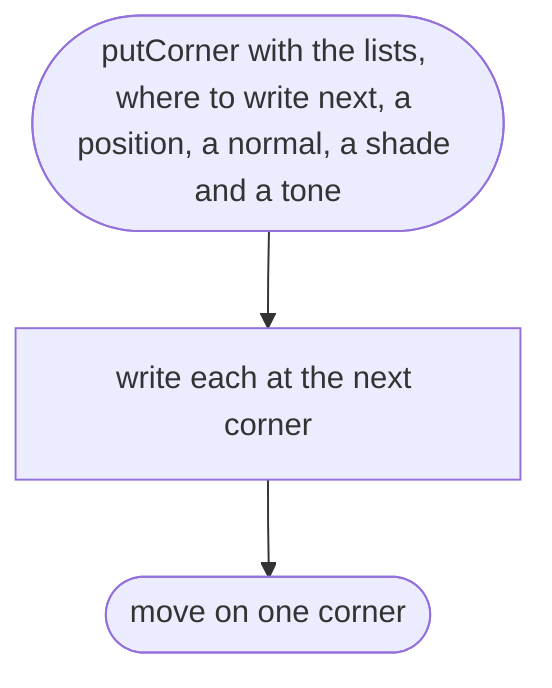

## buildingOutlinesInMetres

Why the game needs it: each building's outline and height in metres, for its solid (src/game/physics.ts).

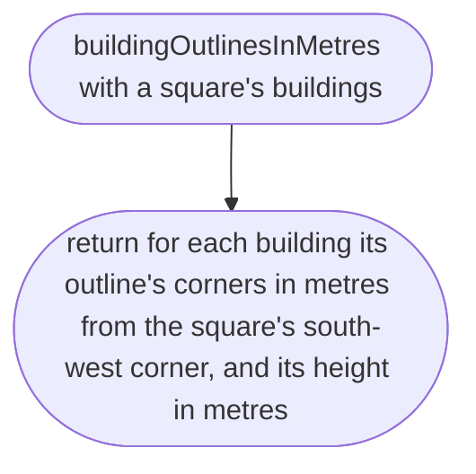

## buildingOutlinesInMetres > inner function 1

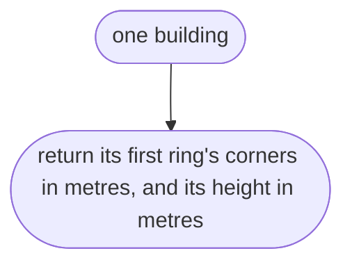
