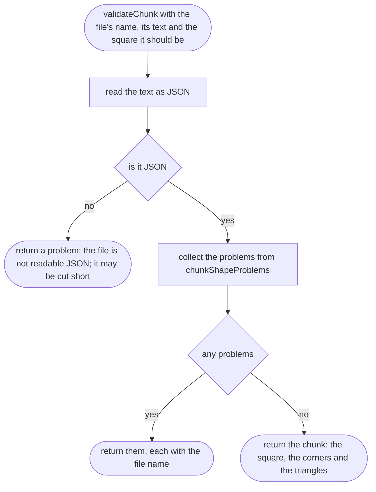
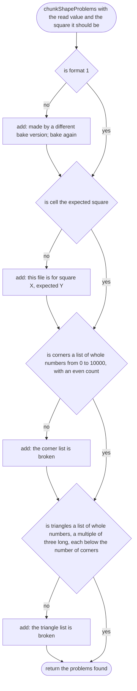
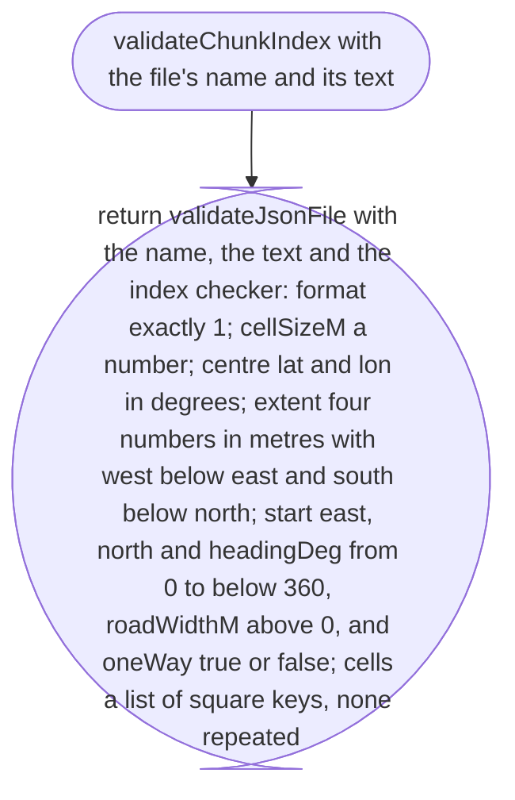
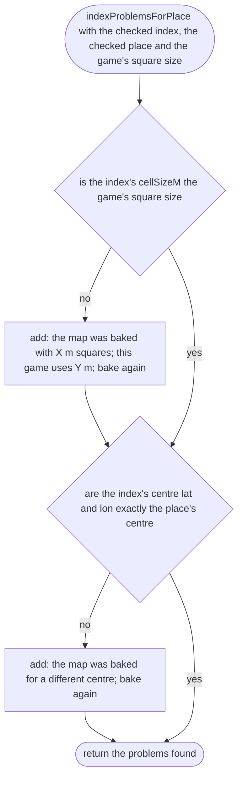
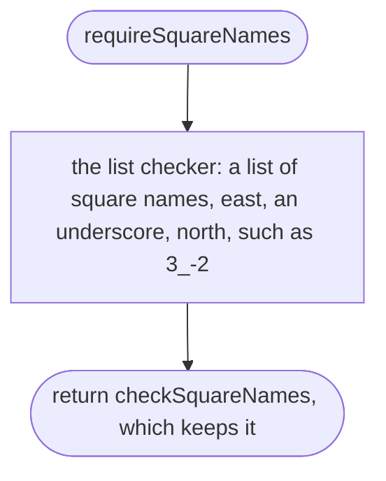

# src/world/chunk.ts

Status: approved. Judged by the delegated approver (docs/reviews/slice-1-approver.md); its fixes F1 to F24 and the orchestrator's decisions on E1 to E3 applied in one pass.

New in scope 005 (items 2 and 4). The two map file formats the bake writes
and the game reads, and their checkers. Checked like every other file: a bad
file gives a problem with the file's name, never a crash or a half-drawn
road. The index is small and uses the place checker's pieces
(`src/place/parse.ts`); a chunk can hold thousands of numbers, so it has its
own quick checks. The pictures drawn from the code will be in
`docs/flows/src/world/chunk.md`.

**Chunk file** `places/<id>/chunks/<east>_<north>.json`:
`{"format":1,"cell":{"east":3,"north":-2},"corners":[e0,n0,e1,n1,…],"triangles":[a,b,c,…]}`.
Corners are whole centimetres east and north of the square's south-west
corner (0 to 10000). Triangles list three corner numbers each, anticlockwise
from above.

**Index file** `places/<id>/chunks/index.json`:
`{"format":1,"cellSizeM":100,"centre":{"lat":…,"lon":…},"extent":{"westM":…,"southM":…,"eastM":…,"northM":…},"start":{"eastM":…,"northM":…,"headingDeg":…},"cells":["3_-2",…]}`.

## validateChunk

Why the game needs it: a damaged or half-downloaded map file must not crash the game or draw a spike across the sky; it is skipped and the player is told part of the map is missing.



## chunkShapeProblems

Why the game needs it: each check catches one way a file goes wrong: an old format, the wrong square's file, a broken number list.



## validateChunkIndex

Why the game needs it: the index decides what the player can drive; it is checked with the same messages as a place file (file, line, found versus needed).



## indexProblemsForPlace

Why the game needs it: if the place's centre moved, or the grid size changed, after the map was baked, every road would be drawn in the wrong place; the player is told to re-bake instead.



## requireSquareNames

Added by the coder in Scope 005 slice 1, approved by the orchestrator on 2026-10-11 (common sense: the check the approved design already asked for): the approved design asked for this check (see below) but named no function for it, and the diagram gate needs one heading per function. `validateChunkIndex` asks for "cells a list of square keys, none repeated". The repeat check sits inside the list's own check, not in a cross-field rule: a cross-field rule waits when a name is misspelt and adds "Fix these first" to a file with only that one mistake, which tests/world/chunk.test.ts ("refuses a square name that is not east_north") does not expect. Why the game needs it: a square listed twice would be loaded twice and drawn on top of itself.



## requireSquareNames > checkSquareNames

Added by the coder in Scope 005 slice 1, approved by the orchestrator on 2026-10-11 (common sense: the check the approved design already asked for): the approved design asked for this check (see below) but named no function for it, and the diagram gate needs one heading per function. Why the game needs it: every badly written name is reported first; only a list of good names is looked at for repeats, and the repeat is named.

```mermaid
flowchart TD
  s(["checkSquareNames a value at a path"])
  a["check it with the list checker"]
  bproblems
  c(["return them"])
  dis a name listed twice
  e(["return one problem at the second one: cells lists that name twice"])
  f(["return the names"])
  s --> a --> b
  b -->|"yes"| c
  b -->|"no"| d
  d -->|"yes"| e
  d -->|"no"| f
```

## extentOrderProblems

Added by the coder in Scope 005 slice 1, approved by the orchestrator on 2026-10-11 (common sense: the check the approved design already asked for): the approved design asked for this check (see below) but named no function for it, and the diagram gate needs one heading per function. `validateChunkIndex` asks for "extent four numbers in metres with west below east and south below north"; this is that cross-field rule, reading `extent` (tests/world/chunk.test.ts, "refuses an extent whose west edge is not west of its east edge"). Why the game needs it: a map whose west edge is not west of its east edge has no inside.

```mermaid
flowchart TD
  s(["extentOrderProblems with the extent, once it is good"])
  ais west below east
  a1["add a problem at extent.westM: must be west of, so below, extent.eastM"]
  bis south below north
  b1["add a problem at extent.southM: must be south of, so below, extent.northM"]
  c(["return the problems found"])
  s --> a
  a -->|"no"| a1 --> b
  a -->|"yes"| b
  b -->|"no"| b1 --> c
  b -->|"yes"| c
```
