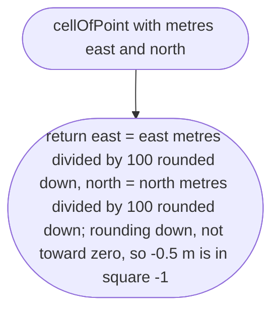
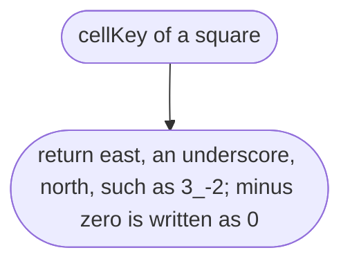
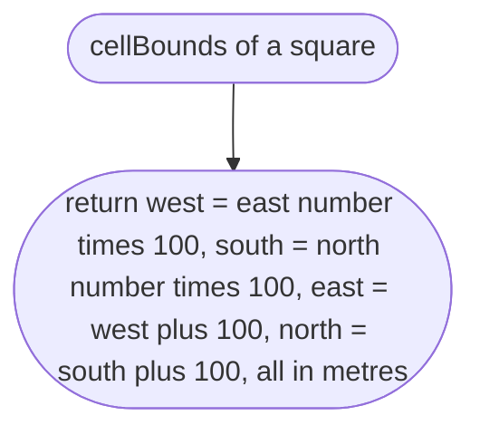
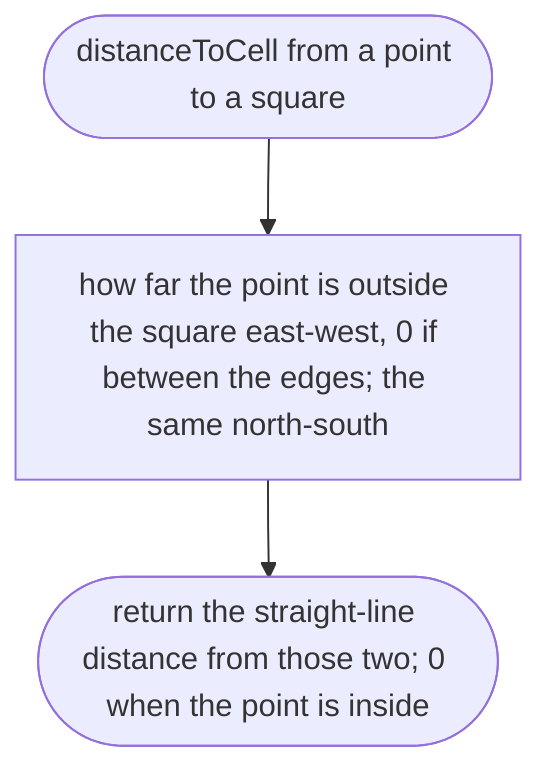
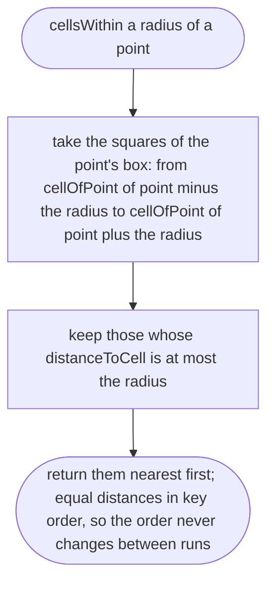

# src/world/grid.ts

Status: draft

New in scope 005 (items 2 and 4). The 100 m squares the world is cut into
(D-0008, owner, 2026-10-10: "plain 100 m grid chunks"). Used by the bake to
cut and by the game to stream, so the two can never disagree about where a
square is. Positions are in map words: metres east and north of the place
centre. The pictures drawn from the code will be in
`docs/flows/src/world/grid.md`.

The square size, 100 m, is one named constant here, with D-0008 beside it.
A square is named by two whole numbers: how many squares east and north of
the centre's square it is (negative for west and south).

## cellOfPoint

Why the game needs it: every road piece and the car's position must land in exactly one square, including points on a square's edge.

## cellKey

Why the game needs it: one short name per square, used for file names and for keeping track of which squares are loaded.

## cellBounds

Why the game needs it: the bake cuts at these edges and the game places the ground and the road at the south-west corner.

## distanceToCell

Why the game needs it: a square counts as near when any part of it is near the car, not only its middle, so the road ahead never pops in late.

## cellsWithin

Why the game needs it: the game loads the squares near the car, nearest first, so the road under and in front of the car arrives before the far ones.

