# src/world/streets.ts

Status: approved by the orchestrator in one pass (Scope 005b, the owner's lighter process for non-physics work, 2026-10-11).

New in scope 005b (items 1 and 2). The street file the bake writes and the
game reads, its checker, and the rule for which street the car is on. It sits
beside `chunk.ts` and `grid.ts` because both the bake and the game use it, so
they can never disagree. The pictures drawn from the code will be in
`docs/flows/src/world/streets.md`.

The file, `places/<id>/streets.json`:

    {"format":1,"centre":{"lat","lon"},"streets":[
    {"name":"Babatunde Ladega Street","size":"minor","lines":[[e0,n0,e1,n1,…],…]},
    {"size":"minor","lines":[…]},
    …]}

Every road a car may use, grouped by name and size. Only 209 of Omole's 1,204
drivable roads have a name in OpenStreetMap, so a map drawn from named roads
alone would be mostly empty; roads with no name are kept, with no `name`, so
the small map draws them. Points are whole decimetres east and north of the
place centre, the same projection as the chunks. `size` is `major` (tertiary
and up) or `minor` (`tools/bake/roads.md`, `roadSize`).

The rule's numbers: within **15 m** (the scope's "about 15 m", owner); the
name changes only after the new answer has held for **1 second**; the name on
screen is kept while its road is no more than **3 m** farther than the
nearest (about one lane). The second and the 3 m are the owner's choice,
proposed by the coder on 2026-10-11, awaiting his yes.

## validateStreetsFile

Why the game needs it: a damaged or half-downloaded street file must not crash the game; the game drives on without names and says why.

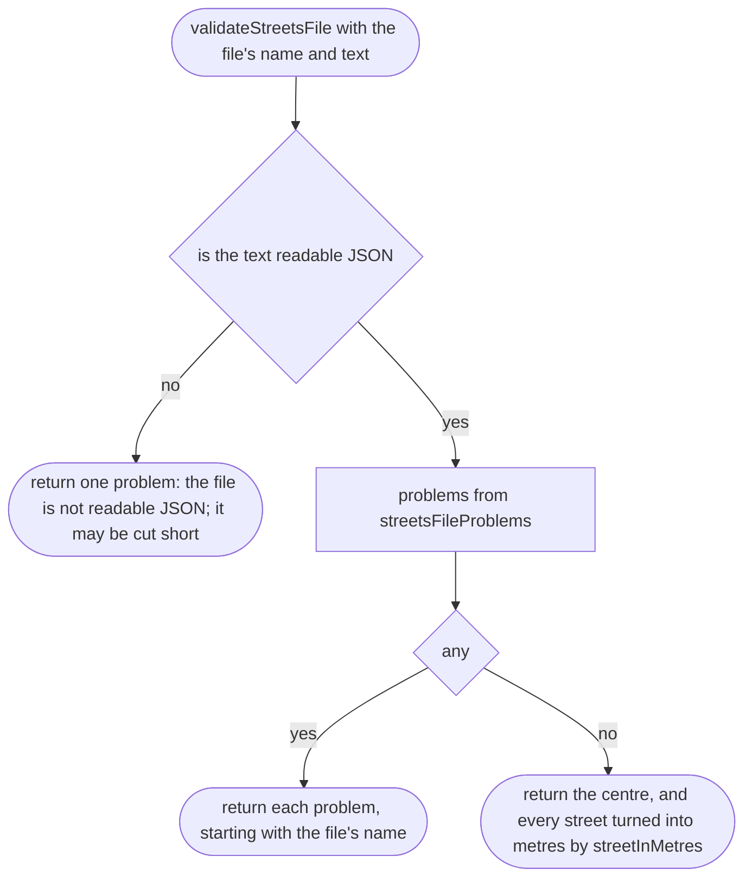

## streetsFileProblems

Why the game needs it: each check catches one way the file goes wrong, in words that say what to do.

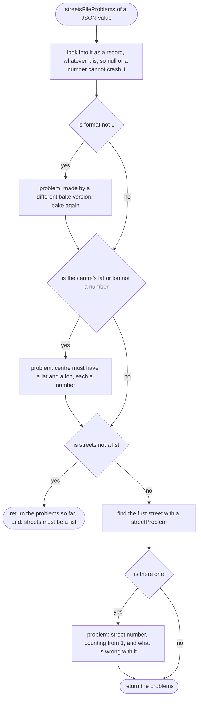

## streetProblem

Why the game needs it: one broken street usually means a broken bake; the first one is named so the place-maker knows where to look.

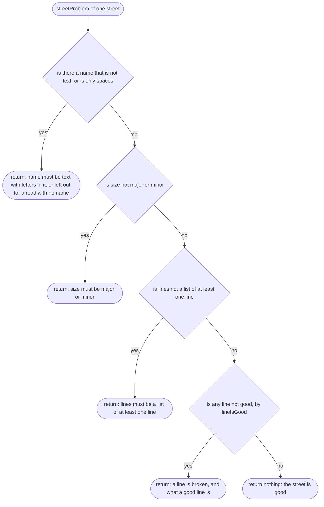

## lineIsGood

Why the game needs it: a long road is checked in time that grows evenly with its length, and a number sent as text or a point a world away is caught.

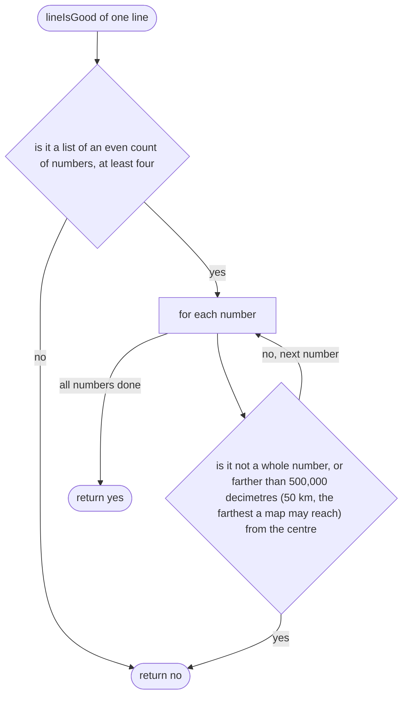

## streetInMetres

Why the game needs it: the game works in metres, and a far line should be skipped without measuring every segment, so each line's box is worked out once, on load.

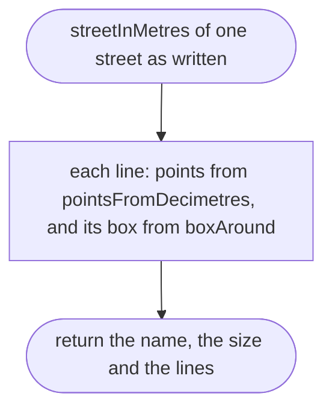

## pointsFromDecimetres

Why the game needs it: the file is east, north, east, north… in whole decimetres.

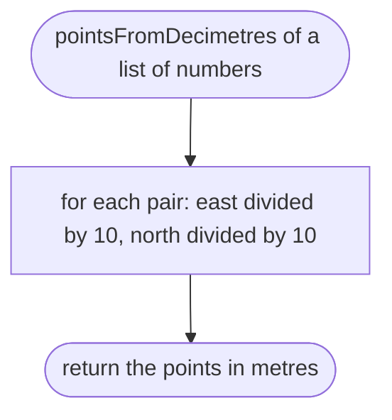

## boxAround

Why the game needs it: the box lets the street finder and the small map skip far lines at once.

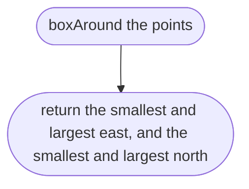

## streetsProblemsForPlace

Why the game needs it: if the place's centre moved after the bake, every name would be found in the wrong place; the player is told to bake again instead. Compared exactly, as the index is (`chunk.md`, `indexProblemsForPlace`).

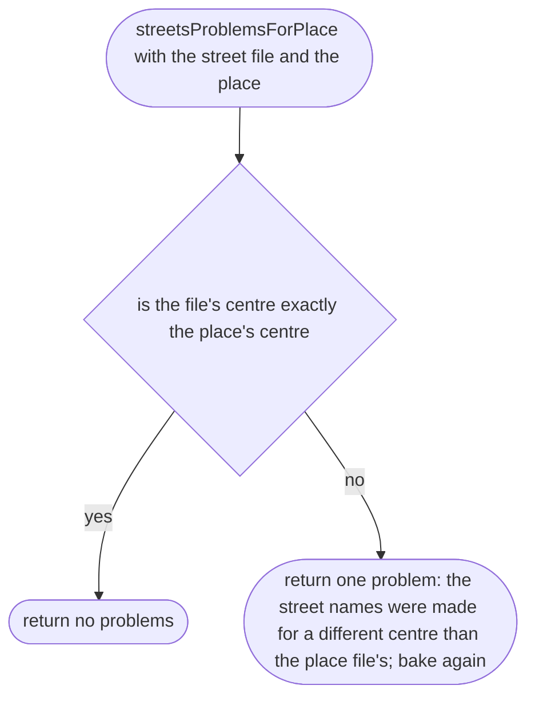

## distanceToStreet

Why the game needs it: how far the car is from a street is the distance to the nearest point of any of its lines.

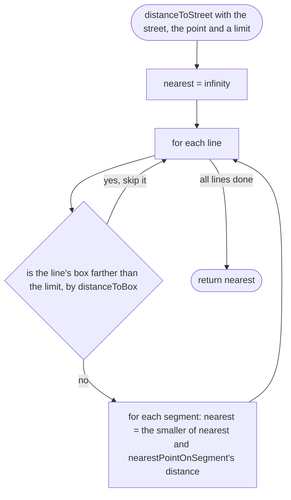

## distanceToBox

Why the game needs it: a quick lower bound; a line whose box is farther than 15 m cannot be within 15 m.

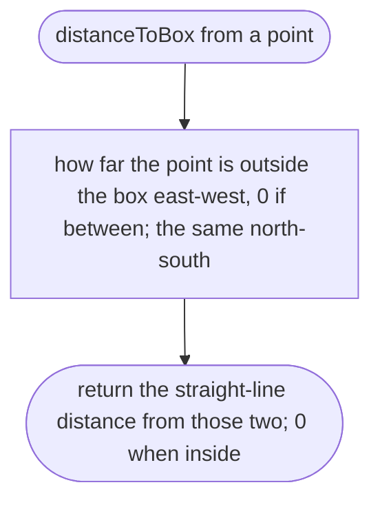

## nearestStreetName

Why the game needs it: the line at the top of the screen names the street the car is on, or nothing off every named road; standing at a junction does not swap names.

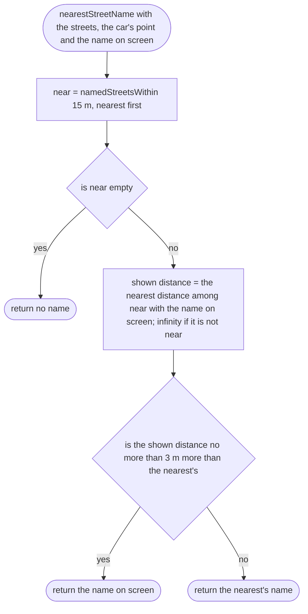

## namedStreetsWithin

Why the game needs it: a road with no name hides nothing, so names are only looked for among named roads; on an exact tie the street first in the file wins, so the answer never changes between runs.

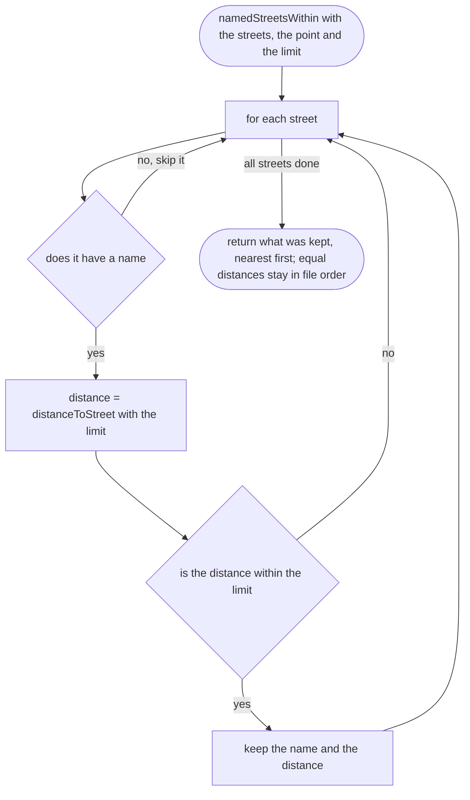

## streetNameAfter

Why the game needs it: the name changes only when the car has been on the new road for a moment, so it does not flicker at junctions (scope item 2); leaving every road clears the name the same way.

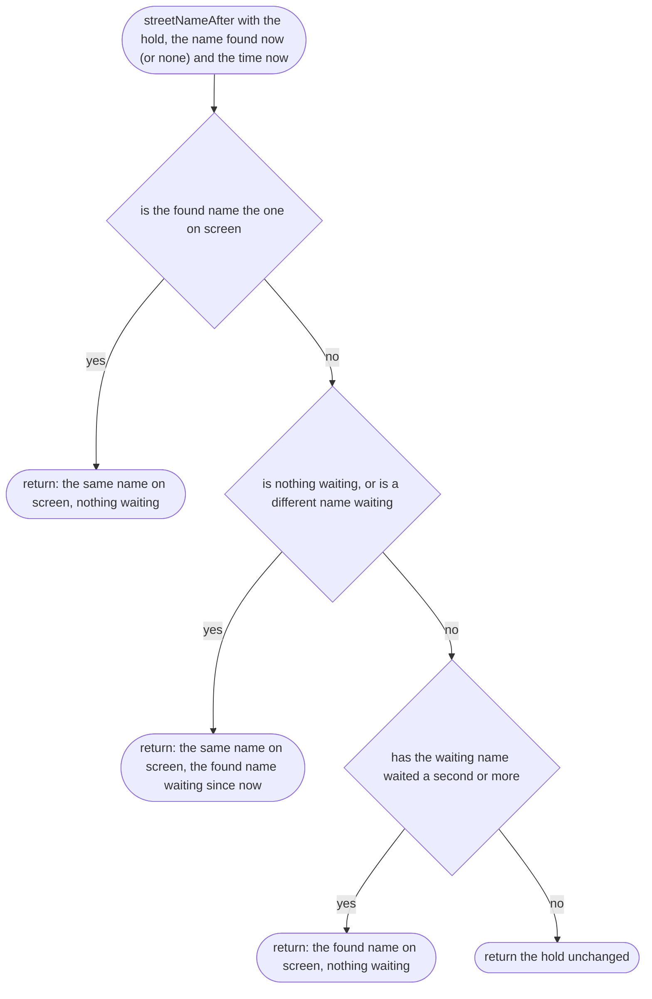
