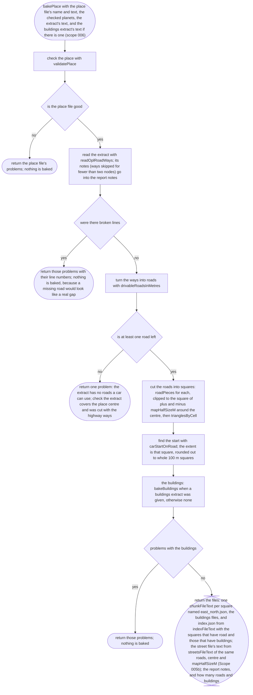
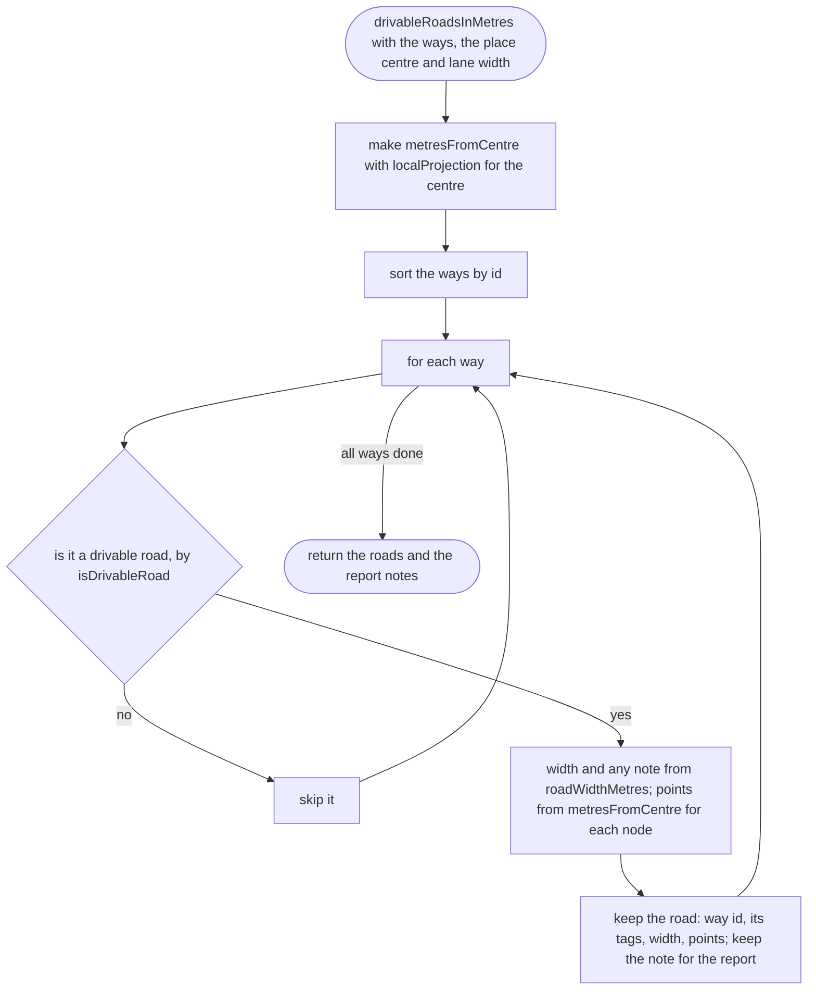
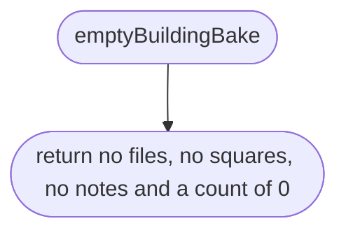
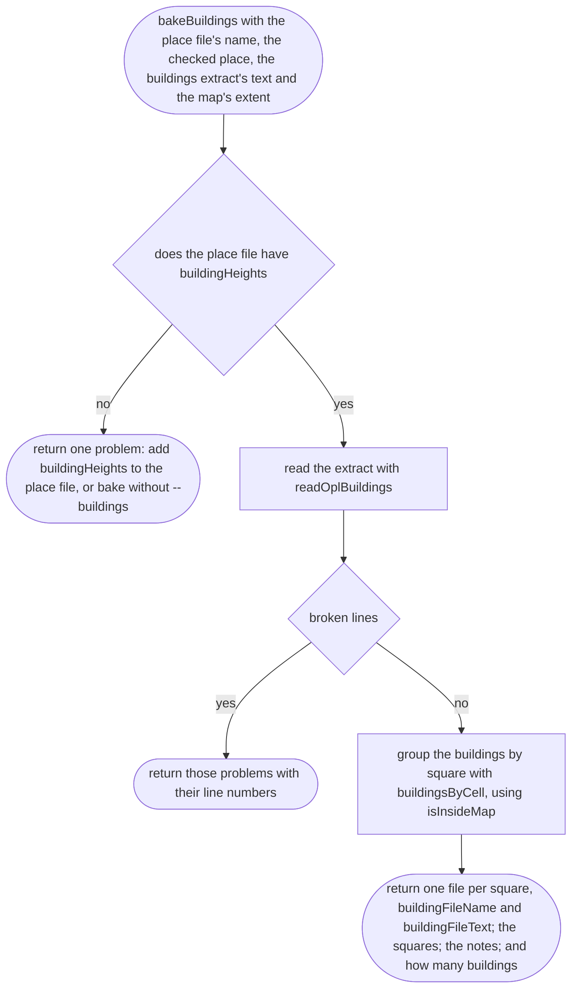
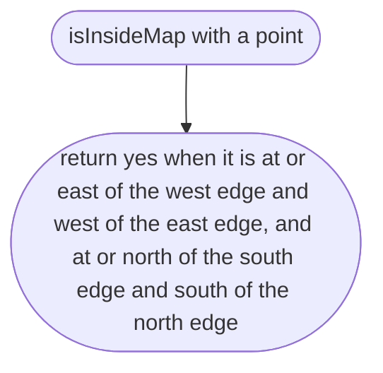

# tools/bake/bake.ts

Status: approved by the orchestrator in one pass (Scope 006, lighter process, 2026-10-11).

New in scope 005 (item 2). The whole bake, from the place file and the
extract's text to the text of every output file, without touching the disk,
so tests can run it on a small made-up extract and compare bytes. The
pictures drawn from the code will be in `docs/flows/tools/bake/bake.md`.

## bakePlace

Why the game needs it: the map the player drives on is made from open map data in one repeatable step, and anything wrong with the input is reported, not baked into a broken map. The map's size comes from the place file's `mapHalfSizeM`, not from the extract: `osmium extract` keeps every node of a way that crosses its box (its default `complete_ways`), so one trunk road could stretch the map, its ground and its edge walls kilometres past the place (approver's F20). A way with fewer than two nodes is skipped with a note, not a problem (F19).

## drivableRoadsInMetres

Why the game needs it: from every way in the extract to just the streets, each with its width and its line in metres, in way-id order so the output never depends on the order of the file.

## emptyBuildingBake

Why the game needs it: a map baked without a buildings extract has roads only, and an index that says so.

## bakeBuildings

Why the game needs it (scope 006): one buildings file per square that has buildings, for the game to load with the square; a building counts as on the map when its first corner is inside the same square the roads are clipped to.

## bakeBuildings > isInsideMap

