# tools/bake/buildings.ts

Status: approved by the orchestrator in one pass (Scope 006, lighter process, 2026-10-11).

New in scope 006 (item 1). Every OpenStreetMap building in the buildings
extract becomes a flat-roofed block on its real footprint, written into the
100 m square that holds the middle of its footprint, so a building across a
square's edge is drawn once. The extract is read in the same OPL format as
the roads (`opl.ts`, libosmium's format, technique only); a multipolygon
relation (OSM wiki, Relation:multipolygon) gives an outline and its holes.
Roofs are cut into triangles by earcut (mapbox/earcut, ISC), as bundled in
three.js 0.186.1 and reached through `ShapeUtils.triangulateShape` (MIT).
Heights follow the OSM wiki's Key:height and Key:building:levels, then the
place file's `buildingHeights` (owner-choice). Our own sanity limits: at most
300 m tall, 100 levels, and corners at most 200 m outside their square.
The pictures drawn from the code will be in `docs/flows/tools/bake/buildings.md`.

**What it does not do yet** (parked): rings made of several ways joined end
to end are skipped with a note; `building=roof` (an open canopy) is drawn as
a solid block.

## isBuilding

Why the game needs it: OSM says "not a building" with building=no, so only a building tag with another value is drawn.

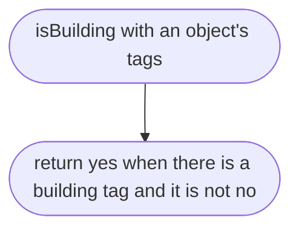

## readOplBuildings

Why the game needs it: every building in the extract is found once, in an order that never depends on the order of the file, so the bake gives the same bytes every time.

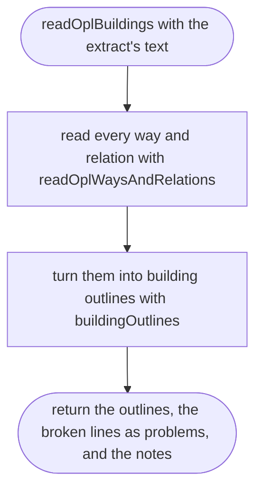

## readOplWaysAndRelations

Why the game needs it: a relation's rings are untagged ways, so every way is kept by its id, tagged or not.

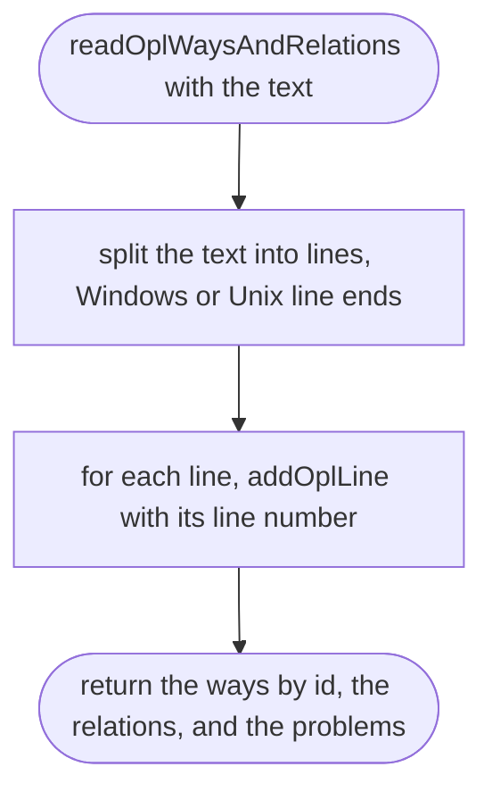

## addOplLine

Why the game needs it: a broken line is reported with its number instead of quietly leaving a building out.

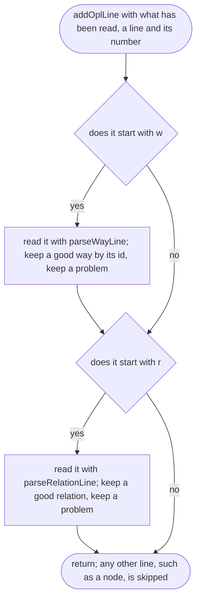

## buildingOutlines

Why the game needs it: a way that is a ring of a building relation would otherwise be drawn twice, once alone and once in its relation.

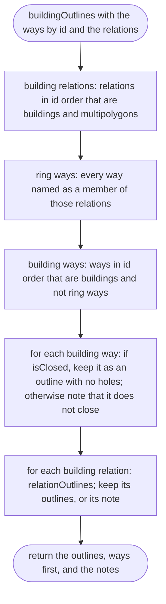

## buildingOutlines > inner function 1

Keeps a relation that is a building and a multipolygon.

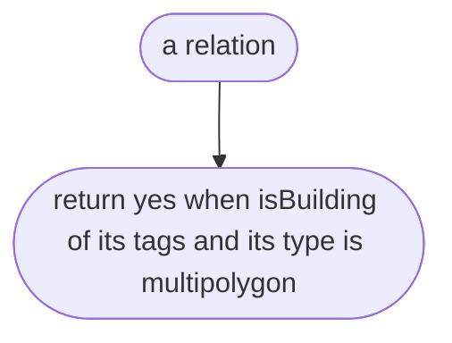

## buildingOutlines > inner function 2

Keeps a way that is a building and not already a ring of a building relation.

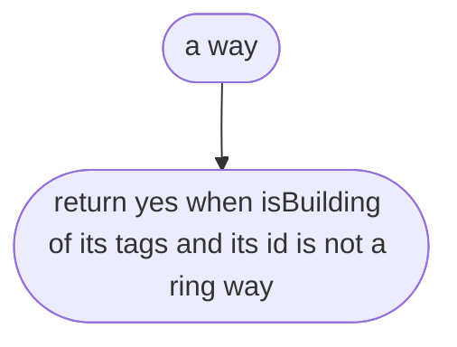

## parseRelationLine

Why the game needs it: courtyard buildings are mapped as relations, and their tags and rings are on the relation's line.

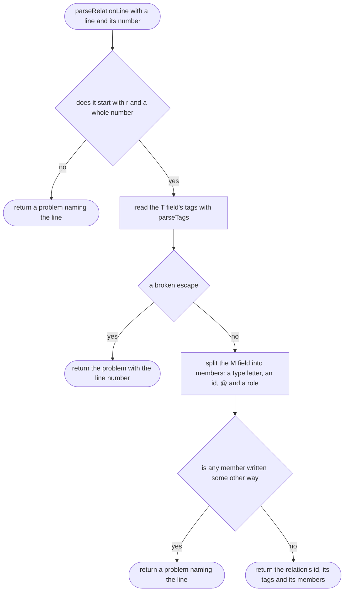

## parseRelationLine > inner function 1

Turns one member's match into its type, id and role.

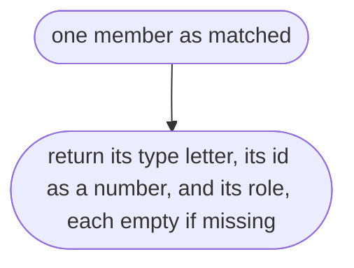

## isClosed

Why the game needs it: only a ring that ends where it starts has an inside to stand a building on.

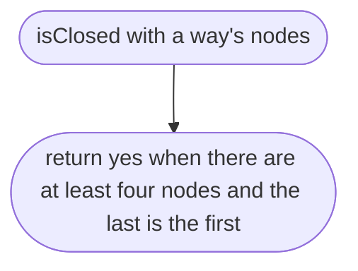

## relationOutlines

Why the game needs it: each outer ring of a building relation is a building, and each hole belongs to the outer ring it lies in.

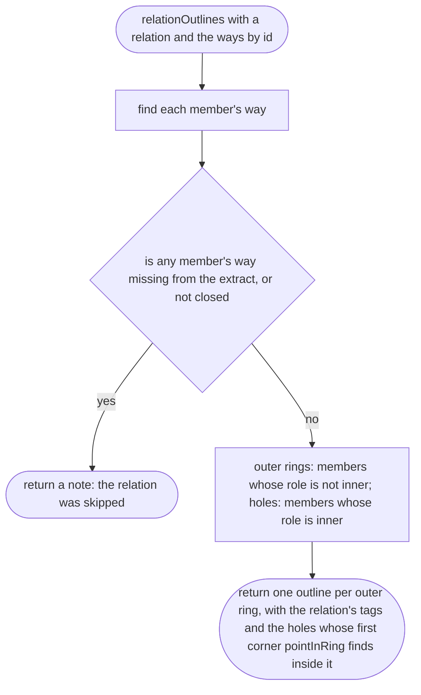

## relationOutlines > inner function 1

Finds a ring that cannot be used.

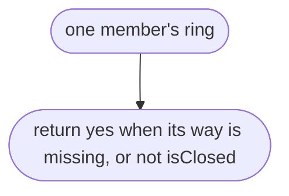

## pointInRing

Why the game needs it: says which outer ring a hole belongs to. Even-odd ray casting (W. Randolph Franklin's PNPOLY test), in degrees, which is fine for rings a few metres apart.

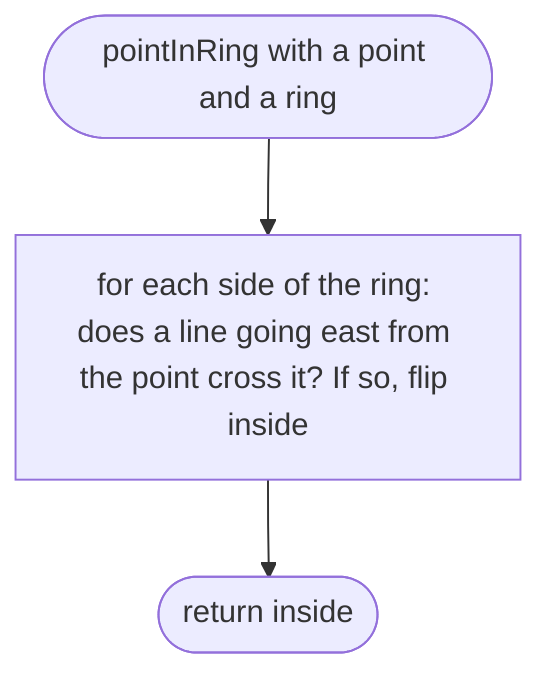

## buildingHeightM

Why the game needs it: a tall building tagged by a mapper stands tall; everything else stands at the place's own height for its type, never a silent guess.

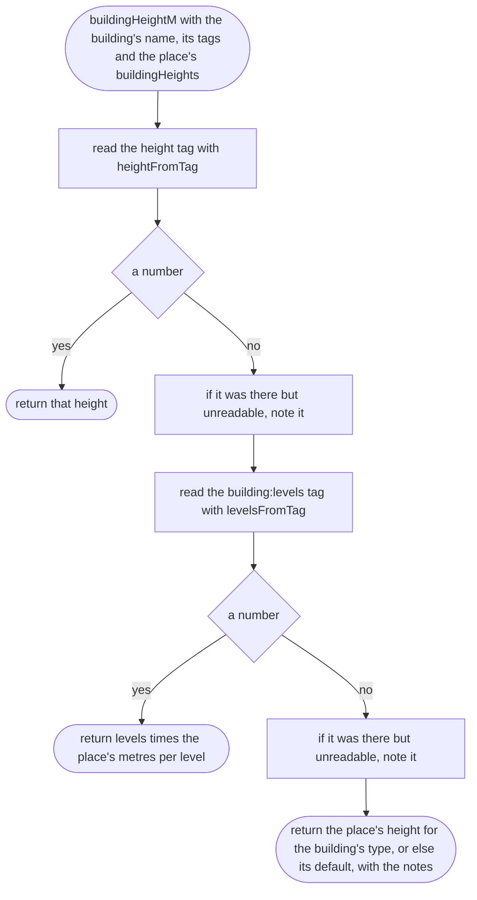

## heightFromTag

Why the game needs it: only metres are safe to use without guessing; feet and words are not guessed at.

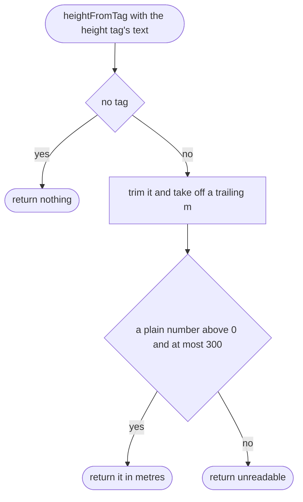

## levelsFromTag

Why the game needs it: a storey count is used only when it is a whole number from 1 to 100.

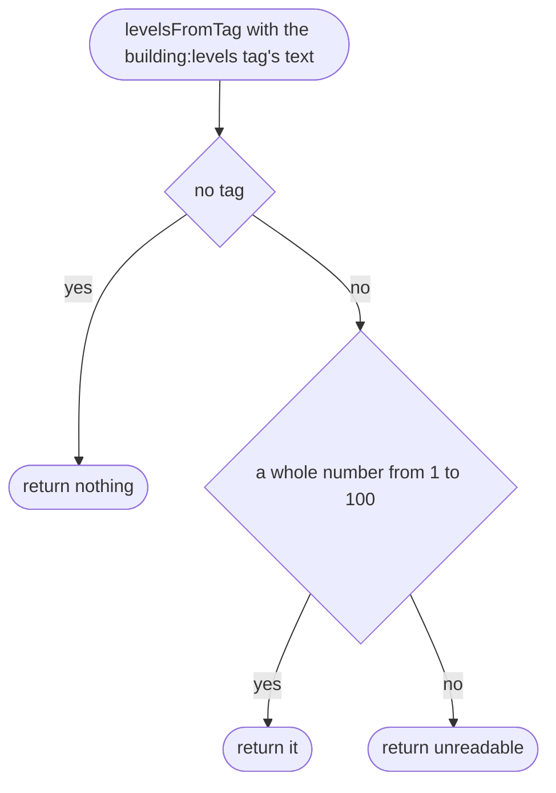

## ringInCentimetres

Why the game needs it: every baked number is a whole centimetre from the square's south-west corner, like the roads, so the files are small and the same every time.

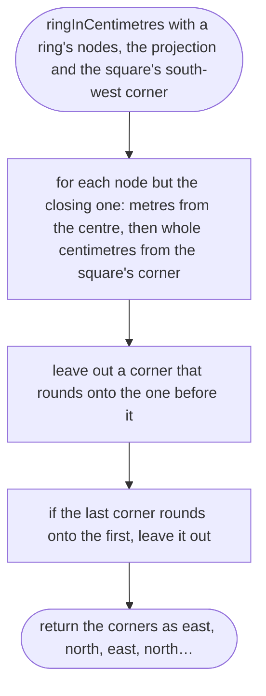

## twiceSignedArea

Why the game needs it: says which way round a ring goes (the shoelace formula), so outlines can be turned anticlockwise and holes clockwise.

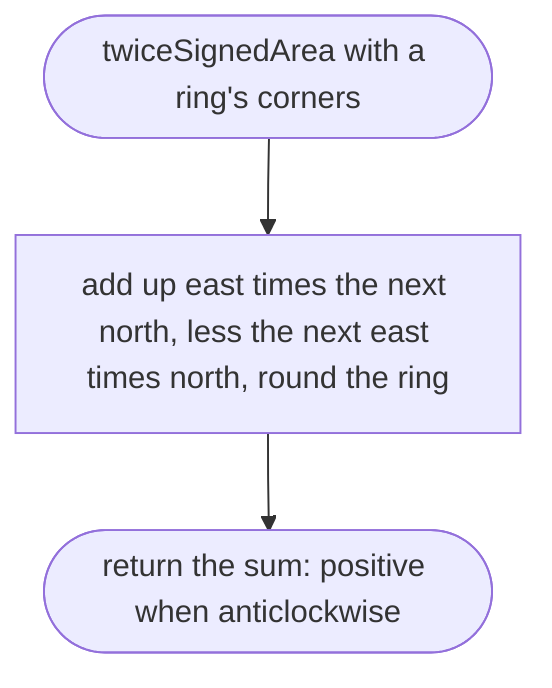

## reversedRing

Why the game needs it: turns a ring round without splitting any corner's east from its north.

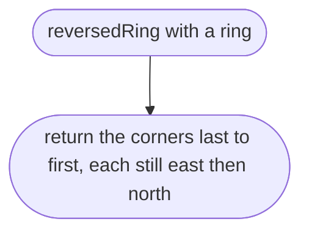

## roofTriangles

Why the game needs it: a flat roof over any footprint, with a courtyard left open, cut into triangles the phone can draw.

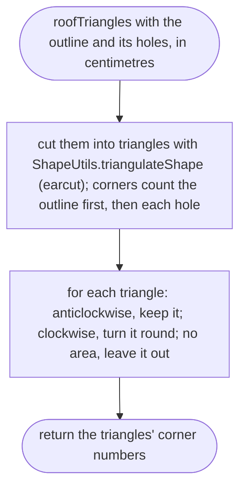

## cellForOutline

Why the game needs it: one square per building, so a building across a square's edge is drawn once.

```mermaid
flowchart TD
  s(["cellForOutline with the outline in metres"])
  a(["return the square, by cellOfPoint, of the middle of the outline's box"])
  s --> a
```

## ringsFitTheirSquare

Why the game needs it: the game's checker refuses corners more than 200 m outside a square, so the bake never writes one.

```mermaid
flowchart TD
  s(["ringsFitTheirSquare with the rings in centimetres"])
  a(["return yes when every number is from −200 m to 300 m from the square's south-west corner"])
  s --> a
```

## ringsFitTheirSquare > inner function 1

```mermaid
flowchart TD
  s(["one ring"])
  a(["return yes when every number in it is within reach"])
  s --> a
```

## bakeBuilding

Why the game needs it: one building, from OSM nodes to the block in its square's file, or a note saying plainly why it was left out.

```mermaid
flowchart TD
  s(["bakeBuilding with an outline, the projection and the place's buildingHeights"])
  a["its square: cellForOutline of the outline in metres"]
  b["the outline with ringInCentimetres from that square's south-west corner"]
  c{"fewer than three corners, or no area"}
  d(["return a note: no area once rounded"])
  e["the holes the same way, leaving out any with fewer than three corners or no area"]
  f["turn the outline anticlockwise and each hole clockwise with twiceSignedArea and reversedRing"]
  g{"ringsFitTheirSquare"}
  h(["return a note: it reaches too far outside its square"])
  i["its height with buildingHeightM, in whole centimetres; its shade from its OSM id, 0 to 3"]
  j(["return the square and the building: height, shade, rings, roofTriangles; with the height notes"])
  s --> a --> b --> c
  c -->|"yes"| d
  c -->|"no"| e --> f --> g
  g -->|"no"| h
  g -->|"yes"| i --> j
```

## bakeBuilding > inner function 1

Keeps a hole with an inside.

```mermaid
flowchart TD
  s(["one hole"])
  a(["return yes when it has at least three corners and some area"])
  s --> a
```

## bakeBuilding > inner function 2

Turns a hole clockwise.

```mermaid
flowchart TD
  s(["one hole"])
  a{"already clockwise"}
  b(["return it"])
  c(["return it reversed"])
  s --> a
  a -->|"yes"| b
  a -->|"no"| c
```

## buildingsByCell

Why the game needs it: each square's buildings together, in bake order, for one file per square.

```mermaid
flowchart TD
  s(["buildingsByCell with the outlines, the place centre, its buildingHeights and the map's edge"])
  a["for each outline: is its first corner inside the map? If not, skip it"]
  b["bakeBuilding; a note means it is left out, and the note is kept"]
  c["add the building to its square's list, keeping the order squares were first seen"]
  d(["return the squares with their buildings, and the notes"])
  s --> a --> b --> c --> d
```

## buildingFileText

Why the game needs it: the same bytes every time for the same input: keys in one order, whole numbers only, one newline at the end.

```mermaid
flowchart TD
  s(["buildingFileText with a square and its buildings"])
  a(["return format 1, the square, and each building's heightCm, shade, rings and roof, as JSON with one newline"])
  s --> a
```

## buildingFileName

Why the game needs it: a square's buildings file sits beside its road file and is found by the same name.

```mermaid
flowchart TD
  s(["buildingFileName with a square"])
  a(["return buildings_, the square's cellKey, .json"])
  s --> a
```
