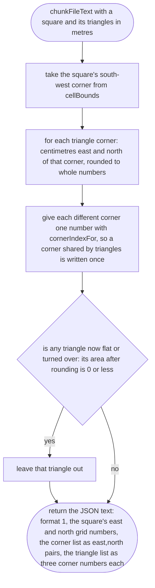
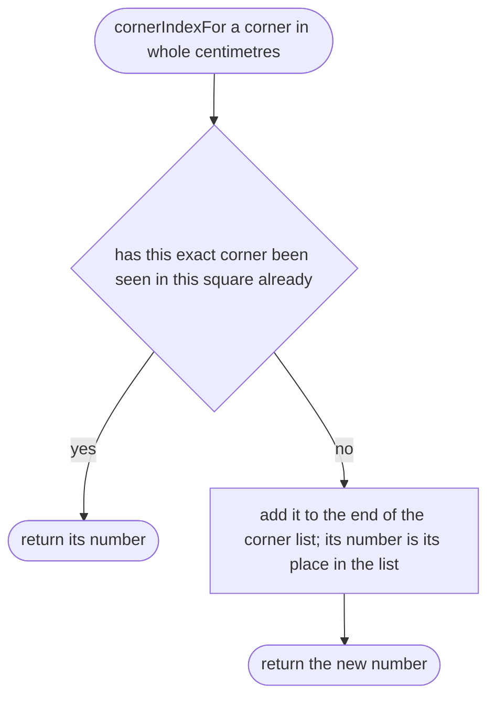
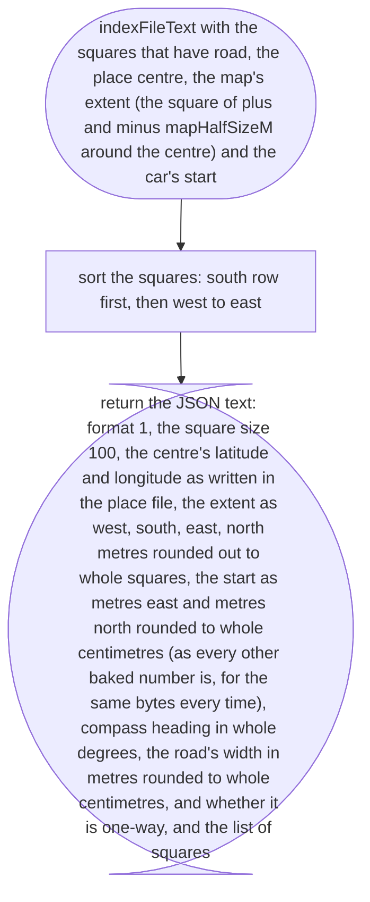

# tools/bake/chunk-text.ts

Status: approved. Judged by the delegated approver (docs/reviews/slice-1-approver.md); its fixes F1 to F24 and the orchestrator's decisions on E1 to E3 applied in one pass.

New in scope 005 (item 2). Writes the chunk files and the index as text, the
same bytes every time for the same input (the scope's determinism rule, and
the reason the published ODbL data can be checked by anyone who re-runs the
bake). The file formats are checked on the game side by `src/world/chunk.ts`,
whose design states them. The pictures drawn from the code will be in
`docs/flows/tools/bake/chunk-text.md`.

How the same bytes are guaranteed: no dates, no machine names, no random
order; every list is written in an order fixed by the input (way ids, node
order, square position); every number in a chunk is a whole number of
centimetres; JSON keys are written in one fixed order; one newline at the end.

## chunkFileText

Why the game needs it: one small file per 100 m square, with numbers small enough to be precise on any phone and short enough to download fast. Rounding can flip a thin sliver over as well as flatten it, and the chunk format promises anticlockwise triangles, so both are left out (approver's F23).

## chunkFileText > cornerIndexFor

Why the game needs it: sharing corners makes the files about half the size.

## indexFileText

Why the game needs it: the game must know which squares have road (so it never asks for a file that does not exist), what centre and square size the map was baked for (so an old bake is caught, not drawn in the wrong place), how far the map goes (the place file's `mapHalfSizeM`, not the extract's reach; approver's F20), and where the car starts, on how wide a road and whether it is one-way (F7).

