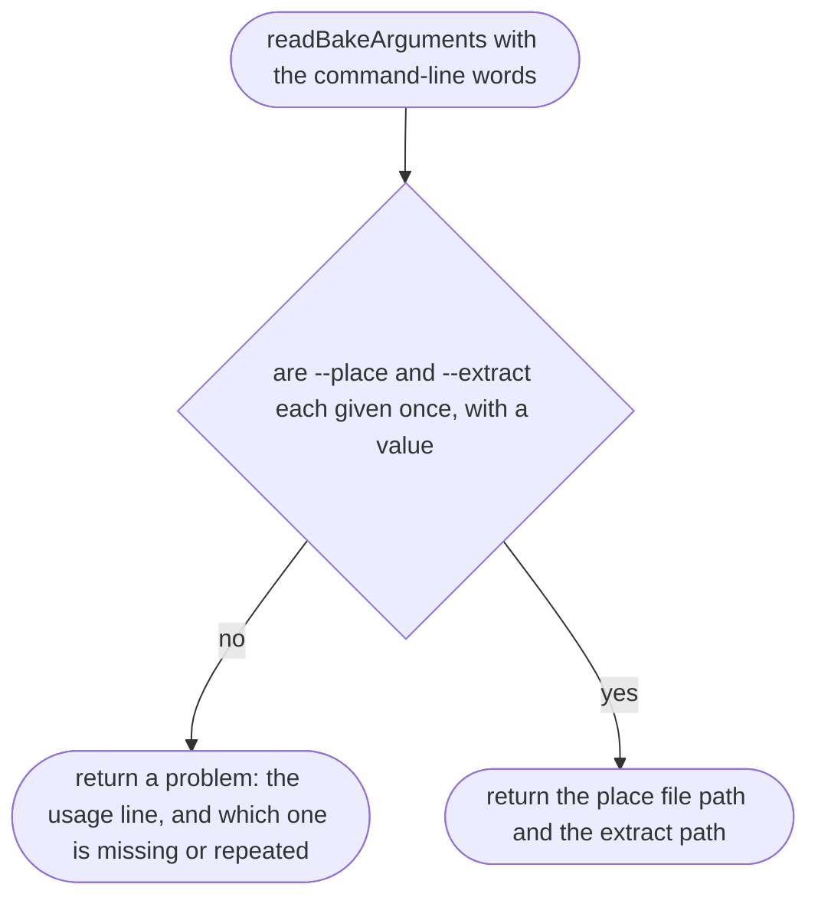
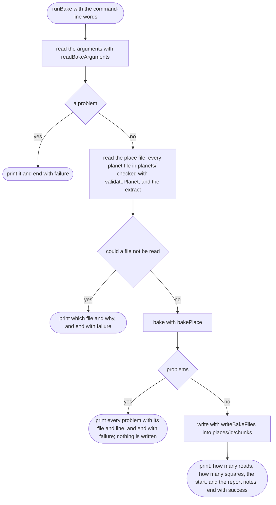

# tools/bake/cli.ts

Status: draft

New in scope 005 (item 2). The command the orchestrator runs on a computer:

    npm run bake -- --place places/omole.json --extract raw-data/omole-roads.opl

The extract is cut beforehand with osmium (osmium-tool, GPL-3.0, run only,
never copied; research/36 section 2), for example
`osmium extract --bbox W,S,E,N nigeria-latest.osm.pbf -o omole.osm.pbf`, then
`osmium tags-filter omole.osm.pbf w/highway -o omole-roads.osm.pbf`, then
`osmium cat omole-roads.osm.pbf -f opl,add_metadata=false,locations_on_ways=true -o omole-roads.opl`.
These steps go in the README. The pictures drawn from the code will be in
`docs/flows/tools/bake/cli.md`.

## readBakeArguments

Why the game needs it: a mistyped command should say what is expected, not crash.

## runBake

Why the game needs it: one command makes the map, prints what it did, and leaves the old map untouched if anything is wrong.

